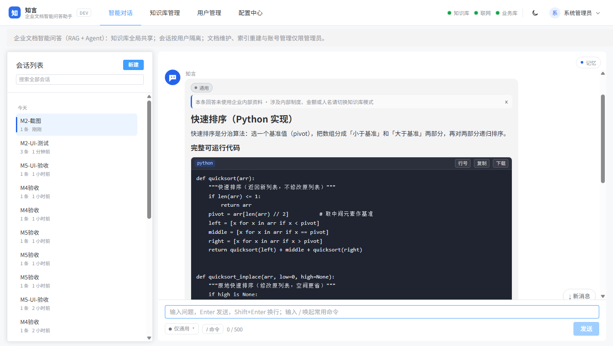
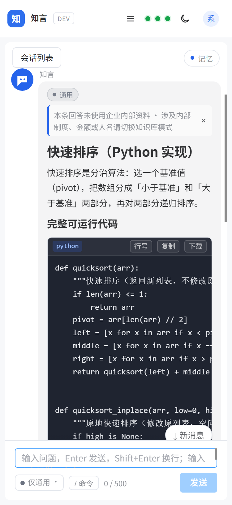

# M2 通用对话（WP2）验收报告

> 对应《RagKnowledge 能力增强需求文档 v3.md》(内部 v3.1) §4.2–§4.5、§8、§9.1–§9.2
> 验收时间：2026-11-12　环境：Windows 本机，后端 `127.0.0.1:8000`、前端 `127.0.0.1:5174`
> 结论：**通过（接口 17/17、UI 17/17、单测 218 passed / 1 skipped）**，可进入 M3（WP3 输入输出日志承载）

---

## 一、阶段目标与交付结论

WP2 要解决的问题是：旧路由把「一切非工具问题」都当检索，导致写代码/写作/闲聊也被塞进 RAG，答不上来就走兜底话术。本阶段把「通用能力」变成一等公民，同时用**内部事实优先保护**防止通用能力抢答公司内部问题。

| 交付项 | 状态 | 证据 |
| --- | --- | --- |
| 7 类意图与 5 级路由优先级（显式模式 → 上下文 → LLM → 关键词 → 默认 knowledge） | 完成 | `backend/agent/decision.py` 重写；接口验收 #1–#7、② |
| 内部事实优先保护 + 降级原因可观测 | 完成 | 接口验收「内部事实保护」；`degraded_reason` 落 SSE done 帧 |
| 通用链路 `GENERAL_SYSTEM_PROMPT` / `stream_general` / `answer_mode='general'` / 温度可配 | 完成 | 单测 `test_stream_general_uses_general_prompt`；接口 #1/#2/#5/#7 |
| `chat_record.intent` 落库与回放 | 完成 | 接口 #1b；`GET /api/chat/record` 返回 intent |
| 配置中心：`ALLOW_GENERAL_CHAT` / `GENERAL_TEMPERATURE` / `INTERNAL_TERMS` | 完成 | 7 组 39 参数；接口 #8a |
| 前端：模式徽标、通用提示、模式选择器、代码块增强、空状态三组 | 完成 | UI 验收 17/17 + 截图 |
| 回归（单测 / 环境自检 / 离线回归 / 构建） | 完成 | 见第五节 |

---

## 二、后端实现清单

### 2.1 路由与决策

- `backend/agent/decision.py`（重写）
  - `INTENT_TOOL`：7 意图 → 工具映射；
  - `_INTERNAL_PATTERN`（我们/我司/公司/内部/制度/流程/报销/审批/考勤/薪资…）、`_GENERAL_PATTERNS`（代码/写作/解释/翻译/闲聊）、`_FOLLOWUP_PATTERN`；
  - `looks_general` / `looks_followup` / `internal_guard` / `keyword_decision`（返回 intent + tool + confidence）；
  - `llm_plan_decision`（结构化 JSON + confidence，异常自动回落关键词）；
  - `decide(query, mode="auto", last_intent=None, internal_terms=None)` 严格按 5 级优先级；显式 knowledge 若原判 general → 记 `suppressed_intent`；显式 general → `forced_general=True` 跳过降级。
- `backend/agent/state.py`：`Decision` 增加 `intent/confidence/degraded_reason/suppressed_intent`；`initial_state(..., decision=...)` 支持预置决策。
- `backend/agent/graph.py`：`plan_node` 检测到预置 decision 直接复用（不再二次调 LLM）；`run_once(..., decision=...)`。

### 2.2 通用回答链路

- `backend/prompts.py`
  - `PLAN_SYSTEM_PROMPT` 改写为 7 意图 + confidence + 硬规则（内部指向优先 knowledge）；
  - 新增 `GENERAL_SYSTEM_PROMPT`：不得编造内部数据/制度/金额/人名/版本/审批人；涉及内部资料须明说并提示切知识库；代码完整可运行；不输出密钥、内网地址、危险命令。
- `backend/services/rag.py`：`stream_general(query, history, temperature)`，只注入系统提示 + 历史原文 + 当前问题（**不注入 facts/summary**），LLM 异常统一 `LLM_UNAVAILABLE_MSG`。

### 2.3 内部实体词典

- 新增 `backend/services/internal_terms.py`：配置 `INTERNAL_TERMS` + 知识库文档标题主干（2–20 字，最多 60 篇）合并；TTL 300s；`asyncio.Lock` 防并发穿透；取词失败降级为配置词表；上限 80 词。

### 2.4 会话与存储

- `backend/services/chat_store.py`：`ensure_record_schema` 补 `intent VARCHAR(32)`；`insert_record(..., intent=...)`；`list_records` 返回 intent 并兼容老数据；新增 `get_last_turn(session_id)`（取最近一条 query/intent/answer_mode，老记录按 answer_mode 反推 intent）。
- `backend/init_db.sql`：建表加 `intent` 列 + `ALTER TABLE ... ADD COLUMN IF NOT EXISTS` 升级语句（老库可直接执行）。
- `backend/schemas/chat.py`：`ChatStreamRequest.mode`（`auto|knowledge|general|biz|workflow`，默认 `auto`）。

### 2.5 聊天路由

`backend/routers/chat.py` 新增模式与话术常量：`MODE_GENERAL`、`TEXT_MODE_LIMITED`、`TEXT_WORKFLOW_COMING`、`TEXT_GENERAL_DISABLED`、`NOTICE_GENERAL_NO_INTERNAL`。`_prepare` 先取上一轮意图 + 内部词典，再 `asyncio.to_thread(decide, ...)`；分支顺序：
`suppressed_general → workflow → general（ALLOW 检查 → stream_general + 通用提示）→ calculator/doc_stats → biz_query → knowledge_search → 默认`。
done 帧新增 `intent` / `mode` / `degraded_reason`。

### 2.6 配置中心

`GROUP_LABELS` 新增 `general: 通用对话`；新增 3 个参数：

| key | 类型 | 默认 | 说明 |
| --- | --- | --- | --- |
| `ALLOW_GENERAL_CHAT` | bool | true | 一键关闭通用直答（合规开关） |
| `GENERAL_TEMPERATURE` | float 0~1.5 | 0.7 | 通用创作温度，知识库仍 0.3 |
| `INTERNAL_TERMS` | str ≤500 | 报销,审批,员工手册,组织架构,内部制度,考勤制度,薪资制度 | 手工内部词表，与文档标题合并 |

配置中心现为 **7 组 / 39 参数**（已由接口验收与单测双重锁定）。

---

## 三、接口层验收（17/17 PASS）

脚本：`m2_general_api.py`（workspace），输出 `m2_general_api_out.txt`。SSE 一律按整段响应文本按行解析，规避 `iter_lines()` 多行拼接问题；只删除脚本自建会话。

| # | 用例 | 结果 | 关键证据 |
| --- | --- | --- | --- |
| 0 | 登录 admin | PASS | user_id=1 |
| 1 | 用 Python 写快排 | PASS | `mode=general intent=general`，len=1865，sources=0，5.6s |
| 1b | 意图落库回放 | PASS | record `intent=general` |
| 2 | 改写文案 | PASS | general，tools=0，sources=0 |
| 3 | 公司报销流程（自动） | PASS | `intent=knowledge`，`mode=web`（知识库未命中走 FALLBACK_MODE），未被通用抢答 |
| 4 | 我们生产库用哪个版本 | PASS | `intent=knowledge`，`mode=web` |
| 4b | 不编造版本号 | PASS | 开头「检索到的信息不足以回答…知识库中未提及贵司具体…版本号」 |
| 5 | 仅通用问报销 | PASS | general + `GENERAL_NO_INTERNAL`；答案声明「属于企业内部制度…无法给出贵公司准确流程」 |
| 5b | 不编金额/审批人 | PASS | 答案无具体金额、审批人字样 |
| 6 | 仅知识库问快排 | PASS | `fallback_guide` + `MODE_KNOWLEDGE_ONLY`，「当前为「仅知识库」模式…无法生成代码…模式选择器切到…」 |
| 7 | 你好 | PASS | general，无 web notice，无 source，len=71 |
| — | 任务模式 | PASS | `intent=workflow` + `WORKFLOW_NOT_READY`，无检索 |
| 8a | 配置关闭通用 | PASS | `PUT /api/admin/config` code=0 |
| 8 | ALLOW_GENERAL_CHAT=false 下问快排 | PASS | `fallback_guide` + `GENERAL_CHAT_DISABLED`，elapsed=1.1s（未调模型） |
| ② | 上下文延续「再改短一点」 | PASS | 仍为 general |
| — | 内部事实保护 | PASS | 「解释一下什么是审批流程」→ knowledge，`degraded_reason=命中内部实体「审批」` |
| — | 配置中心结构 | PASS | groups=7，params=39 |

> 说明：脚本每轮用例独立新建会话，结束后删除自建会话；不触碰历史/用户会话。

---

## 四、前端 UI 验收（17/17 PASS）

脚本：`m2_general_ui.py`（workspace），本机 Chrome headless + CDP(9347) 真实渲染，按 DOM/计算样式断言。

| # | 断言 | 结果 | 证据 |
| --- | --- | --- | --- |
| 1 | 页面内登录 | PASS | code=0 |
| 2 | 新建 UI 验收会话 | PASS | session 创建成功 |
| 3 | 输入框左侧模式选择器，默认「自动」 | PASS | 触发器文案「自动」 |
| 4 | 空状态三组示例 | PASS | `['查资料','写代码','做任务']` |
| 5 | 切「仅通用」写 sessionStorage | PASS | `rk.chatMode=general` |
| 6 | 点击「写代码」示例卡片发送 | PASS | 点击命中卡片 |
| 7 | 回答完成且含代码 | PASS | len≈1991 |
| 8 | 徽标为通用灰色语义 | PASS | `mode-badge tone-general`，文案「通用」 |
| 9 | 通用提示存在 | PASS | 含「未使用企业内部资料」 |
| 10 | 代码块语言标签 + 行号/复制/下载 | PASS | `python`；`['行号','复制','下载']`；45 行代码 `fold=True` |
| 11 | 行号开关生效 | PASS | gutter `display:block`，`aria-pressed=true` |
| 12 | 通用提示可关闭并持久化 | PASS | `rk.generalHintDismissed=1`，提示消失 |
| 13 | 切「仅知识库」写 storage | PASS | `knowledge` |
| 14 | 仅知识库问快排 | PASS | 含「无法生成代码」+「模式选择器」 |
| 15 | 切回自动 | PASS | `auto` |
| 16 | 公司报销问题徽标非 general | PASS | `tone-web`（联网） |
| 17 | 375 窄屏无横向溢出 | PASS | `overflow=0`，选择器/输入框可见 |

### 4.1 截图

1440（通用徽标 + 可关闭提示 + 深色代码块工具条）：

375 窄屏（同屏可见徽标、提示、代码工具条，页面无横向溢出）：

### 4.2 验收中发现并当场修复的问题

| 现象 | 根因 | 修复 |
| --- | --- | --- |
| 代码块语言标签「python」飘到气泡外左上角 | 全局 `styles/markdown.css` 里 `.markdown-lang{position:absolute}` 是给旧版「标签贴在 pre 左上角」用的；新工具条内联后被绝对定位逃出容器 | 组件内以更高特异性覆盖为 `position:static`，并移除 `pre code` 为旧标签预留的 18px 顶部内边距 |
| 代码文字发白、几乎看不清 | 新容器背景误用 `--code-bg`（浅色内联代码底色），而文字色沿用 `--code-text`（深色主题浅字） | 代码块底色统一为 `--code-surface`，工具条/行号槽/折叠条按深色底重做配色 |

---

## 五、回归矩阵

| 项 | 命令 | 结果 |
| --- | --- | --- |
| 后端单测（全量） | `.\.venv\Scripts\python.exe -m pytest backend/tests -q` | **218 passed, 1 skipped**（5.66s） |
| WP2 单测 | `pytest backend/tests/test_general_chat.py -q` | 10 passed |
| 环境自检 | `.\.venv\Scripts\python.exe backend\scripts\check_env.py` | 全部通过 ✅（含未登录 401 鉴权校验） |
| 离线回归 | `pwsh -File backend\scripts\offline_regression.ps1` | `OFFLINE_REGRESSION = PASS` |
| 前端构建 | `npm run build` | EXIT=0，13.33s（`index-qa4lQJvu.css` / `index-Bkx_WaGs.js`） |
| 后端探活 | `GET /health` | `{"code":0,...,"db_ready":true}`，PID 23308 |

WP2 新增单测覆盖：关键词判通用、内部指向词保护、内部词表降级、显式 general 跳过降级、显式 knowledge 压制 general、显式 biz/workflow、上下文延续、`stream_general` 提示词与「不注入 facts/summary」。

---

## 六、设计取舍与已知限制

1. **通用链路不注入会话事实/摘要**：`stream_general` 只带系统提示 + 历史原文 + 当前问题。语义上保证「本条回答未使用企业内部资料」成立；代价是多轮对话里的事实性承接依赖历史原文而非压缩摘要。若后续需要「通用 + 记忆」，应显式区分「内部事实」与「会话偏好」再决定是否注入。
2. **「仅知识库」模式未命中仍走 `FALLBACK_MODE`**：实测 `mode=web`。该行为符合 §4.3「只有 knowledge 意图命中不足才走兜底」的字面语义，但「仅知识库」用户是否期望「连联网也不要」尚未与需求方确认；若要收紧，只需在该模式下跳过 fallback，改动点集中在 `routers/chat.py` 的一个分支。
3. **任务模式仅为占位**：`intent=workflow` 返回 `WORKFLOW_NOT_READY`（M4 开放），不静默降级为检索，避免误导。
4. **代码折叠状态不持久化**：>40 行在流式期间不折叠，完成后的重渲染才折叠；用户展开/收起状态在内容再次更新时会重置（当前仅当轮消息，影响有限）。
5. **内部词表默认值偏制度类**：`INTERNAL_TERMS` 目前是 7 个制度/组织词，未覆盖具体业务系统名；实际召回还依赖知识库文档标题合并（TTL 5 分钟）。若发现漏判，优先补配置而不是改代码。
6. **意图识别依赖 LLM 质量**：显式模式与关键词兜底可保证不跑偏；纯自动模式下个别边界问法可能在 general/knowledge 间摆动，降级原因已写入 done 帧，便于线上观察。

## 七、回滚方案

- 后端：`ALLOW_GENERAL_CHAT=false` 可在线一键关闭通用直答（回落 guide 话术，不调模型）；如需彻底回退代码，恢复 `agent/decision.py`、`routers/chat.py`、`services/rag.py` 三个文件的上一版本即可，`chat_record.intent` 为新增可空列，不回滚也不影响老逻辑（老记录按 `answer_mode` 反推）。
- 前端：新模式徽标/选择器为增量组件，回退 `MessageBubble.vue`、`ChatInput.vue`、`MarkdownRenderer.vue`、`EmptyState.vue`、`useChat.js` 即可；`sessionStorage` 里的 `rk.chatMode` 与 `localStorage` 的 `rk.generalHintDismissed` 属纯界面偏好，残留无副作用。

---

## 八、下一步

M3 = WP3 输入输出日志承载（§5）。本报告经确认后开始实现；M3 同样先交付验收报告再进入 M4。
