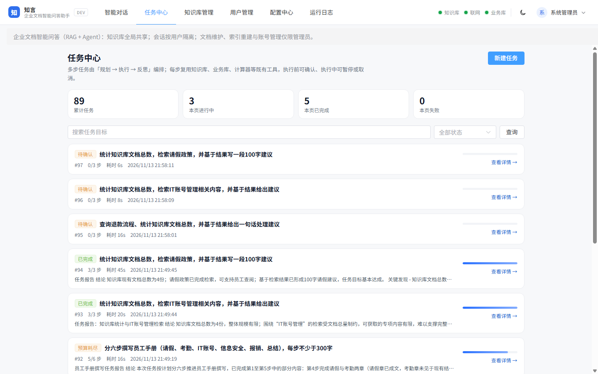
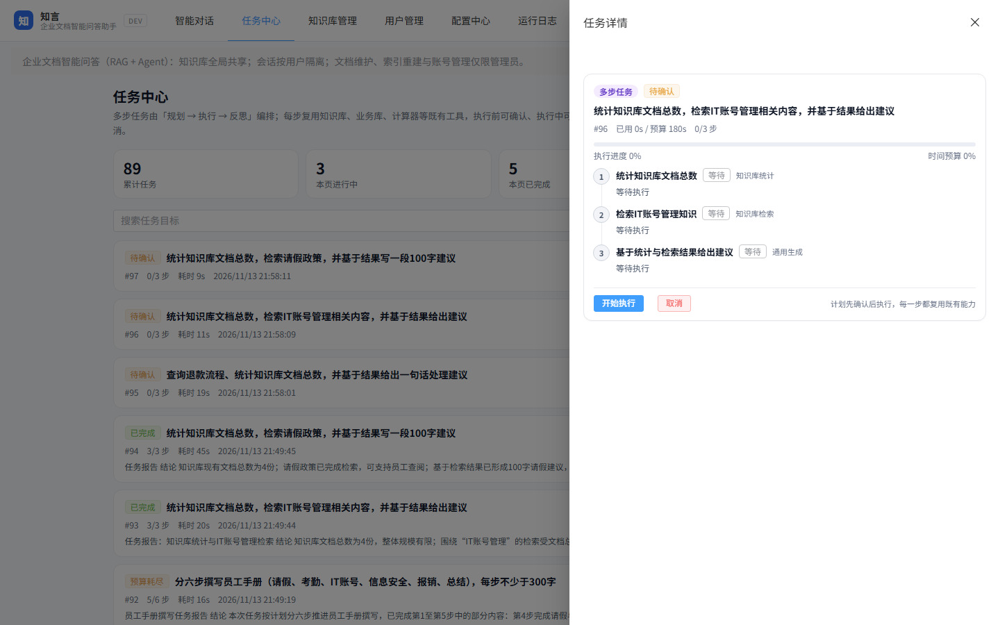
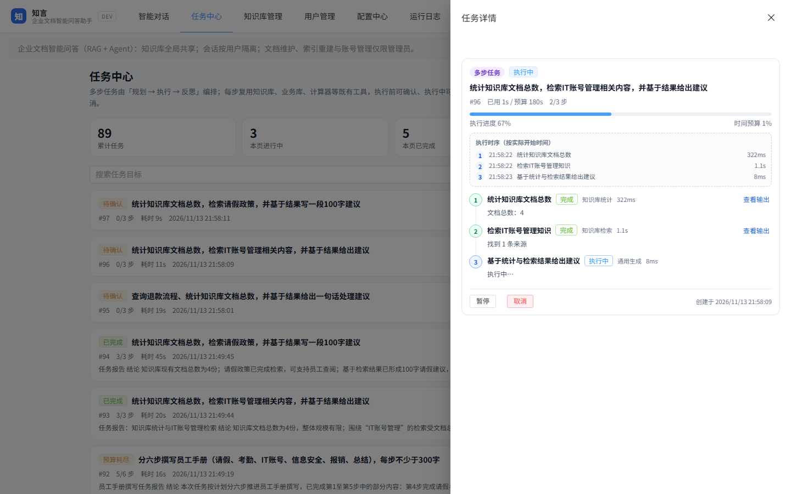
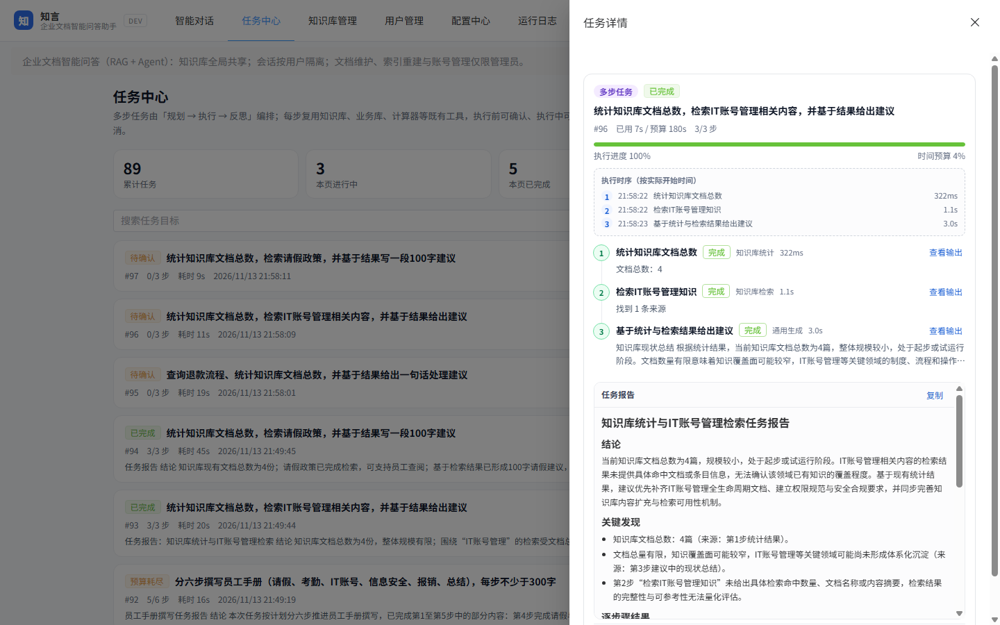
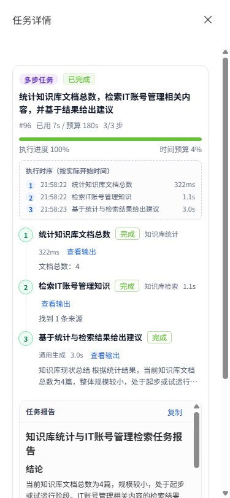
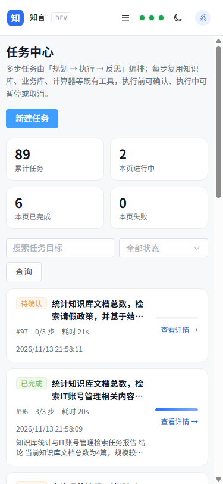
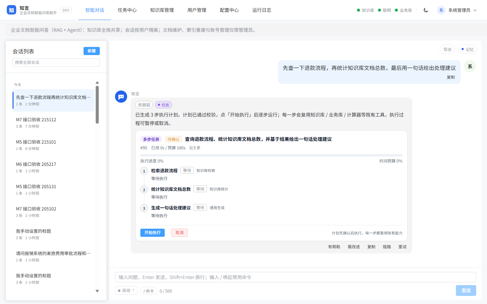
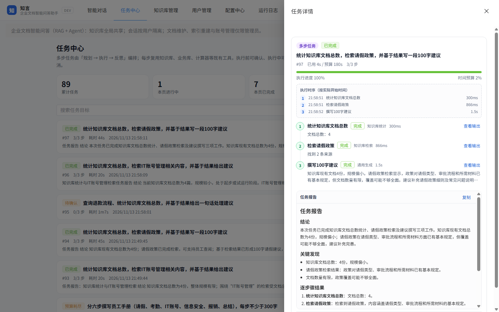

# M4 工作流 Agent（WP4）验收报告

> 对应《RagKnowledge 能力增强需求文档 v3.md》(内部 v3.1) §6.1–§6.11、§7、§8、§9
> 验收时间：2026-11-12　环境：Windows 本机，后端 `127.0.0.1:8000`、前端 `127.0.0.1:5174`
> 结论：**通过（接口 29/29、UI 23/23、重启恢复 8/8、单测 233 passed / 1 skipped、§6.11 十条全部取证）**，可进入 M5。

---

## 一、阶段目标与交付结论

WP4 把“一次问答”扩展为“一条可规划、可确认、可观测、可中断、可恢复的任务链路”：LLM 只负责产出受 schema 约束的计划，执行器按依赖拓扑逐步复用现有工具；每一步都有状态、耗时、输出、日志和事件；用户可确认、暂停、取消，进程重启后可恢复。

| 交付项 | 状态 | 证据 |
| --- | --- | --- |
| `POST /plan` 生成 3 步计划，默认 `awaiting_confirm` | 完成 | 验收 #1；任务 #5 |
| 确认后自动执行，按依赖顺序逐步推进 | 完成 | 验收 #1；UI 任务 #29 |
| 每步真实调用现有工具（知识库/业务库/统计/计算/通用/联网） | 完成 | 验收 #1/#2/#10；真实来源、`文档总数：4` |
| 步骤级人工确认（continue / skip / cancel） | 完成 | 验收 #5；继续与跳过均通过 |
| 暂停 / 恢复 / 取消，已产生结果保留 | 完成 | 验收 #4；取消后第 1 步结果仍在 |
| 6 步上限，超限拒绝并提示拆分 | 完成 | 验收 #6；HTTP 400 `40001` |
| member 敏感步骤裁剪，报告说明权限不足 | 完成 | 验收 #7；无薪资明细泄露 |
| 任务预算（时间 / token）与部分完成报告 | 完成 | 验收 #8；`budget_exceeded` |
| 进程重启恢复：`interrupted` → `resume`，不重跑已完成步骤 | 完成 | 验收 #9；重启后第 1 步 `done` 保留 |
| 每步 `chat_io_log` 与 `llm_call_log` 同 trace | 完成 | 验收 #10；3 条 `workflow:*` + 3 条 LLM 调用 |
| 任务中心 / 会话内计划卡 / 历史回放 / 375 适配 | 完成 | UI 23/23 + 7 张截图 |

---

## 二、实现清单

### 2.1 后端

| 文件 | 内容 |
| --- | --- |
| `backend/services/workflow.py`（新建，约 1250 行） | 任务/步骤状态机、DDL 与启动恢复、CRUD、事件总线、planner JSON 强校验、拓扑执行器、重试与等价工具降级、报告生成、暂停/恢复/取消、逐步 I/O 日志 |
| `backend/routers/workflow.py`（新建） | `POST /plan`、`POST /run`、`GET /{id}/events`（SSE）、`GET /{id}`、`POST /{id}/confirm`、`POST /{id}/cancel`、`POST /{id}/pause`、`POST /{id}/resume`、`GET /list` |
| `backend/main.py` | 注册 router；lifespan 建表 + `recover_interrupted()`；关闭时取消后台协程 |
| `backend/services/chat_store.py` | `chat_record.workflow_task_id` 幂等列，写入与查询返回 |
| `backend/routers/chat.py` | `intent=="workflow"` 分支真实生成计划；SSE 新增 `workflow` 帧；done 帧携带 `workflow_task_id` |
| `backend/config.py` / `backend/services/app_config.py` | 9 个 `WORKFLOW_*` 参数；配置中心组 `workflow: 任务编排`，现共 **9 组 / 51 参数** |
| `backend/prompts.py` | `WORKFLOW_PLAN_SYSTEM_PROMPT`：`{max_steps}` 占位、计划 JSON schema、禁止占位符 |
| `backend/init_db.sql` | `workflow_task` / `workflow_step` DDL、索引、`chat_record.workflow_task_id` ALTER |
| `backend/tests/test_workflow.py`（新建） | 8 个单测：状态机、上限、权限裁剪、事件、计划校验等 |

### 2.2 前端

| 文件 | 内容 |
| --- | --- |
| `api/workflow.js`（新建） | 计划/执行/详情/列表/确认/取消/暂停/恢复 + `streamWorkflowEvents`（fetch SSE） |
| `components/PlanCard.vue`（新建） | 状态、进度、时间预算、步骤时间线、输出展开、任务报告、开始/继续/暂停/取消、步骤确认；内部订阅事件流，历史回放同样适用 |
| `views/WorkflowView.vue`（新建） | 4 指标卡、搜索/状态筛选、任务列表、分页、新建任务、详情抽屉、15s 刷新 |
| `App.vue` / `MessageBubble.vue` | 菜单「任务中心」；消息正文后插入计划卡 |
| `composables/useChat.js` / `api/sse.js` | 消息保存任务 ID、`hydrateWorkflowTasks()` 历史补齐、`workflow` 帧分发 |
| `ModeSelector.vue` / `ModeBadge.vue` | workflow 文案与标识 |

---

## 三、§6.11 十条验收（10/10 PASS）

接口脚本：`m4_accept.py`（workspace），输出 `m4_accept_out.txt`；**最终 29 项断言全部通过**。SSE/事件按整段报文解析，不依赖 `iter_lines()`。

| # | 用例 | 结果 | 关键证据 |
| --- | --- | --- | --- |
| 1 | 3 步计划 → 确认执行 → 真实数据 | PASS | 任务 #5/#12：3 步；第 2 步「文档总数：4」；第 3 步引用 4；报告含结论/关键发现/逐步骤/风险 |
| 2 | 业务库超时 → 重试 → 降级 | PASS | 锁 `biz_a.orders` + `BIZ_QUERY_TIMEOUT=1`：输出 `fallback_from=biz_query`、`fallback_tool=knowledge_search`；报告写明「业务库查询不可用，已降级为知识库检索」 |
| 3 | 执行中关闭页面再打开 | PASS | UI 任务 #30：点「开始执行」后离开任务中心 12s，返回仍看到 3 步完成 + 报告 |
| 4 | 执行中取消 | PASS | 任务 #16：`cancelled`；步骤 `[(1,done),(2,skipped),(3,skipped)]`；第 1 步「文档总数：4」保留；部分完成报告可读 |
| 5 | `awaiting_confirm` 未确认/继续/跳过 | PASS | 任务 #14：确认前 task/step2 均 `awaiting_confirm`，continue 后 completed；任务 #15：skip 后 step2 `skipped`，任务 completed |
| 6 | 8 步计划被拒绝 | PASS | HTTP 400 `{"code":40001,"msg":"该任务超过 6 步上限，请拆分为两个更小的任务后分别执行。"}` |
| 7 | member 查全员薪资 | PASS | 任务 #17：薪资步骤 `status=skipped`、输出「权限不足，已跳过」；报告写明权限不足、无薪资数据；无明细泄露 |
| 8 | 预算 10s | PASS | 任务 #18：`budget` 为 `{max_tokens:8000,max_seconds:10}`；`budget_exceeded`；前 5 步完成、第 6 步保留；报告写明部分完成 |
| 9 | 进程重启 → interrupted → resume | PASS | 任务 #24：重启前 `[(1,done),(2,running),(3,pending)]`；重启后 `interrupted`、第 1 步结果保留、第 2 步回退 `pending`；resume 后完成且不重跑第 1 步 |
| 10 | 每步日志同 trace | PASS | 任务 #12 trace `234222bada4f4ac3`：`chat_io_log` 3 条 `workflow:*` + 任务级 1 条；`llm_call_log` 3 条（`workflow_plan` / `workflow_step` / `workflow_summary`），trace 全一致 |

### 补充验证

- **UI**：`m4_ui.py` 23/23 通过；覆盖任务中心、详情抽屉、UI 启动、SSE 推进、报告、375 适配、关页后台继续、历史会话回放。
- **重启**：`m4_restart.py` 8/8 通过。
- **单测**：`python -m pytest backend/tests -q` → **233 passed, 1 skipped**（6.20s）。
- **构建**：`npm run build` → **EXIT 0**（13.03s）。

---

## 四、截图取证

### 任务中心（1440）



- 4 个概览指标：累计任务、本页进行中、本页完成、本页失败。
- 状态筛选已显示「全部状态」；列表摘要为去 Markdown 的纯文本，不再出现 `# 任务报告` 原始标记。

### 计划详情（1440）



- 620px 抽屉、3 步时间线、待确认状态、「开始执行 / 取消」、180s 预算。

### 执行中



### 完成与报告（1440）



- 3 步全部完成；时间预算从第 1 步开始计算（本例 5%，不再把待确认等待算进去）。
- 任务报告按 Markdown 渲染；标题层级已压缩，避免抽屉内出现过大的 H1。

### 375 适配



- 抽屉满宽 375、页面与卡片均无横向溢出；步骤摘要折叠为 2 行，完整内容点「查看输出」。



### 会话内历史回放



- 刷新/切页后，历史消息仍能回放出 3 步计划卡、完成状态与任务报告。

### 关页后台继续



---

## 五、调试过程与已修复问题（结构化清单）

| # | 现象 | 根因 | 修复 |
| --- | --- | --- | --- |
| 1 | 首次 `plan` 500 | `WORKFLOW_PLAN_SYSTEM_PROMPT.format()` 与 prompt 内 JSON 花括号冲突，`KeyError: '"error"'` | 改为 `.replace("{max_steps}", ...)` |
| 2 | 第二次 `plan` 500 | `workflow_step` INSERT 中同一 `%(status)s` 用于 varchar 与 CASE，psycopg `AmbiguousParameter` | 显式 `::varchar` / `::text` |
| 3 | 第 3 步输出「上游结果尚未提供」 | `general_chat` prompt 的 `{s1结果}` 占位符未替换 | 新增 `_context_of()`，把已完成步骤 summary 注入 user_msg |
| 4 | 暂停后任务被写成 `interrupted` | 取消协程时 `CancelledError` 分支覆盖 paused | 增加 `TASK_PAUSED` 分支，只发事件不改状态 |
| 5 | 业务库无权限时反而去查知识库 | `biz_query` 返回值未带 `code`；薪资正则过宽 | 返回 `code`，`403/429` 不降级；`SALARY_RE` 收紧为全员薪资语义 |
| 6 | `doc_stats` 输出 `str(dict)` | 未做字段映射 | 新增 `DOC_STAT_LABELS`，输出「文档总数：4」 |
| 7 | 步骤字段整体错位 | `_step_row` 索引与 `_STEP_COLS` 不一致 | 按列顺序重建 |
| 8 | 更新时间写 `"now()"` 参数失败 | timestamptz 不接受字符串函数 | 统一 `datetime.now(timezone.utc)` |
| 9 | 步骤确认存在 set/clear 竞态 | 用 `asyncio.Event` 跨协程通知 | 改为每 0.5s 轮询 step/task，最多 600s |
| 10 | `_recent_context` 同步函数被 `await` | 函数定义漏 `async` | 改为 `async def` |
| 11 | 计算工具 `.match` 抛 `AttributeError` | `CALC_EXPR_PATTERN` 是字符串不是编译 Pattern | 改为 `re.fullmatch` |
| 12 | 步骤级 `confirm continue` 后仍 `awaiting_confirm` | 确认只把 step 改 pending，`requires_confirm` 仍为 true，执行器再次进入确认分支 | continue 时同时 `requires_confirm=False`（验收 #5 已复测） |
| 13 | 验收脚本误判成员薪资步骤 | 只查 `skipped_reason`，未看 DB 的 `status=skipped` / 权限输出 | 修正断言（验收 #7 已复测） |
| 14 | 降级原因只在 `fallback_note`，报告看不到 | 报告只拼 summary | 降级时把原因前缀进 summary |
| 15 | 每步没有 `chat_io_log` | 只在任务级写一条 | 新增 `_log_step()`，步骤 done/failed 后入队；`intent=workflow:{tool}`、`answer_mode=workflow`、同 trace、token 置 0 不抢任务级汇总 |
| 16 | 时间预算把「待确认等待」算进去 | 从任务创建时间起算 | 改为优先从第 1 步 `started_at` 起算；`awaiting_confirm/planning` 显示 0 |
| 17 | 任务中心摘要显示原始 Markdown；筛选为空显示 `Select` | 未做纯文本化 / 未设 placeholder | 新增 `plainSummary()`；筛选 `placeholder="全部状态"` |

---

## 六、边界与已知限制

1. **至少一次执行语义**：进程中断时正在执行的步骤会被重置为 `pending` 后重跑。已完成的步骤不会重复执行；但若某个工具在崩溃前已产生外部副作用，恢复后可能再次执行，接入新工具时应保证幂等。
2. **预算检查发生在步骤边界**：正在执行的步骤不会被中途截断（单步仍受 `WORKFLOW_STEP_TIMEOUT=60s` 约束），因此 `budget_exceeded` 可能表现为“当前步完成、下一步 pending”。
3. **任务级 token 汇总不再由步骤日志抢用**：步骤 `chat_io_log` 的 `prompt/completion_tokens` 置 0，真实 token 仍完整记录在 `llm_call_log`，管理端可按 trace 复盘。
4. **并行执行默认关闭**（`WORKFLOW_PARALLEL=False`），当前按依赖串行推进；并行属于后续可选优化。
5. **计划上限 6 步**为配置项 `WORKFLOW_MAX_STEPS`；提示词与后端校验双重约束，超限统一返回 400/40001。
6. **SSE 断线不回放历史**：任务中心与计划卡通过详情快照补齐；实时帧仅负责推进中的状态。

---

## 七、复验命令

```powershell
# 后端单测
D:\code\code_git\RagKnowledge\.venv\Scripts\python.exe -m pytest backend\tests -q

# 接口验收（§6.11 1/2/4/5/6/7/8/10）
cd C:\Users\62331\AppData\Local\Doubao\User Data\Default\.doubao\agent_mode\workspace\.sessions\38453054377623042\agents\m_0cwerFXaWM0
D:\code\code_git\RagKnowledge\.venv\Scripts\python.exe m4_accept.py

# 重启恢复（§6.11 #9，脚本会自动重启 8000 端口进程）
D:\code\code_git\RagKnowledge\.venv\Scripts\python.exe m4_restart.py

# UI 验收（先确保 5174 与 8000 在线；23 项断言 + 截图）
D:\code\code_git\RagKnowledge\.venv\Scripts\python.exe m4_ui.py

# 前端构建
cd D:\code\code_git\RagKnowledge\frontend
E:\nodejs\npm.cmd run build
```

---

**结论：M4（WP4）验收通过，等待确认进入 M5。**
