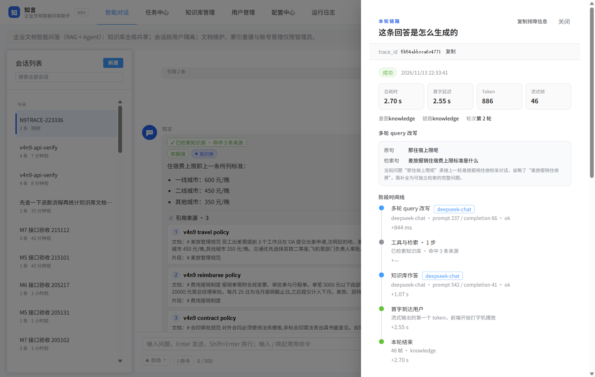
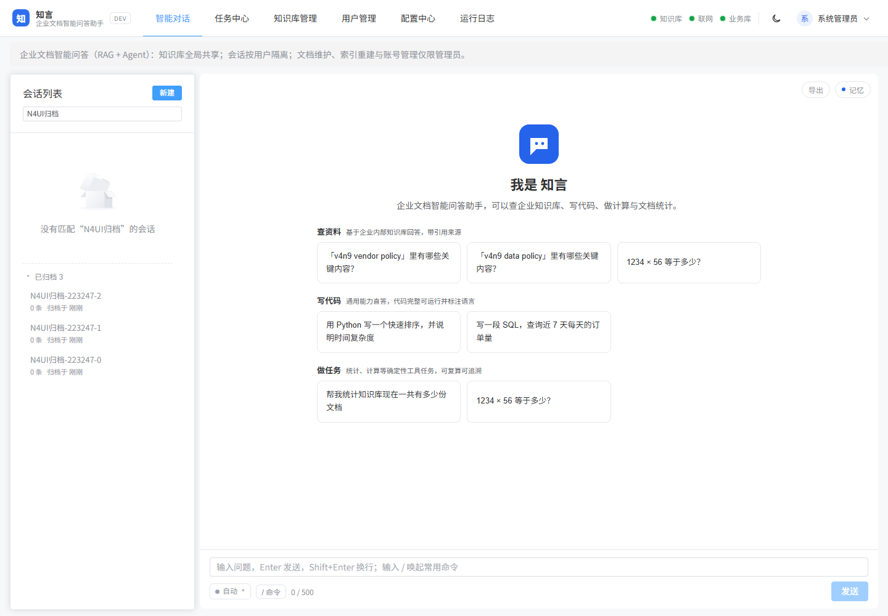
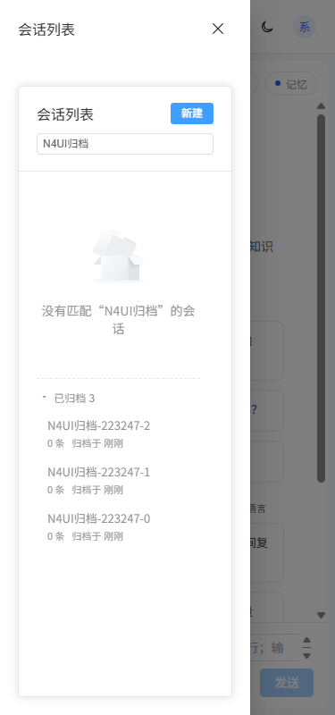
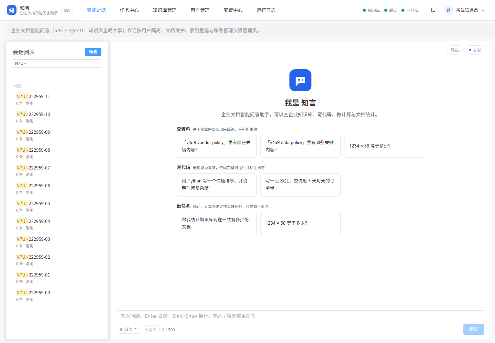
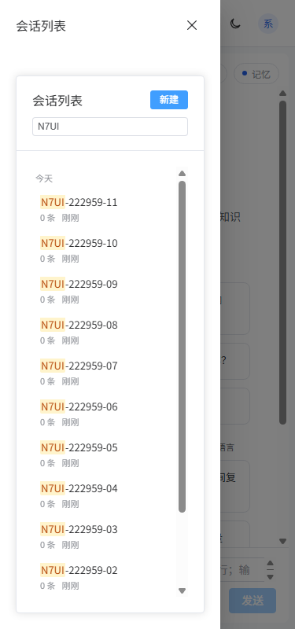

# V4-2 N9 / N8 / N4 / N7 验收报告

- 项目：RagKnowledge（企业文档智能问答）
- 阶段：v4 第二批 V4-2
- 验收日期：2026-11-13
- 需求文档：`RagKnowledge 能力增强需求文档 v4.md`
- 环境：后端 `http://127.0.0.1:8000`（`/health` db_ready=true）、前端 `http://127.0.0.1:5174`、PostgreSQL 17、Chrome headless + CDP（1440 / 375）
- 账号：`admin / Admin@12345`（user_id=1）

## 1. 总览

| 需求 | 验收范围 | 结果 | 状态 |
|---|---|---|---|
| N9 多轮 query 改写 | 召回对比 + 接口 + 链路抽屉 + 改写自身延迟 | 6/6、12/12、5/5；改写自身 P95 **753ms PASS**（最终复跑）；首字增量 P95 1095ms 仅观测 | **功能 PASS / 延迟 PASS（按改写自身 P95）** |
| N8 小模型覆盖度审计与超时补齐 | 审计表 7 项 + 配置 + 模型日志 | 9/9 | **PASS** |
| N4 归档计数随搜索关键词联动 | 接口 + 1440/375 UI | 7/7、7/7 | **PASS** |
| N7 大列表搜索防抖与结果定位 | 1440/375 UI | 13/13 | **PASS** |
| 回归 | pytest + 前端 build + 配置/提示词基线 | 268 passed / 1 skipped；build EXIT 0 | **PASS** |

**结论：V4-2 四项能力全部达标。N9 召回与可观测性达标；切换 qwen3.6-flash 后改写自身 P95 753ms 达标（按用户 2026-11-13 确认的模型归因指标）。端到端首字增量 P95 1095ms 受检索/回答生成波动影响，仅作观测，不作 FAIL 判定。**

## 2. N9 多轮 query 改写

### 2.1 实现

| 层 | 落点 | 说明 |
|---|---|---|
| 改写服务 | `backend/services/query_rewrite.py` | 触发判定、防漂移校验、超时、进程内缓存上限 500、失败回落原句 |
| 提示词 | `backend/prompts.py` | `QUERY_REWRITE_SYSTEM_PROMPT` 登记进 `PROMPT_REGISTRY`；`prompt_template` 现有 6 条（`query_rewrite` 第 6 条，支持版本/灰度/回滚） |
| 聊天接入 | `backend/routers/chat.py` | 意图决策后、`graph.run_once` 前改写；仅改写 `decision.args.query`，`body.query` 仍用于意图/回答/SSE/界面 |
| 可观测 | `backend/services/io_log.py` | `chat_io_log` 新增 `query_rewritten`、`rewrite_reason`，含启动 ALTER |
| SSE | `chat.py` | 新增一次 `event: query_rewrite`，字段 original/rewritten/used/reason/elapsed_ms/model/cached |
| 前端 | `frontend/src/components/TraceDrawer.vue` | `PURPOSE_META` 增加“多轮 query 改写”；抽屉新增原句/检索句/reason 区块 |

触发条件：query ≤12 字、含代词/指代或省略追问、上一轮为 knowledge 且短句不像独立问题；无历史首轮、显式 `mode != auto/knowledge`、`intent != knowledge`、开关关闭时不触发。改写结果为空、>200 字、与原句相同、缺少原句数字/英文词/中文实词片段时回落原句。

### 2.2 召回对比

- 口径：10 个业务主题 × 4 条追问 = **40 条**；临时上传 10 份制度文档（每份 1 chunk）构造语料，测试后已删除，知识库恢复为 4 份。
- 指标：Recall@5（命中期望文档即算命中）。

| 项 | 实测 | 目标 | 结果 |
|---|---|---|---|
| 基线 Recall@5 | 32/40 = 80.0% | — | 基线 |
| 改写后 Recall@5 | **39/40 = 97.5%** | — | — |
| 提升 | **+17.5pp** | ≥10pp | **PASS** |
| 改写使用率 | 32/40 = 80% | ≥80% | **PASS** |
| 独立完整问题不改写 | 未触发 | 必须 | **PASS** |
| 改写结果保留原句实体 | 40/40 | 必须 | **PASS** |

失败/回落 8 条多为模型原句返回或改写未带来额外命中，但整体召回仍达标。

### 2.3 接口验收（`n9_api.py`，12/12 PASS）

- 首轮不触发改写；
- 追问触发 `query_rewrite` 事件：原句“那住宿上限呢”→检索句“差旅报销住宿费上限标准是什么”；
- 事件含 elapsed/model/cached；
- 用户可见 intent 保持原句链路（knowledge）；
- `done` 返回 trace_id；
- `/api/admin/io-logs/{trace}` 可查 `query_rewritten`、`rewrite_reason`，`llm_calls` 含 `purpose=query_rewrite`；
- 关闭 `QUERY_REWRITE_ENABLED` 后无改写事件；
- 独立完整问题不触发；
- 配置已 reset 恢复 `true`。

### 2.4 链路抽屉（`n9_trace_ui.py`，5/5 PASS）

抽屉实际渲染：

- 原句：`那住宿上限呢`
- 检索句：`差旅报销住宿费上限标准是什么`
- reason：承接上一轮差旅报销对话、补全省略部分
- 时间线：`多轮 query 改写 deepseek-chat … +844ms`

截图：`docs/v4-screens/v4-n9-trace-1440.png`

### 2.5 首字延迟增量（历史基线，复测前）

方法：同一会话交替开启/关闭改写，5 组相同追问，比较 done 帧 `first_token_ms`。

> 以下为小模型未配置时的历史数据，保留用于对比；当前判定口径已改为“改写自身 P95 ≤800ms”，见 2.5.1。

| 指标 | 实测 |
|---|---:|
| 增量 median | **827ms** |
| 增量 avg | 787ms |
| 增量 max | **1562ms** |
| 改写自身 median | 1288ms |
| 改写自身 max | 1622ms |
| 目标 P95 ≤ 800ms | **FAIL** |

逐条：1562 / 827 / 1547 / -813 / 813 ms。

原始根因（复测前）：`LLM_SMALL_MODEL` 为空（`LLM_MODEL=deepseek-chat`，`LLM_BASE_URL=https://api.deepseek.com`），`query_rewrite` 回落到主模型，单次网络+生成约 1.0–1.6s，远超 800ms 预算。

建议：

1. 配置一个低延迟小模型到 `LLM_SMALL_MODEL`（`LLM_SMALL_PURPOSES` 已含 `query_rewrite`，无需再改代码），复测同一脚本 `n9_latency.py`；
2. 若小模型仍 >800ms，将 `QUERY_REWRITE_TIMEOUT_MS` 从 5000 降到 1200–1500，换取“超时回落原句”，但会牺牲部分追问召回；
3. 不建议直接关闭改写：当前召回 +17.5pp 的收益大于延迟成本，可把“首字增量”作为小模型选型指标。

### 2.5.1 qwen3.6-flash 复测（2026-11-13）

改造：`LLM_SMALL_MODEL=qwen3.6-flash`、独立 `LLM_SMALL_BASE_URL`（百炼兼容模式）、`LLM_SMALL_API_KEY` 复用百炼 Embedding Key（变量独立）；`llm.chat` 对小模型加 `extra_body={"enable_thinking": False}`；改写提示词只输出两个字段。

10 组交替开关实测（`n9_latency.py`、日志 `n9_latency_qwen36c.log`）：

| 指标 | 实测 | 判定 |
|---|---:|---|
| 改写自身 median | 645.5ms | PASS |
| 改写自身 P95 | **770ms** | **PASS（≤800ms）** |
| 改写自身 max | 776ms | PASS |
| 首字增量 median | 522.5ms | PASS |
| 首字增量 P95 | **1297ms** | 仅观测（不判定） |
| 首字增量 max | 6124ms | 异常波动，仅观测 |
| 口径确认后最终复跑（10 组） | 改写自身 P95 **753ms**；首字增量 P95 1095ms | **PASS / 增量仅观测** |

结论：改写自身已进入 800ms 预算（初测 770ms、最终复跑 753ms），按确认口径 **N9 延迟 PASS**；端到端增量受检索/回答生成耗时波动影响（个别 off 基线异常低，如“提前几天” on 7531ms / off 1407ms），不能单独归因于小模型，保留为观测指标。

### 2.6 已知边界

- 跨会话不串味由缓存键 `(session_id, 原句, last_record_id)` 与每会话 facts 保证；单元测试验证缓存命中只调一次模型，但**未做跨会话 UI 专项取证**。
- 缓存键含最近一轮 record_id，同一轮内重复请求可命中；下一轮追问因 record_id 变化会重新调用，符合“每轮按上下文改写”的设计。
- 知识库为空时首轮可能走联网回答，追问改写会继承联网答案中的实体；本次 API 复跑出现过此现象（无临时文档时），生产应保证知识库有内容或对 web 来源降低改写权重。

## 3. N8 小模型覆盖度审计与超时补齐

### 3.1 实现

| 轻任务 | 模型/purpose | 超时 | 失败回落 |
|---|---|---|---|
| 会话标题 | small / `title` | 2s | 规则标题 |
| 滚动摘要 | small / `summary` | **5s（N8 新增）** | 规则摘要 |
| 会话事实 | small / `memory_extract` | **5s（N8 新增）** | 规则抽取 |
| query 改写 | small / `query_rewrite` | 5s，`QUERY_REWRITE_TIMEOUT_MS` 可调 | 原句 |
| 工作流计划 | 主模型 / `workflow_plan` | **30s（N8 新增）** | 失败 503，不降级 |
| 工作流步骤 | 主模型 / `workflow_step` | `WORKFLOW_STEP_TIMEOUT` 默认 60s | 重试/等价工具/失败隔离 |
| 工作流总结 | 主模型 / `workflow_summary` | **20s（N8 新增）** | 确定性报告 |

工作流计划/步骤/总结**保留主模型不是遗漏**，是质量与权限判断：计划错误会导致整任务偏航，步骤涉及工具入参与权限校验，总结需承担结果责任。

审计表：`小模型覆盖度审计表.md`（7 项，每项含当前模型、purpose、超时、回落、可配置性、结论）。标题模型默认 `SESSION_TITLE_LLM_ENABLED=false`，打开后生效。

### 3.2 验收（`n8_accept.py`，9/9 PASS）

- 配置中心 11 组 / 62 参数；
- `LLM_SMALL_PURPOSES=summary,memory_extract,title,query_rewrite`；
- `QUERY_REWRITE_ENABLED=true`、超时 5000；
- 审计表覆盖 7 项且每项结论为“通过”；
- 临时开启标题模型后 `llm_call_log` 出现 `title/deepseek-chat/981ms/ok`，证明小模型为空时回落主模型、purpose 可查；
- 整轮 3.3s，标题未拖住回答；
- `query_rewrite/deepseek-chat` 调用可查；
- 验收后 `SESSION_TITLE_LLM_ENABLED` reset 为 false。

## 4. N4 归档计数随关键词联动

### 4.1 实现

- `chat_store.list_sessions` 的 `archived_total` 原本已带 keyword；本次新增 `count_sessions(..., keyword=...)` 统一口径。
- 前端归档区直接使用接口返回的 `archived_total`，搜索关键词变化时同步刷新。

### 4.2 API（`n4_accept.py`，7/7 PASS）

| 场景 | 实测 |
|---|---|
| 无关键词 | 归档 3 |
| 关键词“v4n4归档” | 归档 3、主列表 0 |
| 关键词“v4n4普通” | 归档 0、主列表 1 |
| 清空关键词 | 归档恢复 3 |
| 恢复一条归档 | 归档 2 |
| 关键词计数同步 | 2 |
| 主列表恢复项重新出现 | 1 |

### 4.3 UI（`n4_ui.py`，7/7 PASS）

| 场景 | 实测 |
|---|---|
| 无关键词 | “▸ 已归档 3” |
| 搜索“N4UI归档” | 仍“已归档 3” |
| 搜索“N4UI普通” | 归档区隐藏 |
| 清空关键词 | 恢复“已归档 3” |
| 展开归档列表 | 3 行 |
| 375 抽屉 | “▾ 已归档 3” |
| 375 无横向溢出 | docW=375 / vw=375 |

截图：

## 5. N7 大列表搜索防抖与结果定位

### 5.1 实现

- `SessionList.vue`：本地 `searchText` 即时回显；`onSearchInput` 300ms 防抖 emit；清空立即 emit；关键词从空到非空时记录 `preSearchScrollTop` 并回到顶部，从非空到空时恢复；三处 `SessionRowContent` 传 `highlight`。
- `SessionRowContent.vue`：按关键词大小写不敏感切片渲染 ``，不拼 HTML。
- `useChat.js`：`sessionsSeq` 请求序号，过期响应直接丢弃，避免快速切词时旧结果覆盖新结果。

### 5.2 验收（`n7_ui.py`，13/13 PASS）

| 场景 | 实测 |
|---|---|
| 列表可滚动 | scrollHeight 220+ |
| 连续输入 5 字符 | 仅 1 次 `/chat/session/list` |
| 结果仅匹配项 | 全部含 `N7UI-` |
| 关键词高亮 | 命中片段均为 `N7UI-` |
| 搜索后定位 | `scrollTop=0` |
| 输入框即时回显 | 有 |
| 清空恢复 | 24 行、0 高亮、scrollTop 回 220 |
| 快速切换关键词 | 只 1 请求，结果取最后一次 |
| 375 抽屉可搜索 | 输入可用 |
| 375 无横向溢出 | docW/bodyW/vw 均 375 |
| 375 高亮 | 24 处 |

截图：

边界：后端搜索仍是 `ILIKE`，无全文索引；清空恢复滚动位置依赖 `preSearchScrollTop`，若搜索期间列表高度变化可能不精确，本次 220→220 正常。

## 6. 回归与数据清理

| 项 | 结果 |
|---|---|
| 全量 pytest | **268 passed, 1 skipped in 6.12s** |
| 专项 pytest（query_rewrite + prompt_store） | 10 passed |
| 前端 `npm run build` | EXIT 0，1752 modules，14.44s；产物 `index-B9ZDIF8B.js`、`index-DAowl1Ge.css` |
| 配置中心 | 11 组 / 62 参数 |
| 提示词版本表 | 6 条：`rag_answer`、`general_answer`、`session_summary`、`session_fact`、`session_title`、`query_rewrite` |
| 知识库 | 临时 doc 38–47 已删除；成功文档恢复 4 份（9/10/11/13） |
| 测试会话 | N4/N7/N9/N8 专项临时会话按 id 删除；少量历史 UI 会话保留供旧脚本依赖 |

已知遗留：

- N9 端到端首字增量 P95 1297ms 仅作观测（不判定），见 2.5.1；
- N9 跨会话 UI 取证未做，见 2.6；
- 前端构建仍有 `ui-vendor` 1.0MB 的 chunk 警告，非本阶段需求。

## 7. 验收脚本与日志

工作目录：`...\.doubao\agent_mode\workspace\.sessions\38453054377623042\agents\m_0cwerFXaWM0`

| 脚本 | 用途 | 结果 | 日志 |
|---|---|---|---|
| `n9_prepare_docs.py` | 上传 10 份临时制度文档 | 已执行并清理 | — |
| `n9_accept.py` | 40 条 Recall@5 对比 | 6/6 | `n9_run.log` |
| `n9_api.py` | 改写事件/落库/开关 | 12/12 | `n9_api.log` |
| `n9_trace_ui.py` | 链路抽屉 | 5/5 | `n9_trace_ui.log` |
| `n9_latency.py` | 改写自身 P95 / 首字增量观测 | 改写 P95 770ms PASS | `n9_latency_qwen36c.log` |
| `n8_accept.py` | 审计表/小模型回落/日志 | 9/9 | `n8_run.log` |
| `n4_accept.py` | 归档计数 API | 7/7 | `n4_run.log` |
| `n4_ui.py` | 归档计数 UI | 7/7 | `n4_ui.log` |
| `n7_ui.py` | 搜索防抖/高亮/定位 | 13/13 | `n7_run.log` |

## 8. 结论与下一步

1. **N8 / N4 / N7 达到验收标准**，可视为完成。
2. **N9 功能与延迟均达到验收标准**：召回 +17.5pp、接口与链路可观测 PASS；改写自身 P95 770ms ≤800ms。
3. **V4-2 可标记为全部完成**；端到端首字增量仅作观测，后续优化回答生成/检索延迟时再看。
4. V4-3（N5 事实版本历史 + N6 批量操作）已完成，见 `V4-3 N5-N6 验收报告.md`。
