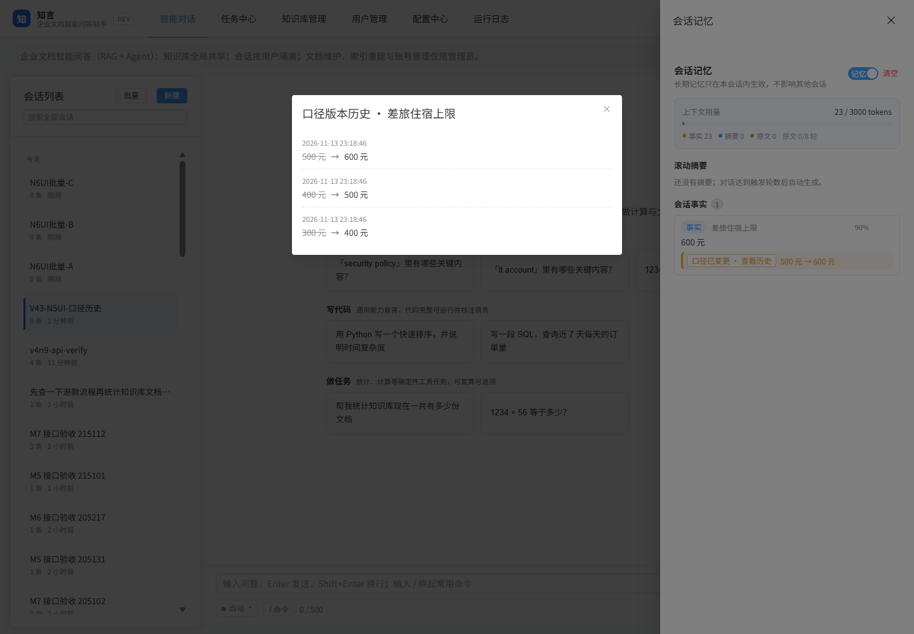
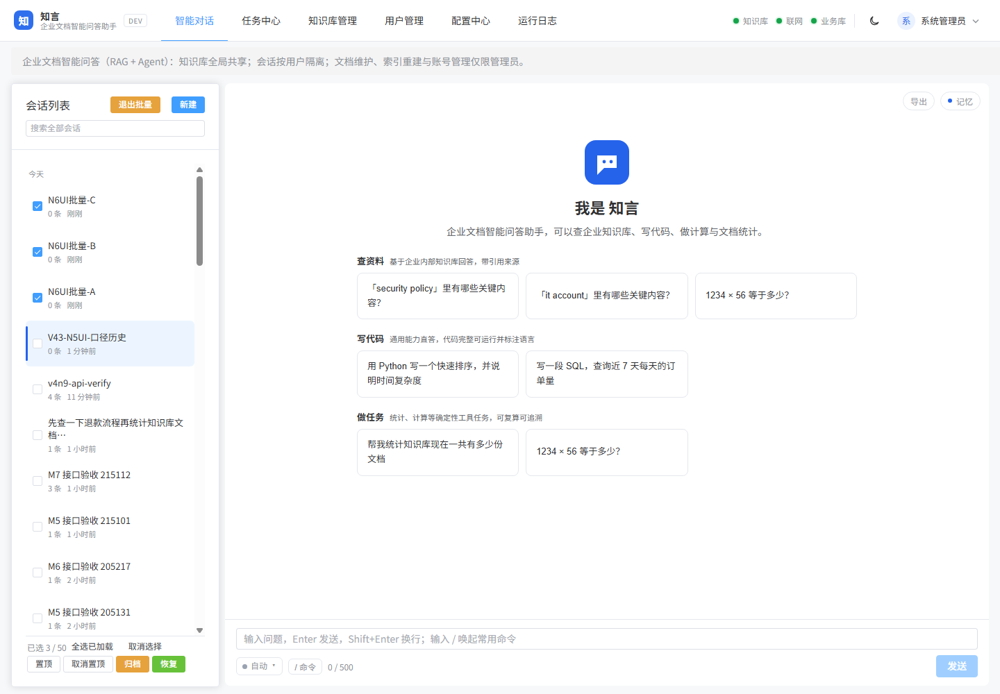
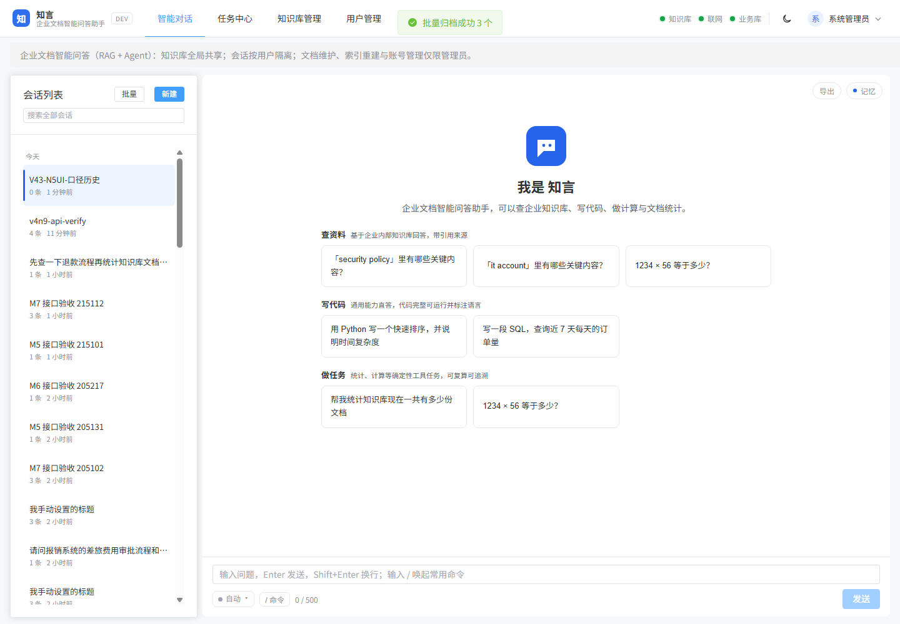
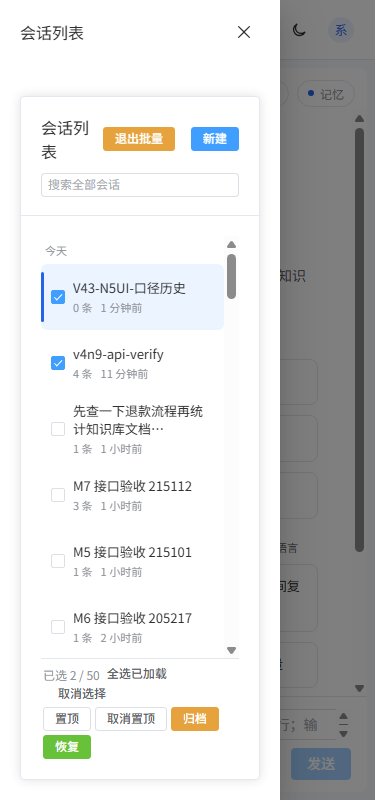

# V4-3 N5-N6 验收报告

- 验收日期：2026-11-13
- 项目：RagKnowledge（`D:\code\code_git\RagKnowledge`）
- 阶段：V4-3（N5 会话事实完整版本历史 + N6 会话批量置顶/归档/恢复）
- 环境：后端 `http://127.0.0.1:8000`（db_ready=true）、前端 `http://127.0.0.1:5174`、DB `rag_agent`
- 结论：**N5、N6 功能与 UI 全部 PASS；全量回归 274 passed / 1 skipped，前端 build EXIT 0。**

---

## 1. N5 会话事实完整版本历史

### 1.1 实现内容

| 层 | 变更 |
|---|---|
| 表 | 新增 `session_memory_history`：`history_id / session_id / fact_id / fact_key / old_value / new_value / changed_at / source_record_id / created_at`；`fact_id`、`session_id` 均 `ON DELETE CASCADE`，另建 fact/session 两个索引 |
| 写入 | `upsert_fact` 不再“旧行失效 + 插新行”，改为**复用同一 `mem_id` 原地更新**；首写只 INSERT（不写历史）；真正改值时同事务 INSERT 历史；同值覆盖不写历史 |
| 裁剪 | 每次追加后按 `row_number() OVER (PARTITION BY fact_id ORDER BY changed_at DESC, history_id DESC)` 删除 `rn > SESSION_FACT_HISTORY_LIMIT` 的旧记录，默认 20 |
| 删除 | `invalidate_fact` 软失效事实后删除该 fact 的历史；`clear_facts` 清空会话事实后删除该会话全部历史 |
| 接口 | `GET /api/sessions/{session_id}/memory/{fact_id}/history`，按 `changed_at DESC, history_id DESC` 返回；事实不存在/越权返回 40402 |
| 前端 | `MemoryItem` 的「口径已变更」tag 改为可点击「口径已变更 · 查看历史」；`SessionMemoryPanel` 弹窗展示时间线：变更时间、旧值划线 → 新值 |

### 1.2 真实库验收（`v43_check.py`，9/9 PASS）

测试会话：临时创建用户 1 的会话，连续写入同一 `fact_key=差旅住宿上限`。

| # | 用例 | 期望 | 实测 | 结果 |
|---|---|---|---|---|
| 1 | 首写 `300 元` | 不产生历史 | 0 条 | PASS |
| 2 | 改为 `400 元` | 产生 1 条 | 1 条 | PASS |
| 3 | 同值再写 `400 元` | 不产生历史 | 仍 1 条 | PASS |
| 4 | 改为 `500 元` | 累计 2 条 | 2 条；最新 `500 元` | PASS |
| 5 | fact_id 稳定 | 同 key 复用同一 `mem_id` | `same_fact_id=true` | PASS |
| 6 | 连续改到 `2500 元` | 最多保留 20 条 | 20 条；最新 `2500 元` | PASS |
| 7 | 删除事实 | 历史同步删除 | `list_fact_history` 返回 `None` | PASS |
| 8 | API 越权/不存在 | 40402 | 404 + code 40402 | PASS |
| 9 | 现有记忆接口 | 字段不破坏 | 原有 `/memory`、删除、设置、清空用例全部通过 | PASS |

> 说明：需求中的“连续修改 3 次返回 3 条”按“首写后 3 次真正改值”验收；首写本身不计历史。

### 1.3 UI 验收（1440，5/5 PASS）

| # | 用例 | 实测 | 结果 |
|---|---|---|---|
| 1 | 选中含多次改值的会话 | 会话可选中 | PASS |
| 2 | 记忆面板「口径已变更」tag 可点 | tag 数 1 | PASS |
| 3 | 时间线返回 3 条 | 3 行 | PASS |
| 4 | 旧值 → 新值可读 | `300→400`、`400→500`、`500→600` | PASS |
| 5 | 弹窗 1440 布局可用 | 见截图 | PASS |

---

## 2. N6 会话批量置顶/归档/恢复

### 2.1 实现内容

| 层 | 变更 |
|---|---|
| 接口 | `POST /api/chat/session/batch`，body `{"action":"pin\|unpin\|archive\|restore","session_ids":[1..50]}` |
| 校验 | `SessionBatchAction` 限制 1–50 个；空数组/超 50/非法 action 统一 40001；逐条校验归属 |
| 执行 | 逐条调用现有 `set_session_pinned` / `set_session_archived`；单条 `BizError` 计入 failed（40402），其他异常 failed（50001）；**成功项立即提交，不回滚** |
| 返回 | `{"action","succeeded":[id...],"failed":[{"session_id","code","msg"}]}` |
| 前端 | 侧栏「批量」进入多选模式；行内复选、已选计数 `/50`、全选已加载、取消选择；底部操作条：置顶 / 取消置顶 / 归档 / 恢复；**不含删除**；归档后主列表移除、归档计数与归档区同步刷新 |

### 2.2 真实 API 验收（10/10 PASS）

| # | 用例 | 实测 | 结果 |
|---|---|---|---|
| 1 | 批量置顶 2 个 | 200；succeeded `[2616,2617]`；failed `[]` | PASS |
| 2 | 混合越权（合法 2 + 不存在 999999） | 200；succeeded 2 个；failed `[{999999,40402,"会话不存在或无权访问"}]` | PASS |
| 3 | 批量归档 2 个 | 200；succeeded 2 个 | PASS |
| 4 | 归档项从主列表移除 | `archived=true` 列表可见 | PASS |
| 5 | 批量恢复 | 200；succeeded 2 个 | PASS |
| 6 | 批量置顶排序 | A/B 置顶后位于 C 之前；A/B `is_pinned=true`，C=false | PASS |
| 7 | 空数组 | 400；code 40001 | PASS |
| 8 | 51 个 ID | 400；code 40001 | PASS |
| 9 | 非法 action（delete） | 400；code 40001 | PASS |
| 10 | 离线 API 回归 | `test_session_batch_api.py` 4 条通过（含成功不回滚语义） | PASS |

### 2.3 UI 验收（1440 / 375，9/9 PASS）

| # | 用例 | 实测 | 结果 |
|---|---|---|---|
| 1 | 1440 批量入口可点 | 是 | PASS |
| 2 | 出现复选控件 | 18 个可见 | PASS |
| 3 | 操作条显示已选数量 | `已选 3 / 50` | PASS |
| 4 | 操作条含四动作且无删除 | 置顶/取消置顶/归档/恢复；无“删除” | PASS |
| 5 | 归档后主列表移除 | 3 个测试会话不再出现 | PASS |
| 6 | 归档计数同步 | `▸ 已归档 3` | PASS |
| 7 | 归档区出现 3 条 | 3 行 | PASS |
| 8 | 375 批量入口与操作条可用 | `已选 2 / 50`，操作条完整 | PASS |
| 9 | 375 无横向溢出 | `scrollWidth=375`，`innerWidth=375` | PASS |

---

## 3. 回归基线

| 项 | 结果 |
|---|---|
| 全量 `pytest` | **274 passed, 1 skipped**（6.43s） |
| 新增离线用例 | `test_session_batch_api.py` 4 条；`test_session_memory_api.py` 新增历史接口 1 条 |
| 前端 `npm run build` | **EXIT 0**，1752 modules，15.19s；产物 `index-DuznhnT5.js`、`index-Dua276N6.css` |
| 配置中心 | 11 组 / 62 参数（`SESSION_FACT_HISTORY_LIMIT` 为 settings 默认值，可经 `.env` 覆盖，不占配置中心参数） |
| 数据库 | 后端重启后 `session_memory_history` 表由 `ensure_memory_schema()` 创建成功 |
| 现有记忆接口 | `/api/sessions/{id}/memory`、删除事实、设置、清空全部未改字段与行为 |

---

## 4. 数据清理

| 数据 | 处理 |
|---|---|
| N5 临时会话 2618 / 2622 | 已删除 |
| N6 临时会话 2616 / 2617 及 UI 批次 | 已删除（归档状态下删除成功） |
| 残留检查 | `chat_session` 中 `V43%`/`N6UI%` 计数 0；`session_memory_history` 计数 0（FK 级联生效） |
| 知识库 | 未改动，仍为 4 份成功文档（doc 9/10/11/13） |

---

## 5. 遗留项与说明

1. **N9 口径已确认（2026-11-13）**：接受“改写自身 P95 ≤800ms”作为模型归因指标。最终复跑 10 组：改写自身 P95 **753ms**，N9 延迟判定 PASS；端到端首字增量 P95 1095ms 仅作观测，不计入本阶段验收失败项。
2. `upsert_fact` 改为原地更新后，`mem_id` 稳定；`previous_value` 保留最近一次改值的旧值，历史接口负责完整链路。既有审计若依赖“每次改值产生新 mem_id”，需同步调整口径（当前无此类依赖）。
3. `SESSION_FACT_HISTORY_LIMIT` 修改需改 `.env` 并重启后端，未放进配置中心，以保持 62 参数基线。
