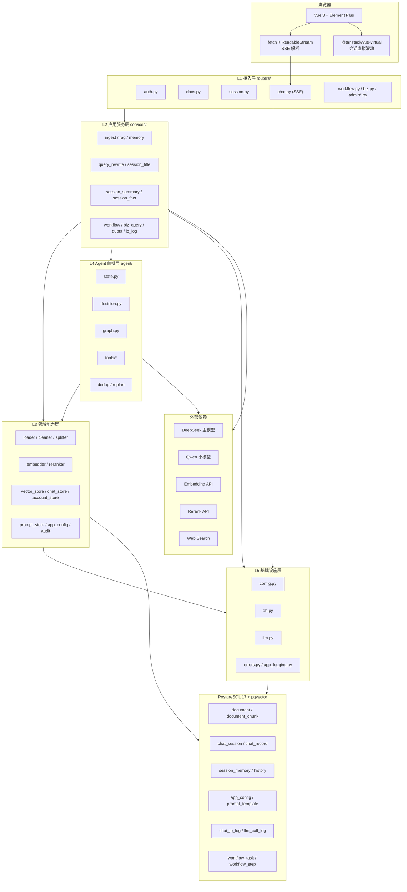
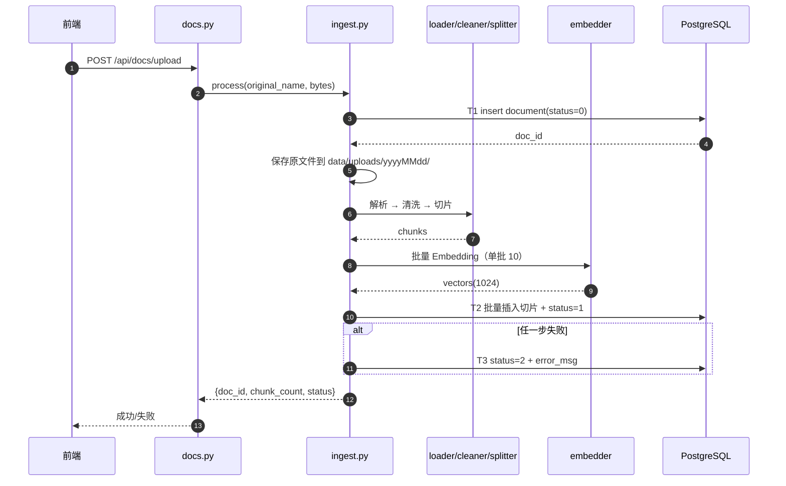
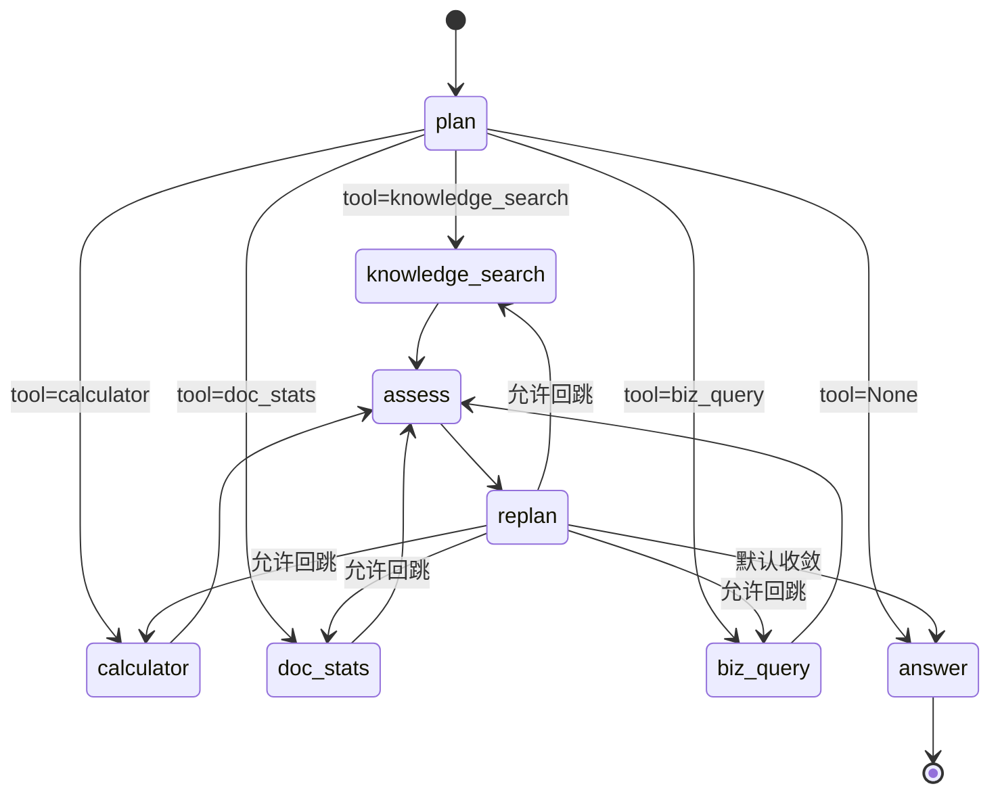

# RagKnowledge 技术架构、技术亮点与面试剖析

> 文档定位：**当前实现的完整技术复盘**，不是早期设计初稿，也不是功能说明书。  
> 代码基线：`D:\code\code_git\RagKnowledge`，核对日期 **2026-11-16**。  
> 适用场景：项目答辩、简历项目描述、Agent/RAG 方向面试准备、后续迭代设计基线。  
> 文档原则：**一切以当前代码为准**。默认值与当前 `.env` 实际值分开写；旧文档中的偏差在本章第 0.3 节集中列出。

---

## 目录

- [0. 先给结论：这个项目到底做了什么](#0-先给结论这个项目到底做了什么)
- [1. 项目定位、边界与规模](#1-项目定位边界与规模)
- [2. 技术栈全景：用了什么、解决什么问题](#2-技术栈全景用了什么解决什么问题)
- [3. 总体架构：分层单体 + 状态图编排 + 事件流输出](#3-总体架构分层单体--状态图编排--事件流输出)
- [4. 数据架构：单库 PostgreSQL + pgvector](#4-数据架构单库-postgresql--pgvector)
- [5. 核心链路一：文档入库](#5-核心链路一文档入库)
- [6. 核心链路二：RAG 检索与生成](#6-核心链路二rag-检索与生成)
- [7. 核心链路三：Agent 意图决策与 LangGraph](#7-核心链路三agent-意图决策与-langgraph)
- [8. 核心链路四：SSE 流式问答](#8-核心链路四sse-流式问答)
- [9. 核心链路五：三层会话记忆与事实版本历史](#9-核心链路五三层会话记忆与事实版本历史)
- [10. 核心链路六：工作流 DAG 与并行执行](#10-核心链路六工作流-dag-与并行执行)
- [11. 核心链路七：大规模会话列表与前端体验](#11-核心链路七大规模会话列表与前端体验)
- [12. 安全、权限与合规](#12-安全权限与合规)
- [13. 配置中心、提示词版本化与双模型路由](#13-配置中心提示词版本化与双模型路由)
- [14. 可观测性与降级体系](#14-可观测性与降级体系)
- [15. 技术亮点逐项剖析（面试主战场）](#15-技术亮点逐项剖析面试主战场)
- [16. 面试叙事：从 90 秒自我介绍到 10 分钟架构讲解](#16-面试叙事从-90-秒自我介绍到-10-分钟架构讲解)
- [17. 高频追问与回答模板](#17-高频追问与回答模板)
- [18. 当前验收数据与可引用指标](#18-当前验收数据与可引用指标)
- [19. 已知边界、技术债与演进路线](#19-已知边界技术债与演进路线)
- [20. 代码索引与二次阅读路径](#20-代码索引与二次阅读路径)
- [附录 A：SSE 事件协议](#附录-asse-事件协议)
- [附录 B：当前配置基线](#附录-b当前配置基线)
- [附录 C：关键 SQL 与数据表](#附录-c关键-sql-与数据表)
- [附录 D：术语表](#附录-d术语表)

---

## 0. 先给结论：这个项目到底做了什么

### 0.1 一句话概括

RagKnowledge 是一个 **面向企业内部文档的 RAG + 多工具 Agent 问答系统**：用户上传 PDF / DOCX / Markdown 后，系统完成解析、清洗、切片、向量化与入库；提问时经过“意图决策 → LangGraph 工具编排 → 向量召回/Rerank → Prompt 组装 → 大模型流式生成”，并通过 SSE 把工具过程、来源、正文、表格、工作流计划实时推给前端。

它不是一个“只调一次大模型”的 Chat Demo，而是一个把 **检索、决策、工具、记忆、安全、可观测性、会话规模** 都做成工程闭环的项目。

### 0.2 六个最值得讲的能力

| 能力 | 工程落点 | 面试价值 |
|---|---|---|
| 单库 PostgreSQL + pgvector | 文档元数据、切片、向量、会话、记忆、日志、配置同库 | 能讲清“为什么单库能消掉双写一致性问题” |
| LangGraph 显式状态图 | `plan → tool → assess → replan → answer` | 能讲清 Agent 控制流、循环上限、可断言性 |
| 7 类意图 + 多层决策 | 显式模式 → 上下文延续 → LLM JSON → 关键词 → 默认 knowledge | 能讲清“分类不是一次 Prompt，而是优先级系统” |
| SSE 全链路 | `fetch + ReadableStream`、心跳、事件协议、首字延迟、trace_id | 能讲清流式协议选型与故障隔离 |
| 三层记忆 + 事实版本历史 | 事实 / 摘要 / 最近原文窗口，token 预算统一裁剪 | 能讲清长对话上下文治理与“口径演变” |
| 工作流 DAG 并行 | `depends_on` 构 DAG，`asyncio.wait(FIRST_COMPLETED)`，默认并发 2 | 能讲清并行调度、失败级联、取消与恢复 |

### 0.3 与旧架构文档的口径差异（重要）

旧 `文档/需求与设计/架构设计文档.md` 成文于 **2026-11-08**，是 v4 之前的设计初稿。本文以当前代码为准，以下差异必须明确：

| 项目 | 旧文档 / 旧 README | 当前代码事实 |
|---|---|---|
| 版本阶段 | 根 README 仍写“M0–M6 / 截至 V56” | 已完成 M1–M8、v2、v3、v4；N1–N11 全部交付 |
| v4 能力 | 旧架构文档未覆盖 | 已覆盖 N1–N11：会话规模、标题小模型、工作流并行、归档计数、事实历史、批量操作、搜索防抖、小模型审计、query 改写、时间显示、宽度拖拽 |
| 相似度阈值 | 旧文档写 `RETRIEVAL_MIN_SCORE=0.0` | 当前 `config.py` 代码默认 **0.5** |
| `answer` 节点 | 旧文档写“LLM 汇总生成” | 当前 `agent/graph.py::answer_node` 只做**确定性汇总**；自然语言回答由 `routers/chat.py` 调 `services/rag.py::stream_answer()` 流式生成 |
| 模型默认值 | 旧文档口径与当前 `.env` 不一致 | 当前主模型 `deepseek-chat`，小模型 `qwen3.6-flash`；模型名统一放 `.env` |
| Rerank | 旧文档写“默认关” | 代码默认 `false`；当前环境 `.env` 开启 `true`，模型 `gte-rerank-v2` |
| 前端端口 | 旧 README 写 5173 | 当前运行环境以 **5174** 为准（Vite 端口可能因占用变化） |

> 面试表达建议：  
> “这份架构文档我做过一次代码对齐。旧版把 answer 节点写成 LLM 汇总，但实际代码里 LangGraph 的 answer 只做确定性汇总，真正生成在 SSE 路由里。这个差异我是在读代码时发现并修正的。”  
> 这句话本身就是“代码与文档一致性”的加分项。

---

## 1. 项目定位、边界与规模

### 1.1 业务定位

企业内部知识库问答，典型问题包括：

- “员工请假流程是什么？”
- “差旅报销住宿费上限是多少？”
- “帮我统计知识库里有多少份文档、多少切片。”
- “查一下张三最近 30 天的订单。”
- “先查考勤，再查薪资，最后汇总成报告。”

系统需要同时处理：

1. **非结构化文档**：PDF / DOCX / Markdown；
2. **结构化业务数据**：客户、订单、库存、考勤、薪资；
3. **纯计算**：四则运算；
4. **系统统计**：文档数、切片数；
5. **通用对话**：写代码、翻译、解释概念；
6. **多步骤任务**：工作流计划与执行。

### 1.2 明确边界（面试时要主动说）

| 不做 | 原因 |
|---|---|
| 不做 OCR | 扫描版 PDF 无文字层，当前只处理有文本层的文件 |
| 不做多租户 SaaS | 当前是单企业部署，知识库全局共享，会话按用户私有 |
| 不做微服务拆分 | 单机 Demo，分层单体足够；用依赖规则保证可维护性 |
| 不做异步文档队列 | 上传同步处理，换取实现简单；状态字段保留 `0 处理中` 以便未来异步化 |
| 不做向量库双写 | 单库 PostgreSQL + pgvector，避免 MySQL + 向量库补偿 |
| 不做复杂权限树 | 当前是 `admin` / `member` 两级角色 + 资源归属校验 |

### 1.3 当前规模基线

| 指标 | 当前值 |
|---|---|
| 后端测试 | **274 passed / 1 skipped** |
| 前端构建 | **EXIT 0，1752 modules，15.19s**，产物 `index-DuznhnT5.js`、`index-Dua276N6.css` |
| 配置中心 | **11 组 / 62 参数** |
| 提示词版本表 | **6 条**：`rag_answer`、`general_answer`、`session_summary`、`session_fact`、`session_title`、`query_rewrite` |
| 知识库基线 | 4 份成功文档：`leave_policy.md`、`attendance_rule.md`、`it_account.md`、`security_policy.md`，各 1 chunk |
| 会话规模验收 | 200 / 500 会话压测，UI 35/35 PASS |

---

## 2. 技术栈全景：用了什么、解决什么问题

### 2.1 后端与数据层

| 技术 | 版本 | 在项目中的角色 | 解决什么问题 | 关键代码 |
|---|---:|---|---|---|
| Python | 3.12 | 后端运行时 | 异步 IO、类型标注、生态成熟 | `backend/` |
| FastAPI | 0.162.2 | HTTP / SSE 框架 | 原生 async、Pydantic 校验、OpenAPI | `backend/main.py`、`routers/` |
| Uvicorn | - | ASGI Server | 承载 FastAPI，支持长连接流式响应 | 启动脚本 |
| Starlette | 1.10.0 | FastAPI 底层 | `StreamingResponse`、中间件 | `main.py` |
| Pydantic | 2.14.3 | 请求/响应模型 | 入参校验、错误包络、类型安全 | `backend/schemas/` |
| pydantic-settings | 2.16.2 | 配置管理 | 环境变量 > `.env` > 默认值 | `backend/config.py` |
| psycopg | 3.3.8 | PostgreSQL 驱动 | 异步连接、参数化 SQL、事务 | `backend/db.py`、`services/*_store.py` |
| psycopg_pool | 3.3.3 | 连接池 | 控制连接数、复用连接、避免长事务占连接 | `backend/db.py` |
| pgvector | 0.5.1 | Python 向量适配 | `vector` 类型写入/读取、`Vector` 包装 | `db.py::to_vector` |
| PostgreSQL | 17 | 主数据库 | 业务数据 + 向量 + 日志 + 配置同库 | `init_db.sql` |
| pgvector 扩展 | 0.8.6 | 向量索引与算子 | HNSW、余弦距离 `<=>` | `init_db.sql` |
| LangGraph | 1.2.20 | Agent 状态图 | 显式节点/条件边、循环上限、可断言 | `agent/graph.py` |
| langchain-core | 1.7.6 | LangGraph 依赖 | 图运行时基础 | 依赖 |
| OpenAI SDK | 3.46.0 | LLM 客户端 | OpenAI 兼容协议，切换 Provider | `backend/llm.py` |
| PyPDF2 | 3.0.1 | PDF 解析 | 提取文本层 | `services/loader.py` |
| python-docx | 1.2.0 | DOCX 解析 | 提取段落文本 | `services/loader.py` |
| Markdown | - | MD 解析 | 保留结构文本 | `services/loader.py` |
| pytest | 9.2.0 | 测试 | 单元/集成/回归 | `backend/tests/` |
| httpx | - | Rerank HTTP 调用 | 调用百炼原生 rerank 端点 | `services/reranker.py` |

### 2.2 前端

| 技术 | 版本 | 角色 | 解决什么问题 | 关键代码 |
|---|---:|---|---|---|
| Vue 3 | 3.4.38 | 前端框架 | Composition API、组件化 | `frontend/src` |
| Element Plus | 2.8 | UI 组件库 | 表格、弹窗、抽屉、表单 | `components/`、`views/` |
| Vite | 5.4 | 构建/Dev Server | 快速冷启动、代理 `/api` | `vite.config.js` |
| @tanstack/vue-virtual | 3.13.52 | 虚拟滚动 | 200+ 会话只渲染可视区 | `SessionList.vue` |
| axios | 1.7.7 | HTTP 客户端 | REST 请求、统一错误处理 | `api/http.js` |
| marked | 18.2 | Markdown 渲染 | 答案 Markdown → HTML | `MarkdownRenderer.vue` |
| DOMPurify | 3.4.17 | XSS 清洗 | 渲染前净化 HTML | `MarkdownRenderer.vue` |
| highlight.js | 11.12 | 代码高亮 | 代码块展示 | `utils/highlight.js` |

### 2.3 模型与外部服务

| 能力 | 当前选型 | 作用 | 关键设计 |
|---|---|---|---|
| 主模型 | DeepSeek `deepseek-chat` | 意图分类、RAG 回答、通用对话、工作流计划 | OpenAI 兼容协议，`llm.chat` / `llm.chat_stream` |
| 小模型 | 百炼 `qwen3.6-flash` | 摘要、事实抽取、标题、query 改写 | 独立 BaseURL/Key；`enable_thinking=False`；失败回落主模型 |
| Embedding | 百炼 `text-embedding-v3` | 文档切片与查询向量化 | 1024 维，单批 10 |
| Rerank | 百炼 `gte-rerank-v2` | 候选片段二次精排 | 原生 text-rerank 端点，复用百炼 Key |
| 联网兜底 | 百炼 Web Search | 知识库命中不足时联网 | `FALLBACK_MODE=web`，可切换 guide/contact |

### 2.4 技术选型的“为什么”与“代价”

| 选型 | 为什么选 | 代价 / 权衡 |
|---|---|---|
| FastAPI 而不是 Django/Flask | 原生 async 适合 SSE 长连接；Pydantic 校验强；OpenAPI 自带 | 生态相对年轻，复杂 ORM 能力弱 |
| 手写 SQL 而不是 ORM / LangChain VectorStore | 向量检索的算子、索引、执行计划可讲透；避免抽象层黑盒 | 需要自己处理类型注册、批量插入、事务 |
| PostgreSQL + pgvector 而不是 MySQL + Chroma | 单库单事务；删除文档无需跨库补偿；可用 `EXPLAIN ANALYZE` | 向量能力受扩展版本限制，超大规模不如专用向量库 |
| LangGraph 而不是单轮 Function Calling | 控制流显式、可画图、可断言、可限制循环 | 需要自己做事件映射，框架版本有漂移风险 |
| SSE + fetch 而不是 WebSocket / EventSource | 问答是单向推送；SSE 协议简单；`EventSource` 不支持 POST body | 需要自己处理分帧、心跳、中断 |
| 分层单体而不是微服务 | 单机部署，降低运维复杂度；依赖规则保证边界 | 后续按 services 边界拆服务需要额外改造 |

---

## 3. 总体架构：分层单体 + 状态图编排 + 事件流输出

### 3.1 架构全景图



### 3.2 分层职责与依赖规则

| 层 | 职责 | 禁止事项 |
|---|---|---|
| L1 `routers/` | 参数校验、鉴权、组装响应、SSE 帧 | 不写 SQL、不直接调外部模型 |
| L2 `services/` | 业务流程编排、事务边界、降级策略 | 不感知 HTTP、不抛 `HTTPException` |
| L3 领域能力 | 解析、切片、向量化、SQL 仓储、配置、提示词 | 不反向依赖 `routers/` |
| L4 `agent/` | 意图决策、状态图、工具调用 | 不直接读写数据库、不拼 SQL |
| L5 基础设施 | 配置、连接池、LLM 客户端、异常、日志 | 不依赖业务模块 |

**一句话**：路由负责协议，服务负责流程，能力层负责算法与 SQL，Agent 负责决策，基础设施负责配置与连接。

### 3.3 运行时拓扑

| 进程/资源 | 技术 | 地址/位置 | 说明 |
|---|---|---|---|
| 前端 Dev Server | Vite | `http://127.0.0.1:5174` | 代理 `/api` 到后端 |
| 后端 API | Uvicorn | `http://127.0.0.1:8000` | `/health`、`/docs` |
| 数据库 | PostgreSQL 17 | `127.0.0.1:5432/rag_agent` | pgvector 0.8.6 |
| 文件存储 | 本地目录 | `data/uploads/` | 按日期分目录，UUID 文件名 |
| 导出文件 | 本地目录 | `data/exports/` | CSV 导出，带临时下载令牌 |

### 3.4 请求穿过系统的路径

以一次知识库问答为例：

```text
浏览器 POST /api/chat/stream
  → RequestContextMiddleware：生成/读取 X-Trace-Id，写 contextvar
  → auth_deps.get_current_user：Cookie → token 哈希 → auth_session
  → chat.py：会话归属校验 → 限流/日 token 配额
  → _prepare()（独立 Task）
      → memory.build_context：事实 + 摘要 + 最近原文窗口
      → chat_store.get_last_turn：上一轮意图
      → internal_terms.get_terms：内部实体词表
      → decision.decide：7 类意图决策
      → query_rewrite.rewrite：短追问改写检索句
      → graph.run_once：LangGraph 执行工具
  → event_gen：按意图分支流式输出 token / source / tool / done
  → chat_store.insert_record：正常完成才落库
  → io_log.enqueue_turn：运行日志入有界队列
```

---

## 4. 数据架构：单库 PostgreSQL + pgvector

### 4.1 为什么放弃 MySQL + 向量库

| 维度 | MySQL + Chroma/其他向量库 | PostgreSQL + pgvector（当前） |
|---|---|---|
| 文档元数据 + 向量 | 两套存储，需要双写 | 同库同表族，一个事务 |
| 删除文档 | 先删向量再删元数据，失败需补偿 | 同事务删除 + 外键级联 |
| 一致性 | 最终一致，需对账 | 强一致 |
| 运维 | 两套服务、两套备份 | 一个数据库 |
| 检索调优 | 向量库黑盒 | `EXPLAIN ANALYZE` 可看 HNSW 执行计划 |
| 规模上限 | 专用向量库更强 | 百万级以内足够；更大规模需分片/专用库 |
| 面试表达 | “我们用了向量库” | “我能讲清 HNSW、算子类、执行计划、事务边界” |

**核心结论**：这个项目的数据规模不需要专用向量库；单库换来的是 **事务一致性 + 运维简单 + 可解释性**。

### 4.2 数据表全景

| 表 | 作用 | 关键字段/索引 |
|---|---|---|
| `document` | 文档元数据 | `doc_id`、`doc_name`、`file_path`、`status`、`chunk_count`、`summary` |
| `document_chunk` | 切片与向量 | `doc_id`、`chunk_index`、`content`、`embedding vector(1024)` |
| `app_user` | 用户 | `username` 唯一、`password_hash`、`role`、`status` |
| `auth_session` | 登录态 | `token_hash`、`user_id`、`expires_at`、`revoked_at` |
| `chat_session` | 会话 | `user_id`、`session_name`、`is_pinned`、`archived_at`、`last_active_at` |
| `chat_record` | 问答记录 | `session_id`、`query`、`answer`、`intent`、`answer_mode`、`trace_id` |
| `session_memory` | 当前 active 事实 | `session_id`、`kind`、`fact_key`、`fact_value`、`previous_value` |
| `session_memory_history` | 事实版本历史 | `fact_id`、`old_value`、`new_value`、`changed_at` |
| `prompt_template` | 提示词版本 | `name`、`version`、`content`、`gray_percent`、`is_active` |
| `app_config` | 运行时配置覆盖 | `key`、`value`、`group_name`、`updated_by` |
| `chat_io_log` | 每轮问答运行日志 | `trace_id`、`intent`、`first_token_ms`、`context_usage`、`tool_chain` |
| `llm_call_log` | 每次 LLM 调用日志 | `trace_id`、`purpose`、`model`、`prompt_tokens`、`latency_ms` |
| `workflow_task` / `workflow_step` | 工作流任务与步骤 | `status`、`depends_on`、`step_index` |
| `chat_rate_window` | 每分钟限流 | `(user_id, window_start)` 主键，原子 UPSERT |
| `operation_log` | 审计日志 | 登录、配置修改、业务查询等 |
| `export_token` | CSV 临时下载 | `token`、`expires_at`、`user_id` |
| `chat_feedback` | 回答反馈 | `record_id`、`user_id`、`rating` |

### 4.3 向量索引与检索 SQL

建表关键片段：

```sql
CREATE EXTENSION IF NOT EXISTS vector;

CREATE TABLE document_chunk (
  chunk_id    BIGSERIAL PRIMARY KEY,
  doc_id      BIGINT NOT NULL REFERENCES document(doc_id) ON DELETE CASCADE,
  chunk_index INT NOT NULL,
  content     TEXT NOT NULL,
  embedding   vector(1024) NOT NULL
);

CREATE INDEX idx_chunk_embedding
ON document_chunk
USING hnsw (embedding vector_cosine_ops);
```

检索 SQL：

```sql
SELECT c.chunk_id, c.doc_id, d.doc_name, c.chunk_index, c.content,
       d.summary AS doc_summary,
       1 - (c.embedding <=> %(qvec)s) AS score
FROM document_chunk c
JOIN document d ON d.doc_id = c.doc_id
WHERE (%(doc_ids)s::bigint[] IS NULL OR c.doc_id = ANY(%(doc_ids)s::bigint[]))
ORDER BY c.embedding <=> %(qvec)s
LIMIT %(k)s;
```

关键点：

- `<=>` 是余弦距离算子；`1 - distance` 转成相似度分数；
- 索引必须用 `vector_cosine_ops`，否则算子与索引不匹配；
- `hnsw.ef_search` 控制候选搜索宽度，当前默认 40；
- `hnsw.iterative_scan=relaxed_order` 配合 `doc_id` 过滤，减少“过滤后候选不足”；
- GUC 设置放在独立可回滚事务里，扩展不支持时只告警，不污染主检索事务。

### 4.4 事务边界

| 场景 | 事务设计 |
|---|---|
| 文档入库 T1 | 插入 `document`（`status=0`），立即提交拿 `doc_id` |
| 文档入库 T2 | 批量插入切片 + 更新文档成功，单事务原子提交 |
| 文档入库 T3 | 失败置 `status=2` + `error_msg`，独立提交，不被 T2 回滚带走 |
| 删除文档 | 单事务先删切片再删文档；外键 `ON DELETE CASCADE` 兜底 |
| 删除会话 | 外键级联删除记录、记忆、事实历史 |
| 事实改值 | 同一事务内更新 `session_memory` + 追加 `session_memory_history` + 裁剪 20 条 |
| 滚动摘要 | `UPDATE ... WHERE summarized_until_record_id < 新水位`，幂等推进 |

### 4.5 连接与并发模型

- `psycopg_pool` 连接池：`DB_POOL_MIN=2`、`DB_POOL_MAX=10`；
- 解析 / 切片 / 同步 Embedding / 同步 LLM 调用放 `run_in_threadpool` 或 `asyncio.to_thread`，避免阻塞事件循环；
- **外部调用期间不持有数据库连接**：入库的解析与向量化、RAG 的 LLM 流式生成，都不在数据库事务内；
- LLM 流式生成用“线程生产 + `asyncio.Queue` 桥接”，避免同步 SDK 阻塞 async 主循环。

### 4.6 本项目最易踩的坑：`pgvector.Vector`

`pgvector-python 0.5.1` 的适配器只注册 `Vector` 和 `numpy.ndarray`，**不注册 Python `list`**。直接传 `list[float]` 会出现：

- 写入：`DatatypeMismatch`，被推断为 `smallint[]`；
- 检索：`操作符不存在: vector <-> smallint[]`。

解决方案：在仓储层统一 `to_vector(list) -> Vector`，业务层仍可传 `list[float]`。这是“一处转换、全链路安全”的适配器做法。

---

## 5. 核心链路一：文档入库

### 5.1 流程



### 5.2 关键实现

| 步骤 | 代码 | 说明 |
|---|---|---|
| 文件名校验 | `ingest.safe_storage_name` | 只取基名、去掉 `..`、UUID 存储名，防路径穿越 |
| 解析 | `loader.extract_text` | PDF / DOCX / MD 三类 |
| 清洗 | `cleaner.clean_text` | 去不可见字符、页码归一、空白压缩 |
| 切片 | `splitter.split_text` | 固定窗口 + 重叠 |
| 向量化 | `embedder.embed_documents` | 批量 10，维度自检 |
| 写入 | `vector_store.commit_ingest` | 单事务批量插入 + 更新文档 |

### 5.3 切片公式

```text
chunk_size = 500 字符
overlap    = 100 字符
step       = 500 - 100 = 400
```

例：文本 1200 字 → 切片窗口 `[0,500)`、`[400,900)`、`[800,1200)`。

为什么用字符而不是 token：

- 中文按字符切更稳定，不依赖分词器；
- 500 字约等于 300–500 token，适合当前 Top-K=5 的上下文预算；
- 重叠 100 字缓解跨边界语义断裂。

边界保护：`overlap >= chunk_size` 时自动降级为 `chunk_size // 5`，避免窗口无法推进。

### 5.4 三个事务的设计理由

为什么不是一个大事务：

1. 解析和 Embedding 是外部调用，耗时不可控；大事务会长期占用数据库连接；
2. T1 先提交拿到 `doc_id`，后续失败时仍能定位并标记 `status=2`；
3. T3 独立提交，避免“失败标记”被 T2 的回滚一起带走；
4. T2 只覆盖“写切片 + 置成功”，保证切片要么全有、要么全无。

### 5.5 删除与重解析

| 操作 | 实现 |
|---|---|
| 删除文档 | `delete_document`：单事务删切片 → 删文档；外键 CASCADE 兜底 |
| 重解析 | `replace_document_chunks`：单事务删旧切片 → 写新切片 → 更新计数；保留 `doc_id` |
| 重建索引 | `reindex_vector_index`：`REINDEX INDEX idx_chunk_embedding`，autocommit 短连接（REINDEX 不能在事务块内） |

### 5.6 大文件上传

- 单文件上限 `UPLOAD_MAX_MB=10`；
- 批量总上限 `UPLOAD_TOTAL_MAX_MB=100`；
- 分片上传：`UPLOAD_CHUNK_MAX_MB=32`、`UPLOAD_DEFAULT_CHUNK_MB=4`、并发 3；
- 分片临时目录 `data/uploads/.chunks`，24 小时清理；
- 后端用 `_read_capped` 限制读取字节数，避免“声明大小造假”。

---

## 6. 核心链路二：RAG 检索与生成

### 6.1 全链路


### 6.2 关键代码路径

| 阶段 | 代码 | 说明 |
|---|---|---|
| 检索参数 | `services/rag.py::retrieve` | 参数全部从配置中心读取，可在线调整 |
| 查询向量化 | `embedder.embed_query` | 同步调用，包在线程里 |
| 向量检索 | `vector_store.search` | 手写 SQL + HNSW GUC |
| 重排 | `reranker.maybe_rerank` | 失败/空候选/无 Key 一律回退原序 |
| 阈值与截断 | `retrieve` | **先阈值过滤，再截断 Top-K** |
| Prompt | `rag.build_prompt` | 固定注入顺序 |
| 生成 | `rag.stream_answer` | LLM 失败降级为来源摘要 |
| 来源字段 | `rag._source_fields` | `doc_name`、`chunk_index`、`score`、`snippet`、`excerpt` |

### 6.3 参数语义

| 参数 | 当前代码默认 | 当前环境 | 作用 |
|---|---:|---:|---|
| `TOP_K` | 5 | 5 | 最终进入生成与来源卡片的片段数 |
| `RETRIEVAL_CANDIDATES` | 20 | 20 | 向量召回候选数，也是 Rerank 输入规模 |
| `RETRIEVAL_MIN_SCORE` | **0.5** | 0.5 | 余弦相似度阈值；`0` 表示不过滤 |
| `RERANK_ENABLED` | false | true | 是否二次精排 |
| `RERANK_MODEL` | `gte-rerank-v2` | 同 | 重排模型 |
| `RERANK_TOP_N` | 5 | 5 | 重排后保留条数 |
| `HNSW_EF_SEARCH` | 40 | 40 | HNSW 搜索候选宽度 |
| `HNSW_ITERATIVE_SCAN` | `relaxed_order` | 同 | 过滤场景下迭代扫描 |
| `EMBEDDING_DIM` | 1024 | 1024 | 必须与 `vector(1024)` 一致 |
| `EMBEDDING_BATCH_SIZE` | 10 | 10 | 单批向量化条数 |

### 6.4 为什么阈值只打在余弦分数上

Rerank 分数（`relevance_score`）不是 0–1 校准概率，不同 query、不同模型下分布不同。如果拿它做绝对阈值过滤，会大面积误杀。因此：

- **排序**：可以用 rerank 分数；
- **绝对过滤**：只用原始余弦相似度 `score`；
- **去重**：按 `(doc_id, chunk_index)`，避免重叠切片重复展示；
- **截断顺序**：先阈值过滤，再截断 Top-K。否则“候选里排后面但够阈值”的片段会被提前丢掉。

### 6.5 Prompt 注入顺序

`rag.build_prompt` 的顺序：

```text
system: 系统约束（版本化提示词 rag_answer）
system: 会话事实块（facts_block）
system: 滚动摘要块（summary_block）
system: 【参考资料】[1]《文档》片段 #0（相似度 0.82）...
history: 最近 N 轮原文
user: 当前问题
```

为什么这个顺序：

- 系统约束最高优先；
- 事实和摘要属于“长期上下文”，放在资料之前，避免被长资料淹没；
- 参考资料紧贴历史之前，模型更容易做引用；
- 当前问题最后，保证模型聚焦。

### 6.6 空命中与 LLM 失败

| 情况 | 行为 |
|---|---|
| 无命中 | 返回固定话术，不调用 LLM，不编造 |
| 命中不足 `FALLBACK_MIN_HITS=2` | 按 `FALLBACK_MODE` 走联网 / 引导 / 联系管理员 |
| LLM 不可用 | 先给不可用提示，再输出确定性来源摘要（只罗列片段，不杜撰结论） |
| Rerank 失败 | 回退向量召回原序，不阻断问答 |
| 改写失败 | 回退原句检索，不阻断问答 |

---

## 7. 核心链路三：Agent 意图决策与 LangGraph

### 7.1 状态契约

`agent/state.py` 的 `AgentState`：

| 字段 | 作用 |
|---|---|
| `query` | 用户原句 |
| `history` | 最近对话消息 |
| `user` | 当前用户（`user_id` / `role`），业务库权限校验用 |
| `round` | 工具轮次 |
| `decision` | 结构化决策：intent / tool / args / confidence / reason |
| `observations` | 每次工具观察结果 |
| `tool_calls` | 工具调用记录（running/done、结果数、详情） |
| `sources` | 去重后的来源 |
| `used_keys` | 已执行工具的规范化键，用于重复调用保护 |
| `answer` | 确定性汇总答案 |
| `replan_route` | 再规划路由 |
| `event_sink` | 工具生命周期事件回调 |

### 7.2 状态图



### 7.3 7 类意图

| 意图 | tool | 典型问题 | 生成路径 |
|---|---|---|---|
| `knowledge` | `knowledge_search` | “请假流程是什么” | RAG 流式生成 |
| `biz_query` | `biz_query` | “查张三最近 30 天订单” | 表格帧 + 摘要 |
| `calculator` | `calculator` | “123*45+6” | 确定性答案帧 |
| `doc_stats` | `doc_stats` | “知识库有多少份文档” | 确定性答案帧 |
| `general` | `None` | “写一个快速排序” | 通用直答，不注入内部资料 |
| `workflow` | `None` | “先查考勤再查薪资” | 只生成计划 |
| `clarify` | `None` | 信息不足 | 澄清引导 |

### 7.4 决策优先级（重点）

`decision.decide` 的真实顺序：

```text
① 用户显式模式（knowledge / general / biz / workflow）
② 会话上下文延续（上一轮 general 的追问仍走 general；上一轮 knowledge 的追问仍走知识库）
③ LLM 结构化 JSON 分类（LLM_PLAN_ENABLED=true）
④ 关键词兜底（keyword_decision）
⑤ 默认 knowledge（保守）
```

此外还有一层 **内部事实保护**：

- 命中内部实体词典、内部指向词（我们/公司/制度/报销/考勤/薪资/…）；
- 或“上一轮是知识库 + 本轮是短追问”；
- 当意图是 `general` 时，强制降级为 `knowledge`，并在 `degraded_reason` 记录原因。

为什么需要这层保护：

- 通用模型可能把“我们公司的报销标准”当成通用知识抢答；
- 企业内部问题必须走内部资料，宁可多检索一次，也不能让模型编造；
- 显式“仅通用”模式不降级，但回答必须声明“未使用企业内部资料”。

### 7.5 工具执行与防重复

每个工具节点都做：

1. 计算 `dedup.call_key(tool_name, args)`；
2. 命中 `used_keys` 直接跳过，避免同一轮反复检索；
3. 发 `tool running` 事件；
4. 执行工具；
5. 发 `tool done` 事件（带结果数、错误、详情）；
6. 回写 `observations`、`tool_calls`、`sources`、`used_keys`。

### 7.6 再规划与收敛

`replan.plan_next` 的确定性门槛：

- `MULTI_ROUND_ENABLED=false` → 收敛；
- `round >= MAX_TOOL_ROUNDS=3` → 强制收敛；
- 最近一次工具失败 → 不做无效重试，收敛；
- `LLM_REPLAN_ENABLED=false`（默认） → 恒收敛到 `answer`；
- LLM 再决策返回的工具参数与历史重复 → 收敛，避免循环。

### 7.7 一个必须讲清的“代码事实”

旧文档说 `answer` 节点由 LLM 汇总生成，但当前代码：

- `agent/graph.py::answer_node` 只做**确定性汇总**：计算器结果、统计结果、检索来源数量、业务查询行数；
- 真正给用户的自然语言回答，在 `routers/chat.py` 的 `event_gen` 里按意图分支调用：
  - `rag.stream_answer()`：知识库 RAG；
  - `rag.stream_general()`：通用对话；
  - `rag.stream_web_answer()`：联网兜底；
  - 工具意图直接用 `final["answer"]`。

为什么这样设计：

- LangGraph 负责“决策与工具”，不负责“最终话术”；
- 流式生成需要 SSE 层控制心跳、首字延迟、来源帧顺序；
- 把生成放在路由层，能统一处理 `token` / `source` / `notice` / `done` 帧；
- `answer_node` 仍是图的终点，保证状态图有明确收敛。

面试可以这样讲：

> “LangGraph 的 answer 节点是确定性汇总，不是最终回答生成。最终回答在 SSE 路由里根据意图调用不同的流式生成器。这样做的好处是图只关心工具编排，流式协议和降级集中在路由层。”

---

## 8. 核心链路四：SSE 流式问答

### 8.1 生命周期

| 阶段 | 动作 | 失败处理 |
|---|---|---|
| 1. 建流前 | 会话归属校验 | 不存在/越权返回 40402，不进入 SSE |
| 2. 建流前 | 每用户限流 + 日 token 配额 | 429，落 `rejected` 日志 |
| 3. 前置准备 | `_prepare()` 独立 Task：记忆、上一轮、词表、决策、改写、图执行 | 记忆失败降级为空上下文；改写失败回退原句 |
| 4. 静默期 | 每 10s 发 `: ping` 注释帧 | 防止代理静默断连 |
| 5. 输出 | 按意图发 `query_rewrite` / `tool` / `source` / `notice` / `token` / `table` / `workflow` / `done` / `error` | 单帧异常隔离 |
| 6. 落库 | 正常完成才 `insert_record` | 落库失败不影响已流出回答 |
| 7. 标题 | 首条记录成功落库后生成标题 | 失败回落规则标题 |
| 8. 记忆维护 | `asyncio.create_task` 在 `done` 后执行摘要 + 事实抽取 | 失败只记日志 |
| 9. 日志 | 包装器 `finally` 统一写 `chat_io_log` | 记录 ok/abort/error |

### 8.2 事件协议

| 事件 | 方向 | 载荷 | 用途 |
|---|---|---|---|
| `query_rewrite` | 后端→前端 | 原句、改写句、是否采用、原因、耗时、模型、缓存 | N9 链路抽屉 |
| `tool` | 后端→前端 | name、status、label、round、result_count | 工具链展示 |
| `source` | 后端→前端 | `sources[]` | 来源卡片 |
| `notice` | 后端→前端 | code、level、msg | 能力边界提示 |
| `token` | 后端→前端 | `{text}` | 正文增量 |
| `table` | 后端→前端 | title、columns、rows、total、download_url | 业务查询表格 |
| `workflow` | 后端→前端 | task 快照 | 工作计划卡片 |
| `done` | 后端→前端 | record_id、trace_id、首字延迟、上下文预算、证据强度 | 收尾与观测 |
| `error` | 后端→前端 | code、msg、trace_id | 致命错误 |

帧格式：

```text
event: token
data: {"text": "员工请假需"}

```

### 8.3 心跳与首帧超时

后端：

```python
while not prep.done():
    try:
        await asyncio.wait_for(asyncio.shield(prep), timeout=settings.SSE_HEARTBEAT_SEC)
    except asyncio.TimeoutError:
        yield ": ping\n\n"
```

前端：

- `fetch + ReadableStream`，按 `\n\n` 分帧；
- 任意完整帧（含 `: ping`）都重置 30s 首帧超时；
- `AbortController` 支持用户点“停止”；
- 先检查 `resp.ok`，非 2xx 解析 JSON 错误包络。

为什么不用 `EventSource`：

- `EventSource` 只支持 GET，不能带 POST body；
- 需要携带 Cookie、自定义 `X-Trace-Id`；
- `fetch` 更灵活，能配合 `AbortController`。

### 8.4 故障隔离

| 故障 | 行为 |
|---|---|
| 客户端中断 | 取消 `prep`，不落库，不补 `done`；日志记 `abort` |
| 落库失败 | 已流出的回答不回滚，`record_id=None`，`done.saved=false` |
| 标题失败 | 静默降级为规则标题 |
| 记忆维护失败 | 只记日志，不影响回答 |
| LLM 流式失败 | 发 `error` 帧；知识库场景可降级为来源摘要 |
| 日志队列满 | 丢弃日志，不阻塞主链路 |

---

## 9. 核心链路五：三层会话记忆与事实版本历史

### 9.1 三层结构

| 层 | 存什么 | 生命周期 | 作用 |
|---|---|---|---|
| 会话事实 | 结构化 key/value（金额单位、公司名、项目名、约束、待办） | 跨轮长期 | 保证“口径”不丢 |
| 滚动摘要 | 更早对话的压缩文本 | 长对话 | 控制上下文长度 |
| 最近原文窗口 | 最近 N 轮问答摘要体 | 短期 | 保留近期细节 |

### 9.2 Token 预算裁剪

`memory.build_context` 的顺序：

```text
预算 = HISTORY_MAX_TOKENS = 3000
先扣事实块 tokens
再扣摘要块 tokens
剩余预算给最近原文窗口
每轮 = 用户问题 + 答案摘要体（answer_digest）
单轮上限 = HISTORY_TURN_MAX_TOKENS = 400
最多取 HISTORY_WINDOW_ROUNDS = 8 轮
```

关键点：

- **事实/摘要优先**，剩余才给原文；
- 预算不够时从更旧轮次开始丢弃，最新的优先保留；
- `answer_digest` 保留答案开头 300 字 + 结尾 150 字，避免长答案占满预算；
- token 估算规则：CJK 1 字 ≈ 1 token，其他 4 字符 ≈ 1 token。

### 9.3 滚动摘要

| 参数 | 值 | 含义 |
|---|---:|---|
| `SUMMARY_TRIGGER_ROUNDS` | 12 | 未摘要轮次超过 12 才触发 |
| `SUMMARY_KEEP_ROUNDS` | 8 | 最近 8 轮不摘要 |
| `SUMMARY_MAX_CHARS` | 400 | 摘要长度上限 |

硬不变量：`SUMMARY_KEEP_ROUNDS >= HISTORY_WINDOW_ROUNDS`，否则摘要水位与原文窗口重叠，最近上下文会丢。

幂等：`UPDATE ... WHERE summarized_until_record_id < 新水位`，并发任务不会重复推进。

### 9.4 事实抽取

| 参数 | 值 | 含义 |
|---|---:|---|
| `SESSION_FACT_EVERY_ROUNDS` | 4 | 每 4 轮抽取一次 |
| `SESSION_FACT_MAX_ITEMS` | 8 | 单次最多 8 条 |
| `SESSION_FACT_MIN_CONFIDENCE` | 0.6 | 低于 0.6 不入库 |
| `SESSION_FACT_HISTORY_LIMIT` | 20 | 每个事实最多保留 20 条历史 |

两条路径：

1. **LLM 结构化抽取**：严格 JSON、kind 白名单、confidence 阈值；
2. **规则抽取兜底**：只识别“记住…/以后都…/单位是…/待办…”这类明确陈述，宁可漏抽不误抽。

### 9.5 事实版本历史（N5）

写入语义：

- 首次写入：只插入 active 行，不写历史；
- 同值覆盖：更新 `update_time`，不写历史；
- 真正改值：同一事务内更新 active 行 + 追加 `session_memory_history` + 裁剪超过 20 条的历史；
- 删除事实 / 清空记忆：历史随外键级联删除；
- 历史接口按稳定 `mem_id` 查询完整版本链。

为什么复用同一 `mem_id`：

- 前端“口径已变更 · 查看历史”需要稳定事实 ID；
- 历史表按 `fact_id` 可查完整时间线；
- 避免每次改值生成新事实导致记忆列表膨胀。

验收事实：

- 首写 0 条历史；
- 同值不写；
- 连续改 3 次 → 3 条历史；
- 超过 20 条 → 只留最近 20 条；
- 删除后历史接口返回 `None`。

### 9.6 异步维护

`chat.py::_post_turn_memory` 在 `done` 帧之后由 `asyncio.create_task` 执行：

```text
maybe_summarize() → maybe_extract()
```

两步都吞异常。原因：记忆维护失败只能影响记忆本身，不能回写问答结果或中断 SSE。

---

## 10. 核心链路六：工作流 DAG 与并行执行

### 10.1 计划结构

工作流计划由 LLM 生成，经 `_validate_plan` 校验：

| 校验 | 说明 |
|---|---|
| 步骤数 | ≤ `WORKFLOW_MAX_STEPS=6` |
| 工具白名单 | 只允许已注册工具 |
| 参数 | 类型、必填、范围校验 |
| 依赖 | `depends_on` 必须是更早步骤 |
| 权限 | 每步独立权限校验 |
| 预算 | 单步超时 60s、任务总超时 180s |
| 人工确认 | `requires_confirm` 步骤不与其他步骤并行 |

### 10.2 并行调度

`workflow._execute_parallel`：

```text
loop:
  回收已完成 worker
  ready = 依赖已完成的 pending 步骤
  如果存在 requires_confirm 且无在跑步骤 → 等人工确认
  按 max_parallel 投递 worker
  await asyncio.wait(inflight, timeout=0.5, FIRST_COMPLETED)
  无在跑步骤：
    预算耗尽 → budget
    pending 被阻塞 → 级联 skipped
    有失败 → failed
    否则 → completed
```

关键点：

- `WORKFLOW_PARALLEL=true`、`WORKFLOW_MAX_PARALLEL=2`；
- 并发上限 1–4；为 1 时走串行基线；
- 每个 worker 独立写 `running` / `done` / `failed`；
- 失败只标记本步，不终止整个任务；
- 下游依赖失败 → 级联 `skipped`；
- 取消/暂停时保留已完成步骤结果；
- 服务重启时 `recover_interrupted` 把遗留 `running` 置为 `interrupted`，可继续。

### 10.3 事件流

工作流任务通过 `subscribe(task_id)` 队列推送：

- `task_status`
- `step_start`
- `step_done`
- `step_error`
- `confirm_required`
- `reflect`
- `task_done`

### 10.4 为什么默认并发 2

- 外部工具（知识库、业务库、LLM）都有速率限制；
- 并发过高会放大数据库连接与模型配额压力；
- 2 个并发已经能覆盖“查考勤 + 查薪资”这类典型并行场景；
- 配置可调到 1–4，保留弹性。

---

## 11. 核心链路七：大规模会话列表与前端体验

### 11.1 Keyset 游标分页（N1）

旧方案 `LIMIT/OFFSET` 的问题：

- 深分页需要扫描并丢弃前 N 行；
- 数据频繁更新时可能重复/漏项。

当前方案：

```sql
SELECT ...
FROM chat_session s
WHERE s.user_id = %(uid)s
  AND s.archived_at IS NULL
  AND (s.is_pinned, COALESCE(s.last_active_at, s.create_time), s.session_id)
      < (%(cur_pinned)s, %(cur_active)s, %(cur_sid)s)
ORDER BY s.is_pinned DESC,
         COALESCE(s.last_active_at, s.create_time) DESC,
         s.session_id DESC
LIMIT %(lim)s;
```

要点：

- 复合键与 `ORDER BY` 完全一致：`is_pinned`、活跃时间、`session_id`；
- 多取一条判断 `has_more`；
- 返回 `next_cursor`，前端下次带上三个游标参数；
- 兼容旧 `page/size` 调用；
- 置顶优先、最近活跃优先。

### 11.2 前端虚拟滚动

`SessionList.vue`：

- `VIRTUAL_THRESHOLD = 40`，40 条以下保持真实 DOM；
- 只虚拟化**非置顶普通会话**；置顶、归档保持真实 DOM；
- `estimateSize`：分组头 28px、会话行 66px；
- `overscan=8`；
- 可通过 `localStorage: ragknowledge:session-virtual=off` 关闭；
- 搜索时重置滚动位置和虚拟列表偏移。

### 11.3 时间显示（N10）

```js
const TWELVE_HOURS = 12 * 60 * 60 * 1000

function relTime(value) {
  const d = parseTime(value)
  const diff = Date.now() - d.getTime()
  if (diff > TWELVE_HOURS) return fullTime(d) // yyyy-MM-dd HH:mm:ss
  const minutes = Math.floor(diff / 60000)
  if (minutes < 1) return '刚刚'
  if (minutes < 60) return `${minutes} 分钟前`
  return `${Math.floor(minutes / 60)} 小时前`
}
```

- 超过 12 小时直接显示完整年月日时分秒，避免“13 小时前/某天”跨天歧义；
- `title` 同时显示创建时间与最近活跃时间。

### 11.4 宽度拖拽（N11）

`ChatView.vue`：

- 默认 300px；
- 最小 220px、最大 520px；
- 上限还受 `min(50% 容器宽, 容器宽 - 360px)` 约束；
- `mousedown` 记录起点，`mousemove` 计算新宽度，`mouseup` 持久化；
- `localStorage: ragknowledge:session-width`；
- 键盘 `ArrowLeft/ArrowRight` 每次 16px；
- 窗口缩放时 `syncLayoutWidth` 重新夹取；
- 992px 以下不启用拖拽，走抽屉布局。

### 11.5 搜索防抖与定位（N7）

- 输入框本地即时回显；
- 300ms 防抖后才发请求，清空立即恢复；
- 请求序号 `sessionsSeq`，旧响应直接丢弃；
- 关键词高亮；
- 搜索开始时记录 `preSearchScrollTop`，清空搜索后恢复；
- 搜索期间滚动复位到顶部，虚拟列表 `scrollToOffset(0)`。

### 11.6 批量操作（N6）

接口 `POST /api/chat/session/batch`：

- 1–50 个会话；
- action：`pin` / `unpin` / `archive` / `unarchive`；
- 去重后逐条校验归属；
- 成功项不回滚，失败项计入 `failed`；
- 越权/不存在统一 `40402`；
- **不提供删除**，避免批量误删。

前端：

- 侧栏“批量”多选模式；
- 底部操作条：已选 N/50、置顶、取消置顶、归档、恢复；
- 375px 抽屉下操作条换行，无横向溢出。

### 11.7 归档计数（N4）

`archived_total` 与 `keyword` 同口径：

- 主列表请求带 `keyword` 时，归档计数也只统计匹配关键词的归档会话；
- 避免“搜索时归档数还是全量”的误导。

---

## 12. 安全、权限与合规

### 12.1 认证

| 机制 | 实现 |
|---|---|
| 登录 | 用户名 + 密码 |
| 密码哈希 | PBKDF2-SHA256，260,000 次迭代，随机 16 字节盐 |
| 登录态 | 不透明随机 token，`secrets.token_urlsafe(32)` |
| Cookie | `HttpOnly`、`SameSite=Lax`；HTTPS 部署时应开 `Secure` |
| 数据库存储 | 只存 token 的 SHA-256 哈希 |
| 会话有效期 | 7 天；剩余不足一半时滑动续期 |
| 登出/改密/禁用 | 吊销数据库记录 |

为什么不用 JWT：

- 服务端需要可撤销登录态；
- 数据库只存哈希，泄露后不能直接重放；
- 单机场景不需要 JWT 的无状态扩展性。

### 12.2 授权

| 场景 | 规则 |
|---|---|
| 会话 | 按 `user_id` 私有；不存在与越权统一 `40402`，防枚举 |
| 知识库 | 全局共享，所有登录用户可检索 |
| 文档管理 | `admin` 才能上传/删除/重解析/重建索引 |
| 业务库 | `admin` 全量；`member` 仅 `allowed_roles` 含 `member` 的意图；敏感数据强制绑定 `user_id` |
| 配置/提示词 | `admin` 才能修改 |
| 反馈/导出 | 只能操作自己的记录/会话 |

### 12.3 SQL 安全

- 全项目 SQL 收敛在 `vector_store.py`、`*_store.py`、`db.py`；
- 100% 参数化 `%(name)s`；
- `doc_stats` 用枚举白名单映射常量 SQL，绝不拼接用户输入；
- 业务库只读连接：`conn.set_read_only(True)` + `statement_timeout`；
- 业务 SQL 有合规闸门 `guard_sql`，拦截危险语句；
- 结果行数硬上限 + 内联上限 + CSV 导出。

### 12.4 工具安全

| 工具 | 安全措施 |
|---|---|
| `calculator` | 正则白名单 + AST 白名单；禁用 `eval`；拒绝 Name/Call/Attribute/Pow/Mod；校验 `isfinite` |
| `doc_stats` | 枚举白名单；未知类型返回 `40001` |
| `biz_query` | 意图注册表 + 角色闸门 + 参数校验 + 只读事务 + 行数限制 + 脱敏 |
| `knowledge_search` | 只读检索；来源字段受控 |

### 12.5 配额与限流

| 机制 | 实现 |
|---|---|
| 每分钟请求数 | `chat_rate_window` 原子 UPSERT，跨进程/重启有效 |
| 日 token 配额 | 汇总 `chat_io_log` 当日 `total_tokens` |
| 超限 | 建流前返回 429，落 `rejected` 日志 |
| 故障降级 | 配额服务不可用时放行并告警一次，可用性优先 |

### 12.6 错误与信息泄露

- 非 SSE 接口统一 `{code, msg, data}`；
- 业务层只抛 `BizError`；
- 全局异常处理器不回显堆栈、SQL、绝对路径；
- Pydantic 校验错误只汇总首条原因；
- `trace_id` 只暴露给前端用于排障，不暴露内部 ID。

---

## 13. 配置中心、提示词版本化与双模型路由

### 13.1 配置优先级

```text
环境变量 > .env（项目根 > backend/.env）> 代码默认值
```

运行期再叠加配置中心：

```text
app_config（数据库，仅存显式改过的项）> .env（settings）> 代码默认
```

为什么只存改过的项：

- “恢复默认” = 删除该行，不会把默认值写死进库；
- `.env` 调整后，“恢复默认”回到 `.env` 语义；
- 配置中心只做覆盖层，避免两处配置漂移。

### 13.2 配置中心

- 当前 **11 组 / 62 参数**；
- 分组：检索、生成、通用对话、会话记忆、会话管理、配额与限流、上传、兜底、业务库、运行日志、任务编排；
- 进程内缓存 TTL 5s；保存后立即刷新；
- `get_cached()` 供同步 LLM 函数读取，避免在 `chat()` 里 await 数据库；
- 数据库故障时读默认值并告警一次；写失败明确报 `50001`。

### 13.3 提示词版本化

`prompt_template`：

| 字段 | 作用 |
|---|---|
| `name` | 提示词名称（6 条注册） |
| `version` | 单调递增版本 |
| `content` | 提示词正文 |
| `gray_percent` | 灰度比例 0–100 |
| `is_active` | 当前目标版本 |

灰度分桶：

```python
bucket = sha1(f"{name}:{user_id}") % 100
if gray >= 100 or bucket < gray:
    使用当前版本
else:
    使用上一个版本
```

- 同一用户在同一提示词上稳定落桶；
- 管理员可把历史版本设为当前版本，实现回滚；
- 读取 5s 缓存，写入后立即失效；
- 只允许 `PROMPT_REGISTRY` 登记的 name，避免“能改但不生效”的假配置。

### 13.4 双模型路由

| 用途 | 模型 | 说明 |
|---|---|---|
| `answer` | 主模型 | RAG 回答、通用回答、联网回答 |
| `plan` | 主模型 | 意图分类 |
| `replan` | 主模型 | 再规划（默认关闭） |
| `summary` | 小模型 | 滚动摘要 |
| `memory_extract` | 小模型 | 事实抽取 |
| `title` | 小模型 | 会话标题 |
| `query_rewrite` | 小模型 | 多轮检索改写 |
| `workflow_*` | 主模型 | 工作流计划/反思 |

关键实现：

- `get_client()` / `get_small_client()` / `_client_for(purpose)`；
- 小模型 BaseURL/Key/模型名三者任一为空 → 回落主模型；
- 小模型固定 `extra_body={"enable_thinking": False}`；
- 小模型调用失败 → 去掉 `extra_body` 后用主模型重试；
- 启动 `warm_small_model()` 预热，避免首轮改写承担冷启动；
- `chat_stream()` 固定走主模型。

为什么小模型要独立 BaseURL/Key：

- Qwen 模型名不能发到 DeepSeek 端点；
- 百炼兼容模式与 DeepSeek 的鉴权、参数不同；
- 变量名独立（`LLM_SMALL_API_KEY`），值可复用百炼 Key，便于轮换与审计。

为什么关 `enable_thinking`：

- 百炼 Qwen3 默认开思考，会把 500ms 级改写拖到数秒；
- 轻任务只需要结构化短输出，不需要思维链；
- 关闭后 N9 改写自身 P95 降到 753ms。

---

## 14. 可观测性与降级体系

### 14.1 `trace_id` 全链路

- 中间件读取前端 `X-Trace-Id`，校验 8–32 位安全字符，否则生成新值；
- 写入 `contextvars`；
- LLM 调用、工具链、异常、SSE `done` 帧共用同一个 `trace_id`；
- 响应头回写 `X-Trace-Id`。

### 14.2 两类日志

| 表 | 粒度 | 内容 |
|---|---|---|
| `chat_io_log` | 每轮问答一条 | 输入输出、意图、answer_mode、首字延迟、耗时、帧数、工具链、上下文 token 构成、query 改写、UA/IP |
| `llm_call_log` | 每次 LLM 调用一条 | `purpose`、模型、温度、prompt/completion tokens、延迟、状态 |

设计要点：

- 写入走**有界队列 + 后台 worker**；
- 问答主链路只 `put_nowait`，日志绝不拖慢首字；
- 队列满时丢弃并计数告警，不阻塞主链路；
- 线程内 LLM 调用通过 `call_soon_threadsafe` 投递，避免跨线程操作 asyncio Queue；
- 保留期 90 天。

### 14.3 `done` 帧中的观测字段

| 字段 | 作用 |
|---|---|
| `record_id` / `saved` | 是否落库 |
| `trace_id` | 排障 |
| `first_token_ms` | 首字延迟 |
| `elapsed_ms` | 总耗时 |
| `source_count` | 来源数 |
| `answer_mode` | 回答模式 |
| `evidence_strength` | 证据强度：strong/medium/weak |
| `context_usage` | 上下文预算：事实/摘要/原文/检索/系统/问题 tokens |
| `prompt_version` | 生效提示词版本 |
| `intent` / `mode` / `degraded_reason` | 决策可解释性 |

### 14.4 降级矩阵

| 故障 | 降级 |
|---|---|
| LLM 不可用 | 知识库：来源摘要；通用：错误提示；SSE 发 `error` |
| Embedding 不可用 | 入库失败 `50003`；检索失败返回空 |
| Rerank 不可用 | 回退向量原序 |
| query 改写失败 | 回退原句 |
| 记忆读取失败 | 空上下文继续 |
| 摘要/事实抽取失败 | 只记日志 |
| 标题失败 | 规则标题 |
| 落库失败 | 回答照常流出，`saved=false` |
| 日志队列满 | 丢弃日志 |
| 配额服务故障 | 放行并告警一次 |
| 工作流步骤失败 | 标记本步失败，下游 skipped |

---

## 15. 技术亮点逐项剖析（面试主战场）

> 这一章是文档的核心。每个亮点按固定结构：**是什么 → 代码落点 → 解决什么问题 → 量化效果 → 面试官可能怎么问 → 回答模板 → 如何扩展**。

### 亮点总览

| # | 亮点 | 一句话价值 | 最容易被追问 |
|---|---|---|---|
| H1 | 单库 PostgreSQL + pgvector | 消灭双写一致性问题 | 为什么不用专用向量库？HNSW 原理？ |
| H2 | LangGraph 显式状态图 | Agent 控制流可画、可断言、可限循环 | 和 Function Calling 有什么区别？ |
| H3 | 7 类意图 + 多层决策 | 分类不是一次 Prompt，而是优先级系统 | 怎么防止通用模型抢答内部问题？ |
| H4 | SSE 全链路 | 单向推送 + 心跳 + 故障隔离 | 为什么不用 WebSocket？怎么处理断连？ |
| H5 | 向量召回 + Rerank + 阈值 | 召回与精排分离，阈值只打余弦分 | 为什么阈值不用 rerank 分？ |
| H6 | 双模型路由 | 轻任务走小模型，主回答走大模型 | 怎么保证小模型失败不影响体验？ |
| H7 | N9 query 改写 | 短追问改写为独立检索句，Recall +17.5pp | 怎么防止改写漂移？ |
| H8 | 三层记忆 + 事实版本 | 长对话不丢口径，还能回溯演变 | token 预算怎么分？事实怎么抽？ |
| H9 | 工作流 DAG 并行 | 无依赖步骤并行，失败级联跳过 | 怎么调度？怎么取消？ |
| H10 | Keyset + 虚拟滚动 | 200+ 会话仍可用 | 为什么不用 offset？虚拟滚动怎么做？ |
| H11 | 认证与工具安全 | HttpOnly + 哈希 + 只读 SQL + AST | 越权怎么防？SQL 注入怎么防？ |
| H12 | 可观测性与配置治理 | trace_id 串起全链路，配置热生效 | 日志会不会拖慢问答？ |

---

### H1：单库 PostgreSQL + pgvector

**是什么**

文档元数据、切片、向量、会话、记忆、日志、配置、提示词版本全部落 PostgreSQL；向量列用 `vector(1024)`，HNSW 索引，余弦距离 `<=>`。

**代码落点**

- `backend/init_db.sql`
- `backend/services/vector_store.py`
- `backend/db.py::to_vector`
- `backend/services/rag.py::retrieve`

**解决什么问题**

1. 文档与切片同事务：删除文档不需要跨库补偿；
2. 一个连接池、一个备份、一个监控；
3. 向量检索可用 `EXPLAIN ANALYZE` 讲清执行计划；
4. 避免 MySQL + Chroma 的双写、对账、补偿代码。

**量化效果**

- 删除文档：单事务 + 外键 CASCADE，无孤儿切片；
- 知识库基线 4 份文档各 1 chunk，检索稳定命中；
- 200/500 会话压测通过，说明单库连接池可承载。

**面试官可能怎么问**

1. “为什么不用 Milvus/Chroma？PG 向量检索性能够吗？”
2. “HNSW 的原理是什么？`ef_search` 调大有什么代价？”
3. “`vector_cosine_ops` 是干什么的？换错会怎样？”
4. “单库会不会成为瓶颈？”

**回答模板**

> “这个项目的数据规模是单企业知识库，百万级以内。选 PG + pgvector 的核心不是性能极限，而是一致性和可解释性：文档元数据和切片向量同库，删除文档一个事务搞定，不需要双写补偿。检索用 HNSW + 余弦距离，`<=>` 算距离，`1-distance` 转相似度，索引算子类必须和查询算子匹配，否则不走索引。`ef_search` 越大召回越高、延迟越高，当前 40 是召回和延迟的折中。规模再大我会按租户/文档分片，或者把向量检索拆到专用库，但那是演进，不是当前瓶颈。”

**如何扩展**

- 数据量增长：按 `doc_id` 分区、按租户分库；
- 检索性能：调整 `ef_search`、`m`、`ef_construction`，用 `EXPLAIN ANALYZE` 验证；
- 混合检索：增加全文检索 `tsvector` + 向量分数融合（RRF）；
- 多租户：`document` 增加 `tenant_id`，检索带租户过滤。

---

### H2：LangGraph 显式状态图

**是什么**

用 `StateGraph` 显式定义 `plan → knowledge_search / calculator / doc_stats / biz_query → assess → replan → answer`，而不是让模型自由调用工具。

**代码落点**

- `backend/agent/state.py`
- `backend/agent/graph.py`
- `backend/agent/replan.py`
- `backend/agent/dedup.py`

**解决什么问题**

1. 控制流可见：每个节点、每条边都能画出来；
2. 循环有上限：`MAX_TOOL_ROUNDS=3`；
3. 重复调用有保护：`used_keys` + `dedup.call_key`；
4. 工具失败可收敛：最近一次失败不再无效重试；
5. 状态可断言：测试可以直接检查 `observations`、`sources`、`tool_calls`。

**量化效果**

- 工具链事件完整：`running/done` 成对；
- 重复调用直接跳过；
- 3 轮上限防止死循环；
- `LLM_REPLAN_ENABLED=false` 时零额外模型调用。

**面试官可能怎么问**

1. “LangGraph 和 Function Calling 有什么区别？”
2. “为什么要 assess 和 replan 两个节点？”
3. “怎么防止 Agent 无限循环？”
4. “answer 节点是 LLM 生成吗？”

**回答模板**

> “单轮 Function Calling 的问题是控制流在模型手里，你很难断言它下一步一定做什么。LangGraph 把控制流变成显式图：plan 决策、工具节点执行、assess 累加轮次、replan 判断是否回跳、answer 收敛。循环上限、重复调用保护、工具失败收敛都在图层面做，不依赖模型自觉。answer 节点其实是确定性汇总，真正自然语言回答在 SSE 路由里流式生成，这样图和流式协议职责分离。”

**如何扩展**

- 增加 `web_search` 工具节点；
- 增加 `human_approval` 中断节点；
- 用 `checkpoint` 做会话级恢复；
- 把 `replan` 改成基于观察结果的规则路由，减少 LLM 调用。

---

### H3：7 类意图 + 多层决策 + 内部事实保护

**是什么**

`knowledge / biz_query / calculator / doc_stats / general / workflow / clarify` 七类意图；决策优先级为“显式模式 → 上下文延续 → LLM JSON → 关键词 → 默认 knowledge”；另有内部事实保护。

**代码落点**

- `backend/agent/decision.py`
- `backend/routers/chat.py::_prepare`

**解决什么问题**

1. 用户显式模式最高优先，避免“我选了仅知识库还被通用模型抢答”；
2. 短追问跟随上一轮链路，避免“再改短一点”被拉回知识库；
3. LLM 分类失败时有关键词兜底，不会整条链路失败；
4. 内部指向词命中时，`general` 强制降级为 `knowledge`，防止编造内部制度；
5. `degraded_reason` 让决策可解释。

**量化效果**

- 显式模式 100% 覆盖；
- LLM 失败时关键词兜底仍可用；
- 内部事实保护覆盖“我们/公司/制度/报销/考勤/薪资”等词；
- `clarify` 兜底避免空决策。

**面试官可能怎么问**

1. “意图分类为什么不用一次 LLM 调用搞定？”
2. “怎么防止通用模型回答内部问题？”
3. “用户选了仅知识库，但问题是通用问题怎么办？”
4. “上下文延续会不会导致意图粘滞？”

**回答模板**

> “一次 LLM 分类的问题是优先级不可控：用户显式模式、上一轮上下文、内部事实保护都应该比模型分类更高。我的做法是把决策拆成优先级系统：显式模式最高，其次短追问延续，再让 LLM 输出结构化 JSON，失败用关键词兜底，最后默认 knowledge。内部事实保护是单独一层：即使模型判成 general，只要命中内部实体或内部指向词，就强制走 knowledge，并记录 degraded_reason。这样既保留 LLM 的语义能力，又不会被它带偏。”

**如何扩展**

- 用少量标注数据做意图分类器，降低 LLM 调用；
- 增加 `confidence` 阈值，低置信走 clarify；
- 内部词表从配置中心 + 文档标题派生，支持热更新；
- 记录混淆矩阵，持续优化关键词。

---

### H4：SSE 全链路与故障隔离

**是什么**

后端 `StreamingResponse` 输出 `event: ...\ndata: ...\n\n`；前端 `fetch + ReadableStream` 手写解析；10s 心跳；30s 首帧超时；`AbortController` 中断。

**代码落点**

- `backend/routers/chat.py::chat_stream`
- `frontend/src/api/sse.js`
- `backend/services/stream_heartbeat.py`

**解决什么问题**

1. 问答是单向推送，SSE 比 WebSocket 简单；
2. `EventSource` 不支持 POST body，所以用 `fetch`；
3. 代理/网关可能静默断连，心跳保活；
4. 前置准备可能超过 30s，心跳让前端知道连接还活着；
5. 单帧解析失败不中断整条流；
6. 客户端中断不落库、不补 `done`。

**量化效果**

- 心跳 10s；
- 首帧超时 30s；
- `done` 帧带首字延迟、总耗时、帧数；
- 日志记录 `ok/abort/error`。

**面试官可能怎么问**

1. “为什么不用 WebSocket？”
2. “SSE 断线重连怎么做？”
3. “前端怎么解析 SSE？”
4. “模型很慢，首字一直不出来怎么办？”

**回答模板**

> “问答是单向流，不需要 WebSocket 的双向能力，SSE 协议更简单。但 `EventSource` 只支持 GET，不能带 POST body 和自定义头，所以我用 `fetch + ReadableStream` 手写解析：按 `\n\n` 分帧，`event:` 取事件名，`data:` 拼 JSON。模型慢的时候后端每 10s 发 `: ping` 注释帧，前端任意完整帧都重置 30s 首帧超时。客户端点停止用 `AbortController`，后端捕获 `CancelledError` 后不落库、不补 done，日志记 abort。”

**如何扩展**

- 断线重连：前端记录最后 `record_id` / 事件序号，后端支持 `Last-Event-ID` 续传；
- 多路复用：一个 SSE 连接同时推多个任务事件；
- 背压：对超长答案做分块限速。

---

### H5：向量召回 + Rerank + 阈值

**是什么**

`candidates=20` 向量召回 → 可选 `gte-rerank-v2` 精排到 `top_n=5` → 余弦阈值 `0.5` 过滤 → 截断 `TOP_K=5` → 按 `(doc_id, chunk_index)` 去重。

**代码落点**

- `backend/services/rag.py::retrieve`
- `backend/services/reranker.py`
- `backend/services/vector_store.py::search`

**解决什么问题**

1. 向量召回是粗排，Rerank 是精排，二者分离；
2. Rerank 分数不是校准概率，不能做绝对阈值；
3. 先阈值后截断，避免“候选里排后面但够阈值”的片段被提前丢掉；
4. 去重避免重叠切片重复展示；
5. Rerank 失败回退原序，不阻断问答。

**量化效果**

- 候选 20 → 重排 5 → 最终 5；
- 阈值 0.5 过滤低相关片段；
- 知识库 4 份文档基线稳定命中。

**面试官可能怎么问**

1. “为什么要 Rerank？向量召回不够吗？”
2. “阈值为什么设 0.5？怎么调？”
3. “Rerank 分数为什么不能做阈值？”
4. “召回和精排的顺序能不能反？”

**回答模板**

> “向量召回解决‘找得到’，Rerank 解决‘排得准’。向量模型是双塔，query 和 doc 分别编码，语义粗粒度；Rerank 是 cross-encoder，query 和 doc 一起看，精度更高但慢，所以只对 20 个候选做。阈值只打余弦分，因为 rerank 分不是 0–1 校准概率，不同 query 分布不同，做绝对过滤会误杀。顺序必须是先召回、再重排、再阈值、再截断，不能先截断，否则后面的候选没机会。”

**如何扩展**

- 混合检索：BM25/全文 + 向量 + RRF 融合；
- 自适应阈值：按 query 类型/历史分布动态调；
- 多路召回：标题、摘要、片段分别召回；
- 缓存：高频 query 的检索结果缓存。

---

### H6：双模型路由

**是什么**

主模型 DeepSeek `deepseek-chat` 负责回答、意图分类、工作流；小模型 Qwen `qwen3.6-flash` 负责摘要、事实抽取、标题、query 改写。小模型独立 BaseURL/Key，失败回落主模型。

**代码落点**

- `backend/llm.py`
- `backend/config.py`
- `backend/services/app_config.py`

**解决什么问题**

1. 轻任务不需要大模型，降低成本与延迟；
2. 小模型独立端点，避免把 Qwen 模型名发到 DeepSeek；
3. `enable_thinking=False` 解决百炼 Qwen3 默认思考导致超时；
4. 小模型失败自动回落主模型，不影响用户体验；
5. 启动预热，避免首轮改写冷启动。

**量化效果**

- N9 改写自身 P95 753ms；
- 小模型覆盖度审计 9/9 PASS；
- 摘要/事实 5s、工作流计划 30s、总结 20s 超时。

**面试官可能怎么问**

1. “为什么不用一个模型全包？”
2. “小模型失败怎么办？”
3. “`enable_thinking=False` 是干什么的？”
4. “模型名为什么放 `.env` 而不是配置中心？”

**回答模板**

> “轻任务和重任务对模型要求不同。摘要、事实抽取、标题、query 改写只需要短文本结构化输出，用小模型更快更便宜；回答和意图分类需要更强语义，用主模型。小模型独立 BaseURL/Key，是因为百炼兼容模式和 DeepSeek 端点不同，模型名不能混发。百炼 Qwen3 默认开思考，会把 500ms 级改写拖到几秒，所以轻任务固定 `enable_thinking=False`。小模型调用失败会去掉这个参数、切回主模型重试，保证体验。模型名放 `.env` 是为了避免配置中心和 `.env` 两处不一致，配置中心只管开关和用途清单。”

**如何扩展**

- 按任务做模型评测，动态选模型；
- 小模型失败率监控，超过阈值自动关闭路由；
- 本地小模型（Ollama）作为第三级回落；
- 成本核算：按 `llm_call_log` 的 token 统计。

---

### H7：N9 多轮 query 改写

**是什么**

多轮短追问（“那住宿上限呢”）改写成独立检索句（“差旅报销住宿费上限标准是什么”），**只改检索 query**，不改用户可见问题、意图判断、回答生成。

**代码落点**

- `backend/services/query_rewrite.py`
- `backend/routers/chat.py::_prepare`
- `backend/services/prompts.py::QUERY_REWRITE_SYSTEM_PROMPT`

**解决什么问题**

1. 多轮对话中短追问缺少主语，向量检索召回差；
2. 改写后检索句自包含，Recall 提升；
3. 只影响检索，用户看到的还是原句；
4. 超时/失败/不合法 → 回退原句；
5. 缓存 + 防漂移 + 链路事件。

**触发条件**

- 有历史；
- 长度 ≤12；或含代词（这/那/它/他/她/该/上述/前面/刚才）；或含省略词（呢/还有/另外/同样/怎么办）；或上一轮 knowledge + 短句且不像独立问题；
- 显式模式不是 auto/knowledge 不改；
- 意图不是 knowledge 不改。

**防漂移**

- 抽取原句关键实体：数字、英文词、中文实词片段；
- 改写结果必须包含这些实体，否则拒绝；
- 长度 ≤200；
- 与原句相同则拒绝；
- 超时 5s；
- 500 条 LRU 缓存，key = `(session_id, original, last_record_id)`。

**量化效果**

- Recall@5：**80.0% → 97.5%（+17.5pp，6/6）**；
- API 12/12；
- 链路抽屉 5/5；
- 改写自身 P95 **753ms**；
- 端到端首字增量 P95 1095ms（仅观测）。

**面试官可能怎么问**

1. “改写会不会改变用户意图？”
2. “怎么防止模型瞎改？”
3. “为什么只改检索，不改回答？”
4. “改写增加延迟，怎么权衡？”
5. “缓存 key 为什么带 `last_record_id`？”

**回答模板**

> “多轮短追问的核心问题是检索句不自包含。比如用户先问差旅报销，再问‘那住宿上限呢’，直接拿原句去检索，向量里没有‘差旅报销’上下文，召回会掉。N9 用一个小模型把短追问改写成独立检索句，但只改 `decision.args.query`，用户可见的问题、意图判断、回答生成都用原句。防漂移靠实体保留校验：抽原句的数字、英文、中文实词，改写结果必须包含，否则拒绝；再加超时、长度、同句校验。缓存 key 带 `last_record_id`，是因为同一句话在不同轮次上下文不同，不能跨轮复用。效果是 Recall@5 从 80% 到 97.5%，改写自身 P95 753ms，失败一律回退原句。”

**如何扩展**

- 用对话状态跟踪（DST）替代单次改写；
- 改写结果做人工评测集，持续回归；
- 缓存加 TTL 和失效策略；
- 对长追问也做改写（当前只做短追问）。

---

### H8：三层记忆 + 事实版本历史

**是什么**

会话事实（结构化 key/value）+ 滚动摘要（长对话压缩）+ 最近 N 轮原文窗口；token 预算统一裁剪；事实每 4 轮异步抽取；摘要 12 轮触发、保留最近 8 轮；事实历史每 fact 最多 20 条。

**代码落点**

- `backend/services/memory.py`
- `backend/services/session_summary.py`
- `backend/services/session_fact.py`
- `backend/services/session_memory_store.py`
- `backend/routers/chat.py::_post_turn_memory`

**解决什么问题**

1. 长对话不能无限塞原文，token 会爆；
2. 事实保证“口径”不丢（金额单位、公司名、项目名）；
3. 摘要保证更早对话不丢；
4. 原文窗口保证近期细节；
5. 事实版本历史支持“口径演变”回溯；
6. 异步维护不阻塞回答。

**量化效果**

- 事实/摘要优先占预算，剩余给原文；
- 单轮上限 400 tokens；
- 摘要保留 8 轮，触发 12 轮；
- 事实历史最多 20 条；
- N5 真实库 9/9：首写 0 条、同值不写、连续改 3 次 3 条、超 20 条留最近 20、删除后 None、越权 40402。

**面试官可能怎么问**

1. “长对话上下文怎么管理？”
2. “事实和摘要有什么区别？为什么都要？”
3. “token 预算怎么分？”
4. “事实抽取会不会把一次性条件沉淀成事实？”
5. “事实版本历史怎么存？为什么复用 mem_id？”

**回答模板**

> “我把上下文分三层：事实是结构化 key/value，保长期口径；摘要是更早对话的压缩，保长对话；原文窗口是最近 N 轮，保近期细节。预算 3000 token，先扣事实和摘要，剩余给原文，单轮上限 400，预算不够从更旧轮次丢。事实每 4 轮抽一次，只抽最近 2 轮，避免把一次性查询条件沉淀成事实；LLM 失败用规则兜底，宁可漏抽不误抽。版本历史用独立表，改值时同事务追加，复用同一个 mem_id，前端可以按稳定 fact_id 查完整时间线，超过 20 条裁掉最旧。维护都在 done 帧之后异步做，失败不影响回答。”

**如何扩展**

- 事实做语义去重/冲突检测；
- 摘要分层（日摘要/周摘要）；
- 记忆检索：按 query 召回相关事实，而不是全量注入；
- 记忆过期策略：低置信事实自动失效。

---

### H9：工作流 DAG 并行

**是什么**

LLM 生成计划，`depends_on` 构 DAG；无依赖步骤并行，默认并发 2；每步独立权限/预算/超时；失败下游 skipped；取消保留已完成结果。

**代码落点**

- `backend/services/workflow.py`
- `backend/routers/workflow.py`
- `frontend/src/components/PlanCard.vue`

**解决什么问题**

1. 串行执行慢：查考勤和查薪资无依赖，可以并行；
2. 失败级联：上游失败，下游不再无效执行；
3. 人工确认：敏感步骤不与其他步骤并行；
4. 取消/暂停：保留已完成结果，可继续；
5. 服务重启：遗留 running 置 interrupted，可恢复。

**量化效果**

- N3 专项验收 34/34 PASS；
- 默认并发 2，可调 1–4；
- 单步超时 60s，任务总超时 180s；
- 最大步骤 6。

**面试官可能怎么问**

1. “怎么判断哪些步骤能并行？”
2. “并发度怎么定？为什么是 2？”
3. “上游失败，下游怎么办？”
4. “取消任务时正在跑的步骤怎么处理？”
5. “服务重启后任务怎么办？”

**回答模板**

> “计划里每个步骤有 `depends_on`，依赖已完成的步骤才进入 ready 队列；调度器维护 inflight，最多 2 个 worker，`asyncio.wait(FIRST_COMPLETED)` 回收完成的继续投递。并发度 2 是因为外部工具都有速率限制，太高会放大数据库和模型配额压力。上游失败，下游级联标记 skipped，不无效执行；人工确认步骤不与其他步骤并行。取消时取消 inflight，但已完成的步骤结果保留；服务重启把遗留 running 置 interrupted，用户可继续。”

**如何扩展**

- 动态并发：按工具类型限流；
- 步骤重试：幂等工具可重试；
- 计划可视化：前端 DAG 图；
- 任务队列：多任务公平调度。

---

### H10：Keyset 游标 + 虚拟滚动

**是什么**

会话列表用 `(is_pinned, last_active_at, session_id)` 复合 keyset 游标；前端 40 条以上只虚拟化非置顶普通会话；配合搜索防抖、归档计数、批量操作、时间显示、宽度拖拽。

**代码落点**

- `backend/services/chat_store.py::list_sessions`
- `backend/routers/session.py::list_sessions`
- `frontend/src/components/SessionList.vue`
- `frontend/src/composables/useChat.js`

**解决什么问题**

1. 200+ 会话时 `OFFSET` 深分页慢；
2. 全量 DOM 渲染卡顿；
3. 搜索输入频繁请求；
4. 归档计数与关键词不一致；
5. 单会话操作效率低；
6. 会话时间跨天歧义；
7. 会话栏宽度不可调。

**量化效果**

- N1：200/500 会话压测 + UI 35/35 PASS；
- N7：13/13；
- N4：API 7/7、UI 7/7；
- N6：API 10/10、UI 9/9；
- N10/N11：24/24。

**面试官可能怎么问**

1. “Keyset 分页和 OFFSET 有什么区别？”
2. “复合游标怎么保证顺序一致？”
3. “虚拟滚动为什么只虚拟化普通会话？”
4. “搜索防抖 300ms 怎么定？”
5. “批量操作怎么保证部分成功？”

**回答模板**

> “OFFSET 深分页要扫描并丢弃前 N 行，数据更新时还可能重复/漏项。Keyset 用上一页最后一条的排序键做游标，查询条件 `(is_pinned, active, session_id) < 游标`，和 ORDER BY 完全一致，所以不会重复漏项。前端 40 条以上用虚拟滚动，只渲染可视区；置顶和归档保持真实 DOM，因为它们的布局和交互不同。搜索 300ms 防抖 + 请求序号，旧响应丢弃。批量操作逐条校验归属，成功不回滚、失败计入 failed，越权统一 40402，不提供删除。”

**如何扩展**

- 游标签名/加密，防止篡改；
- 会话列表服务端搜索 + 高亮；
- 虚拟滚动支持动态行高；
- 批量操作加事务性开关。

---

### H11：认证、权限与工具安全

**是什么**

HttpOnly Cookie Session；数据库只存 token 哈希；PBKDF2 密码；会话按用户私有；业务库只读事务 + 参数化 SQL；计算器 AST 白名单；`doc_stats` 枚举白名单；配额与限流；错误不泄露内部信息。

**代码落点**

- `backend/services/security.py`
- `backend/services/auth_deps.py`
- `backend/routers/auth.py`
- `backend/services/biz_query.py`
- `backend/agent/tools/calc_tool.py`
- `backend/errors.py`

**解决什么问题**

1. 密码不落明文；
2. 数据库泄露后 token 不能直接重放；
3. 越权与不存在统一 40402，防枚举；
4. SQL 注入：参数化 + 白名单；
5. 任意代码执行：AST 白名单，禁用 `eval`；
6. 业务库误写：只读事务；
7. 配额滥用：限流 + 日 token 上限。

**量化效果**

- 274 测试通过；
- 越权 40402；
- 批量混合越权仅成功合法项；
- 计算器拒绝函数/变量/属性/幂运算。

**面试官可能怎么问**

1. “为什么不用 JWT？”
2. “Cookie 怎么防 CSRF？”
3. “SQL 注入怎么防？”
4. “计算器为什么不用 `eval`？”
5. “越权为什么返回 404 而不是 403？”

**回答模板**

> “认证用 HttpOnly Cookie + 不透明 token，数据库只存 token 哈希，登出/改密/禁用可吊销，JWT 做不到服务端即时撤销。CSRF 用 `SameSite=Lax`，HTTPS 再开 Secure，关键写操作还可以加 CSRF token。SQL 全部参数化，统计走枚举白名单，业务库只读事务 + `statement_timeout`。计算器不用 eval，用 AST 白名单，只允许数字、四则运算、括号，拒绝 Name/Call/Attribute。越权返回 404 而不是 403，是为了不泄露‘这个会话是否存在’，防枚举。”

**如何扩展**

- CSRF token；
- 登录失败次数限制；
- 权限模型升级到 RBAC/ABAC；
- 审计日志告警；
- 密钥管理（Vault/KMS）。

---

### H12：可观测性与配置治理

**是什么**

`trace_id` 贯穿一次问答；`chat_io_log` 记录每轮问答；`llm_call_log` 记录每次模型调用；日志有界队列 + 后台 worker；配置中心 11 组/62 参数热生效；提示词版本化 + 灰度 + 回滚。

**代码落点**

- `backend/app_logging.py`
- `backend/services/io_log.py`
- `backend/services/app_config.py`
- `backend/services/prompt_store.py`

**解决什么问题**

1. 一次问答跨多个 LLM/工具，排障需要串联；
2. 首字延迟、token 构成、工具链需要量化；
3. 日志不能拖慢首字；
4. 配置改完要生效，不能重启；
5. 提示词需要版本化、灰度、回滚；
6. 配置中心和 `.env` 不能两处漂移。

**量化效果**

- 62 个参数、11 组；
- 6 条提示词版本；
- 缓存 TTL 5s；
- 日志队列 1000，满时丢弃不阻塞；
- `done` 帧带上下文预算与证据强度。

**面试官可能怎么问**

1. “日志会不会拖慢问答？”
2. “trace_id 怎么贯穿？”
3. “配置中心怎么保证多实例一致？”
4. “提示词灰度怎么做？”
5. “怎么定位一次慢回答？”

**回答模板**

> “trace_id 在前端生成，随 `X-Trace-Id` 发到后端，中间件写入 contextvar，LLM、工具、异常、done 帧都用同一个。日志写入是有界队列 + 后台 worker，主链路只 `put_nowait`，队列满就丢弃并告警，绝不阻塞首字。配置中心只存显式改过的项，优先级是数据库 > `.env` > 默认，5s 缓存，保存后立即刷新。提示词按 `sha1(name:user_id) % 100` 分桶灰度，同一用户稳定落桶，可回滚历史版本。定位慢回答看 `chat_io_log` 的 `first_token_ms`、`elapsed_ms`、`context_usage` 和 `llm_call_log` 的 `latency_ms`。”

**如何扩展**

- OpenTelemetry 接入；
- 指标看板：P50/P95 首字、工具成功率、检索命中率；
- 配置变更审计与回滚；
- 提示词 A/B 测试与自动评测。

---

## 16. 面试叙事：从 90 秒自我介绍到 10 分钟架构讲解

### 16.1 90 秒项目介绍

> “我做过一个企业文档智能问答系统 RagKnowledge，技术栈是 FastAPI + LangGraph + PostgreSQL/pgvector + Vue3。它不是简单的 Chat Demo，而是把文档入库、RAG 检索、多工具 Agent、会话记忆、SSE 流式输出、权限与可观测性做成了闭环。  
>   
> 核心链路是：文档上传后解析、清洗、500 字切片、100 字重叠、批量 Embedding，单事务写入 pgvector；提问时先做 7 类意图决策，命中知识库就走 query 改写、HNSW 余弦召回、可选 Rerank、阈值过滤，再拼 Prompt 流式生成；命中业务库就返回表格和 CSV；复杂任务走工作流 DAG 并行。  
>   
> 我比较想讲的是三个点：第一，单库 PostgreSQL + pgvector 消掉了 MySQL + 向量库的双写一致性问题；第二，LangGraph 把 Agent 控制流显式化，循环上限、重复调用保护、失败收敛都在图里；第三，多轮 query 改写把短追问改写成独立检索句，Recall@5 从 80% 提升到 97.5%。”

### 16.2 5 分钟架构讲解顺序

1. **业务问题**：企业内部文档 + 业务数据 + 计算 + 通用对话；
2. **整体架构**：分层单体，routers/services/agent/domain/infra；
3. **数据架构**：单库 PostgreSQL + pgvector，为什么；
4. **RAG 链路**：切片 → Embedding → HNSW → Rerank → 阈值 → Prompt → 流式；
5. **Agent 链路**：7 类意图 + LangGraph + 工具安全；
6. **工程化**：SSE、记忆、配置中心、可观测性、权限；
7. **量化结果**：测试 274、前端 build、N1/N9/N3 验收数据；
8. **边界与演进**：OCR、多租户、混合检索、异步队列。

### 16.3 项目难点怎么讲（STAR）

**难点一：多轮短追问召回差**

- Situation：多轮对话中“那住宿上限呢”缺少主语，向量召回差；
- Task：提升 Recall，但不改变用户可见问题；
- Action：N9 query 改写，只改检索 query，实体保留校验、超时、缓存、防漂移；
- Result：Recall@5 80% → 97.5%，改写自身 P95 753ms。

**难点二：200+ 会话列表卡顿**

- Situation：会话多时全量 DOM + OFFSET 深分页；
- Task：200 验收 / 500 设计；
- Action：复合 keyset 游标 + 前端虚拟滚动 + 搜索防抖 + 归档计数；
- Result：200/500 压测通过，UI 35/35。

**难点三：工作流串行慢**

- Situation：查考勤、查薪资无依赖却串行；
- Task：并行但不打爆外部服务；
- Action：`depends_on` DAG + 并发 2 + 失败级联 + 取消保留；
- Result：N3 专项 34/34。

### 16.4 如果面试官问“你最大的技术收获”

> “最大的收获不是学会某个框架，而是学会**把不确定性收进工程边界**：LLM 会失败、Rerank 会超时、日志会满、用户会中断、数据库会抖。我的做法是每一层都有降级：改写失败回退原句，Rerank 失败回退原序，LLM 失败给来源摘要，日志队列满丢弃，配额服务故障放行。系统不是靠模型永远正确，而是靠失败时仍然可用。”

---

## 17. 高频追问与回答模板

| # | 问题 | 回答要点 |
|---|---|---|
| 1 | 为什么不用 LangChain 的 VectorStore？ | 手写 SQL 能讲清算子、索引、执行计划；避免抽象层黑盒；类型转换可控 |
| 2 | HNSW 和 IVFFlat 怎么选？ | HNSW 召回高、构建慢、内存大；IVFFlat 构建快、需要训练、召回依赖 lists/probes；当前规模选 HNSW |
| 3 | `ef_search` 调大有什么代价？ | 候选更多、召回更高、延迟更高；当前 40 |
| 4 | 为什么要重叠切片？ | 缓解跨边界语义断裂；100 字重叠 |
| 5 | 切片大小怎么定？ | 500 字约 300–500 token，配合 Top-K=5；太大噪声多，太小语义不完整 |
| 6 | Embedding 维度为什么必须固定？ | 表结构 `vector(1024)` 与模型输出强绑定；换模型要重建列与索引 |
| 7 | 为什么 Rerank 只对 20 个候选？ | cross-encoder 慢，全量不现实；20 是召回与延迟折中 |
| 8 | 阈值 0.5 怎么来的？ | 经验值 + 验收调；太低噪声多，太高漏召回；配置中心可调 |
| 9 | 为什么先阈值后截断？ | 避免候选里排后面但够阈值的片段被提前丢掉 |
| 10 | LangGraph 比 Function Calling 强在哪？ | 控制流显式、循环上限、状态可断言、工具记录完整 |
| 11 | Agent 怎么防止死循环？ | `MAX_TOOL_ROUNDS=3` + `used_keys` 去重 + 最近失败收敛 |
| 12 | 意图分类为什么不用一次 LLM？ | 显式模式/上下文/内部保护优先级更高；LLM 失败要有关键词兜底 |
| 13 | 通用模型抢答内部问题怎么办？ | 内部实体词 + 内部指向词 + 知识库追问 → 强制降级 knowledge |
| 14 | SSE 和 WebSocket 怎么选？ | 单向推送选 SSE；双向/二进制选 WebSocket；`EventSource` 不支持 POST，所以 fetch |
| 15 | SSE 断线怎么办？ | 心跳 10s；前端 30s 首帧超时；可扩展 Last-Event-ID 续传 |
| 16 | 首字延迟怎么优化？ | 小模型改写、预热、流式、减少前置阻塞、心跳；看 `first_token_ms` |
| 17 | 长对话 token 怎么控？ | 三层记忆 + 预算裁剪 + 摘要 + 事实 + 原文窗口 |
| 18 | 事实抽取会不会误抽？ | 置信度 0.6、kind 白名单、只抽最近 2 轮、规则兜底、宁可漏抽 |
| 19 | 工作流并发为什么是 2？ | 外部工具限流；可调 1–4；2 覆盖典型并行 |
| 20 | 工作流失败怎么办？ | 本步 failed，下游 skipped，任务 failed；可重试/改计划 |
| 21 | Keyset 分页怎么保证不重不漏？ | 复合游标与 ORDER BY 完全一致；多取一条判断 has_more |
| 22 | 虚拟滚动为什么只虚拟化普通会话？ | 置顶/归档布局和交互不同；保持真实 DOM 简单可靠 |
| 23 | 批量操作部分失败怎么处理？ | 逐条校验、成功不回滚、失败计入 failed、越权 40402 |
| 24 | 为什么用 PBKDF2 而不是 bcrypt？ | 标准库、无第三方依赖；26 万次迭代；生产可换 Argon2 |
| 25 | 为什么 token 存哈希？ | 数据库泄露后不能直接重放；登出可吊销 |
| 26 | SQL 注入怎么防？ | 全参数化 + 枚举白名单 + 只读事务 + 合规闸门 |
| 27 | 计算器怎么防 RCE？ | 正则白名单 + AST 白名单 + 禁用 eval + 拒绝 Call/Attribute |
| 28 | 日志会不会拖慢问答？ | 有界队列 + 后台 worker + `put_nowait` + 满时丢弃 |
| 29 | 配置中心怎么热生效？ | 数据库覆盖 + 5s 缓存 + 保存即刷新；同步 LLM 只读缓存 |
| 30 | 提示词灰度怎么做？ | `sha1(name:user_id)%100` 稳定分桶；可回滚版本 |
| 31 | 单库会不会成为瓶颈？ | 当前规模够；未来按租户分片/专用向量库；连接池 2–10 |
| 32 | 这个项目最难的地方？ | 不是某个技术，而是把 LLM 的不确定性收进工程降级边界 |

---

## 18. 当前验收数据与可引用指标

### 18.1 测试与构建

| 项 | 结果 |
|---|---|
| 后端 pytest | **274 passed / 1 skipped** |
| 前端 build | **EXIT 0，1752 modules，15.19s** |
| 产物 | `index-DuznhnT5.js`、`index-Dua276N6.css` |

### 18.2 v4 验收

| 项 | 结果 |
|---|---|
| N1 会话规模 | 200/500 会话压测；UI 35/35 PASS |
| N2 标题链路 | 13/13 PASS |
| N3 工作流并行 | 34/34 PASS |
| N10/N11 会话页体验 | 24/24 PASS |
| N9 query 改写 | Recall@5 80.0% → 97.5%（+17.5pp，6/6）；API 12/12；链路抽屉 5/5；改写自身 P95 753ms |
| N8 小模型覆盖度 | 9/9 PASS |
| N4 归档计数 | API 7/7、UI 7/7 |
| N7 搜索防抖 | 13/13 |
| N5 事实历史 | 真实库 9/9 |
| N6 批量操作 | 真实 API 10/10、UI 9/9 |

### 18.3 数据清理

- `V43%` / `N6UI%` / `N6ORDER%` 临时数据计数 0；
- `session_memory_history` 计数 0（验收后清理）；
- 知识库基线保留 4 份文档。

---

## 19. 已知边界、技术债与演进路线

### 19.1 已知边界

| 边界 | 影响 | 未来方向 |
|---|---|---|
| 无 OCR | 扫描版 PDF 无法入库 | 接 PaddleOCR / 云 OCR |
| 单企业 | 知识库全局共享 | 多租户 `tenant_id` |
| 同步入库 | 大文件请求耗时长 | 异步队列 + 进度轮询 |
| 单机部署 | 无水平扩展 | 容器化 + 多实例 + 共享 PG |
| 意图分类依赖 LLM | 有延迟 | 小模型/规则/分类器混合 |
| Rerank 可选 | 默认关时精度有限 | 按环境开启 + 评测 |
| 工作流并发 2 | 大任务慢 | 按工具限流动态并发 |
| 无对话级 checkpoint | 中断后不能从图中间恢复 | LangGraph checkpoint |

### 19.2 技术债

1. 旧 `架构设计文档.md` 与当前实现仍有口径差异，本文是当前基线；
2. `agent/graph.py::run_stream` 是旧的确定性事件流入口，实际主链路走 `chat.py`；
3. 部分验收报告仍引用旧版本号（如 M0–M6），需要后续统一；
4. 前端搜索/虚拟滚动/批量操作缺少组件级单测；
5. 业务库意图注册表是 JSON 文件，缺少在线管理界面；
6. `chat_io_log` 的 token 估算是字符估算，不是真实 tokenizer。

### 19.3 演进路线

```text
短期（1–2 周）
  ├─ 统一文档口径：README / 旧架构文档加“当前实现以本文为准”
  ├─ 增加混合检索：tsvector + 向量 + RRF
  ├─ 前端组件单测：SessionList 虚拟滚动/搜索/批量
  └─ 业务库意图在线管理

中期（1–2 月）
  ├─ 异步文档队列 + 进度
  ├─ 多租户 tenant_id
  ├─ OCR
  ├─ LangGraph checkpoint 恢复
  └─ 指标看板：首字 P95、工具成功率、召回率

长期
  ├─ 专用向量库/分片（按规模）
  ├─ 多模型路由与成本优化
  ├─ Agent 评测集与自动回归
  └─ RBAC/ABAC 权限模型
```

---

## 20. 代码索引与二次阅读路径

### 20.1 按链路读代码

| 链路 | 入口 | 关键文件 |
|---|---|---|
| 启动 | `backend/main.py` | `lifespan`、中间件、路由注册 |
| 配置 | `backend/config.py` | `Settings`、`safety_check` |
| 数据库 | `backend/db.py` | 连接池、`to_vector` |
| 入库 | `backend/routers/docs.py` | `services/ingest.py`、`loader/cleaner/splitter/embedder/vector_store` |
| 检索 | `backend/services/rag.py` | `vector_store.search`、`reranker` |
| Agent | `backend/agent/graph.py` | `state.py`、`decision.py`、`tools/*` |
| SSE | `backend/routers/chat.py` | `event_gen`、`instrumented_gen` |
| 记忆 | `backend/services/memory.py` | `session_summary.py`、`session_fact.py`、`session_memory_store.py` |
| 工作流 | `backend/services/workflow.py` | `_execute_parallel`、`_run_parallel_step` |
| 会话规模 | `backend/services/chat_store.py` | `list_sessions`、`frontend/SessionList.vue` |
| 安全 | `backend/services/security.py` | `auth_deps.py`、`biz_query.py`、`calc_tool.py` |
| 可观测 | `backend/services/io_log.py` | `app_logging.py`、`chat_io_log` |

### 20.2 按问题读代码

| 问题 | 先看 |
|---|---|
| “为什么检索结果不准？” | `rag.retrieve` → `vector_store.search` → `reranker` |
| “为什么回答是通用模型说的？” | `decision.decide` → `internal_guard` |
| “为什么首字慢？” | `chat._prepare` → `query_rewrite` → `llm.chat_stream` |
| “为什么会话列表卡？” | `chat_store.list_sessions` → `SessionList.vue` |
| “为什么工作流不并行？” | `workflow._parallel_limit` → `_ready_steps` |
| “为什么事实历史没有？” | `session_memory_store.upsert_fact` → `list_fact_history` |
| “为什么日志没有？” | `io_log.enqueue_turn` → `start_worker` |
| “为什么配置不生效？” | `app_config.get_value` → `refresh` |

### 20.3 测试入口

```bash
cd D:\code\code_git\RagKnowledge\backend
D:\code\code_git\RagKnowledge\.venv\Scripts\python.exe -m pytest -q
```

前端：

```bash
cd D:\code\code_git\RagKnowledge\frontend
E:\nodejs\npm.cmd run build
```

---

## 附录 A：SSE 事件协议

### A.1 帧格式

```text
event: <type>
data: <json>

```

### A.2 示例

```text
event: query_rewrite
data: {"original_query":"那住宿上限呢","rewritten_query":"差旅报销住宿费上限标准是什么","used":true,"reason":"承接上一轮追问","elapsed_ms":420,"model":"qwen3.6-flash","cached":false}

event: tool
data: {"name":"knowledge_search","status":"running","label":"正在检索知识库","round":0}

event: source
data: {"sources":[{"doc_name":"leave_policy.md","doc_title":"leave policy","chunk_index":0,"score":0.82,"snippet":"..."}]}

event: token
data: {"text":"员工请假需"}

event: done
data: {"record_id":123,"saved":true,"session_id":9,"source_count":2,"answer_mode":"knowledge","evidence_strength":{"level":"strong","label":"强"},"intent":"knowledge","elapsed_ms":3200,"first_token_ms":900,"trace_id":"a1b2c3d4","context_usage":{"budget_tokens":3000,"memory_tokens":1200,"retrieval_tokens":800,"prompt_tokens_total":2600}}
```

### A.3 前端解析要点

```js
const frames = buffer.split('\n\n')
buffer = frames.pop() || ''
for (const frame of frames) {
  if (frame.startsWith(':')) continue // 心跳
  // event: / data: 逐行解析
}
```

---

## 附录 B：当前配置基线

> 以下为当前代码默认值 / 当前环境值，密钥不展开。

### B.1 检索

| 参数 | 值 |
|---|---|
| `TOP_K` | 5 |
| `RETRIEVAL_CANDIDATES` | 20 |
| `RETRIEVAL_MIN_SCORE` | 0.5 |
| `RERANK_ENABLED` | 代码默认 false；当前环境 true |
| `RERANK_MODEL` | `gte-rerank-v2` |
| `RERANK_TOP_N` | 5 |
| `HNSW_EF_SEARCH` | 40 |
| `HNSW_ITERATIVE_SCAN` | `relaxed_order` |
| `HNSW_MAX_SCAN_TUPLES` | 20000 |

### B.2 入库与向量

| 参数 | 值 |
|---|---|
| `EMBEDDING_PROVIDER` | `api` |
| `EMBEDDING_MODEL` | `text-embedding-v3` |
| `EMBEDDING_DIM` | 1024 |
| `EMBEDDING_BATCH_SIZE` | 10 |
| `CHUNK_SIZE` | 500 |
| `CHUNK_OVERLAP` | 100 |
| `UPLOAD_MAX_MB` | 10 |
| `UPLOAD_TOTAL_MAX_MB` | 100 |
| `UPLOAD_CHUNK_MAX_MB` | 32 |
| `UPLOAD_DEFAULT_CHUNK_MB` | 4 |
| `UPLOAD_DEFAULT_CONCURRENCY` | 3 |

### B.3 模型

| 参数 | 值 |
|---|---|
| `LLM_PROVIDER` | `deepseek` |
| `LLM_BASE_URL` | `https://api.deepseek.com` |
| `LLM_MODEL` | `deepseek-chat` |
| `LLM_SMALL_MODEL` | `qwen3.6-flash` |
| `LLM_SMALL_BASE_URL` | `https://dashscope.aliyuncs.com/compatible-mode/v1` |
| `LLM_SMALL_PURPOSES` | `summary,memory_extract,title,query_rewrite` |
| `LLM_ROUTING_ENABLED` | true |
| `LLM_PLAN_ENABLED` | true |
| `LLM_TEMPERATURE` | 0.3 |
| `LLM_MAX_TOKENS` | 1024 |
| `LLM_TIMEOUT` | 60 |

### B.4 记忆

| 参数 | 值 |
|---|---|
| `HISTORY_WINDOW_ROUNDS` | 8 |
| `HISTORY_MAX_TOKENS` | 3000 |
| `HISTORY_TURN_MAX_TOKENS` | 400 |
| `SUMMARY_TRIGGER_ROUNDS` | 12 |
| `SUMMARY_KEEP_ROUNDS` | 8 |
| `SUMMARY_MAX_CHARS` | 400 |
| `SESSION_FACT_EVERY_ROUNDS` | 4 |
| `SESSION_FACT_MAX_ITEMS` | 8 |
| `SESSION_FACT_HISTORY_LIMIT` | 20 |
| `SESSION_FACT_MIN_CONFIDENCE` | 0.6 |

### B.5 会话与工作流

| 参数 | 值 |
|---|---|
| `SESSION_ARCHIVE_DAYS` | 30 |
| `SESSION_LIST_PAGE_SIZE` | 50 |
| `WORKFLOW_PARALLEL` | true |
| `WORKFLOW_MAX_PARALLEL` | 2 |
| `WORKFLOW_MAX_STEPS` | 6 |
| `WORKFLOW_STEP_TIMEOUT` | 60 |
| `WORKFLOW_TASK_TIMEOUT` | 180 |
| `WORKFLOW_BUDGET_SECONDS` | 180 |
| `WORKFLOW_BUDGET_TOKENS` | 8000 |
| `SSE_HEARTBEAT_SEC` | 10.0 |
| `QUERY_REWRITE_ENABLED` | true |
| `QUERY_REWRITE_TIMEOUT_MS` | 5000 |

### B.6 配额与限流

| 参数 | 值 |
|---|---|
| `QUOTA_ENABLED` | true |
| `QUOTA_DAILY_TOKEN_LIMIT` | 200000 |
| `QUOTA_RATE_LIMIT_PER_MINUTE` | 20 |
| `FALLBACK_MODE` | `web` |
| `FALLBACK_MIN_HITS` | 2 |
| `BIZ_QUERY_INLINE_MAX_ROWS` | 100 |
| `BIZ_QUERY_HARD_MAX_ROWS` | 3000 |
| `BIZ_QUERY_TIMEOUT` | 5.0 |

---

## 附录 C：关键 SQL 与数据表

### C.1 文档与切片

```sql
CREATE TABLE IF NOT EXISTS document (
  doc_id      BIGSERIAL PRIMARY KEY,
  doc_name    VARCHAR(255) NOT NULL,
  file_path   VARCHAR(512) NOT NULL,
  file_size   BIGINT NOT NULL,
  status      SMALLINT NOT NULL DEFAULT 0, -- 0 处理中 1 成功 2 失败
  chunk_count INT NOT NULL DEFAULT 0,
  summary     VARCHAR(120),
  error_msg   VARCHAR(512),
  create_time TIMESTAMP NOT NULL DEFAULT now()
);

CREATE TABLE IF NOT EXISTS document_chunk (
  chunk_id    BIGSERIAL PRIMARY KEY,
  doc_id      BIGINT NOT NULL REFERENCES document(doc_id) ON DELETE CASCADE,
  chunk_index INT NOT NULL,
  content     TEXT NOT NULL,
  embedding   vector(1024) NOT NULL
);
```

### C.2 会话 keyset

```sql
SELECT s.session_id, s.session_name, s.create_time, s.last_active_at,
       s.is_pinned, s.archived_at,
       (SELECT count(*) FROM chat_record r WHERE r.session_id = s.session_id) AS record_count
FROM chat_session s
WHERE s.user_id = %(uid)s
  AND s.archived_at IS NULL
  AND (s.is_pinned, COALESCE(s.last_active_at, s.create_time), s.session_id)
      < (%(cur_pinned)s, %(cur_active)s, %(cur_sid)s)
ORDER BY s.is_pinned DESC, COALESCE(s.last_active_at, s.create_time) DESC, s.session_id DESC
LIMIT %(lim)s;
```

### C.3 事实历史

```sql
INSERT INTO session_memory_history
  (session_id, fact_id, fact_key, old_value, new_value, changed_at, source_record_id)
VALUES
  (%(sid)s, %(mid)s, %(key)s, %(old)s, %(new)s, now(), %(src)s);

WITH ranked AS (
  SELECT history_id,
         row_number() OVER (
           PARTITION BY fact_id ORDER BY changed_at DESC, history_id DESC
         ) AS rn
  FROM session_memory_history
  WHERE fact_id = %(mid)s
)
DELETE FROM session_memory_history
WHERE history_id IN (SELECT history_id FROM ranked WHERE rn > %(n)s);
```

### C.4 向量检索

```sql
SELECT c.chunk_id, c.doc_id, d.doc_name, c.chunk_index, c.content,
       d.summary AS doc_summary,
       1 - (c.embedding <=> %(qvec)s) AS score
FROM document_chunk c
JOIN document d ON d.doc_id = c.doc_id
WHERE (%(doc_ids)s::bigint[] IS NULL OR c.doc_id = ANY(%(doc_ids)s::bigint[]))
ORDER BY c.embedding <=> %(qvec)s
LIMIT %(k)s;
```

---

## 附录 D：术语表

| 术语 | 解释 |
|---|---|
| RAG | Retrieval-Augmented Generation，检索增强生成 |
| HNSW | Hierarchical Navigable Small World，分层可导航小世界图，近似最近邻索引 |
| `<=>` | pgvector 余弦距离算子 |
| `ef_search` | HNSW 查询时候选队列宽度 |
| Rerank | 对召回候选做二次精排 |
| SSE | Server-Sent Events，服务器单向事件流 |
| Keyset | 基于排序键的游标分页 |
| DAG | 有向无环图，工作流依赖模型 |
| `trace_id` | 一次请求的全链路追踪 ID |
| `answer_digest` | 答案摘要体，保留开头与结尾，控制上下文 token |
| `degraded_reason` | 决策被降级的原因，用于可观测性 |

---

## 结语

如果只用一句话总结这个项目的技术含量：

> **它把 RAG 的“检索不准”、Agent 的“控制不稳”、流式的“连接不可靠”、记忆的“上下文不可控”、会话规模的“列表不可用”、安全的“边界不可信”，逐项变成了可落地、可观测、可降级的工程方案。**

这份文档不是终稿。后续每次架构变更，建议同步更新第 0.3 节口径差异、第 18 节验收数据、第 19 节技术债，保持“文档与代码同源”。
</content>
