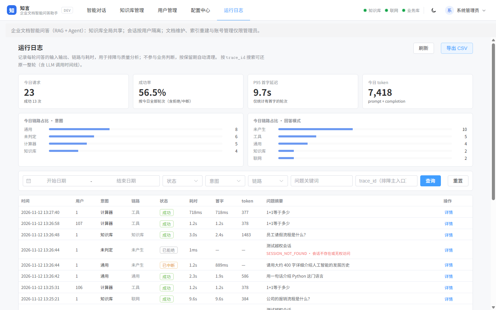
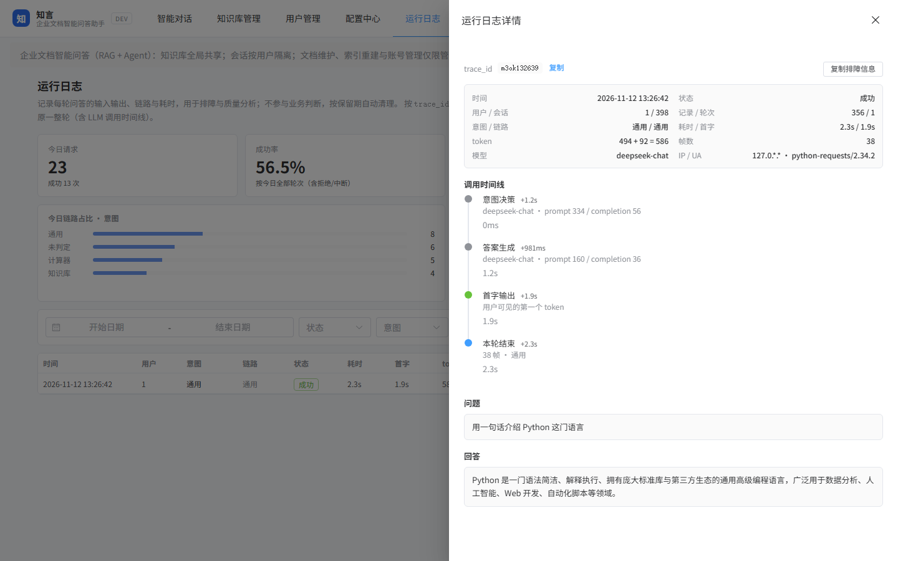
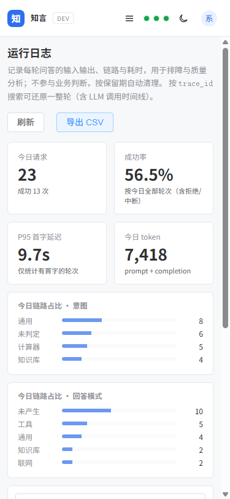
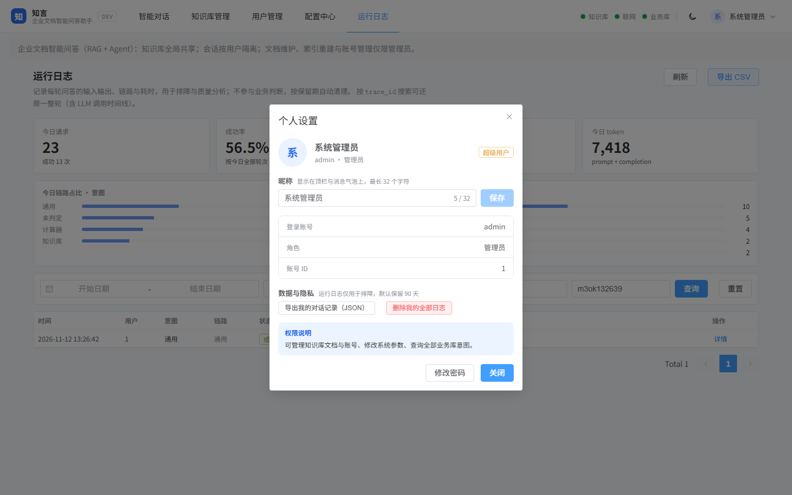
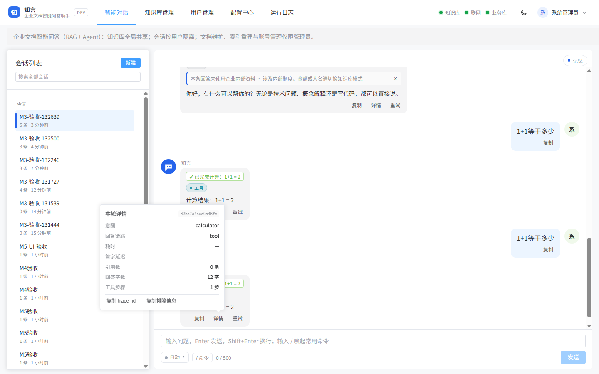
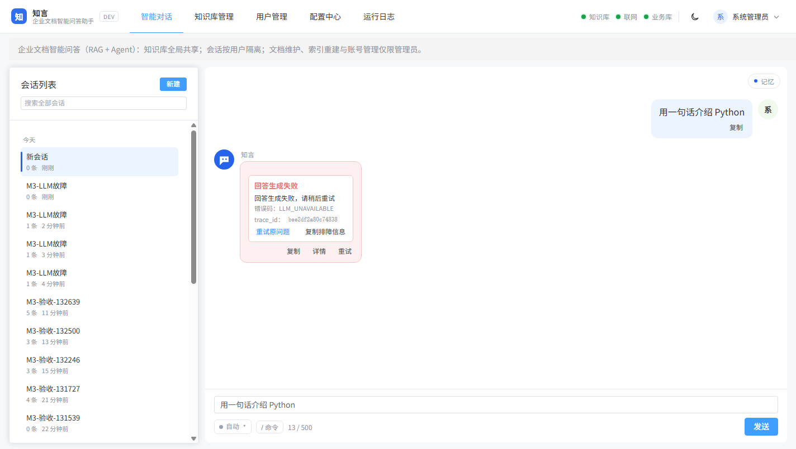

# M3 输入输出日志（WP3）验收报告

> 对应《RagKnowledge 能力增强需求文档 v3.md》(内部 v3.1) §5.1–§5.7、§8、§9.1–§9.2
> 验收时间：2026-11-12　环境：Windows 本机，后端 `127.0.0.1:8000`、前端 `127.0.0.1:5174`
> 结论：**通过（接口 34/34、UI 18/18、单测 225 passed / 1 skipped、§5.7 八条全部取证）**，可进入 M4（WP4 工作流 Agent）

---

## 一、阶段目标与交付结论

WP3 要解决的是**可追溯**：任何一次提问——成功、失败、中断、被拦截——都能查到“谁、何时、问了什么、答了什么、走了哪条链路、花了多少 token、为什么失败”。I/O 日志独立建表、独立保留期、独立权限，`operation_log` 的“不记录聊天内容”约束保持不变。

| 交付项 | 状态 | 证据 |
| --- | --- | --- |
| trace_id 全链路：前端生成 → `X-Trace-Id` → contextvar → done/error 帧回传 → 消息详情/错误卡片 | 完成 | 接口 ①/⑤/④；UI「详情」popover、ErrorState |
| 轮次级 `chat_io_log` + 调用级 `llm_call_log` 幂等建表与索引 | 完成 | `init_db.sql`、`services/io_log.py`；表存在性已核 |
| 有界队列异步写库（容量 1000，满则丢弃计数），不阻塞首字 | 完成 | `IO_LOG_QUEUE_MAX`；写库在 `instrumented_gen` finally |
| ok / abort / error / rejected 四类状态全覆盖 | 完成 | 接口 ①②④；LLM 故障专项 #3 |
| token 统计（流式 usage chunk）与首字延迟 | 完成 | 接口 ① token 586，两次调用分项误差 0.00%；UI 详情时间线 |
| 管理端查询/详情/导出/stats 四接口 + `IoLogView.vue` | 完成 | 接口 ③⑤；UI 18/18 + 截图 |
| 用户侧：消息详情、错误提示、JSON 导出、删除本人日志、删会话级联 | 完成 | 接口 ④/⑦/用户侧 1–5；UI 个人设置 |
| 保留期清理 | 完成 | `m3_retention.py`：注入 100 天前记录，清理后只剩当天 |
| 脱敏 | 完成 | 手机/身份证/邮箱/IP；`query/answer` 全文保留供排障 |

---

## 二、实现清单

### 2.1 数据模型（§5.3）

- `backend/init_db.sql`：新增 `chat_io_log`、`llm_call_log` 两表及 5 个索引（`user_time` / `trace` / `status` / `purpose`）。
- `backend/services/io_log.py`（新建）：`ensure_schema()` 幂等建表；`chat_io_log` 字段与需求一致：`trace_id/user_id/session_id/record_id/turn_index/intent/answer_mode/query/answer/status/error_code/error_msg/model/*_tokens/first_token_ms/elapsed_ms/frame_count/tool_chain/context_usage/ua/ip_masked`。

### 2.2 采集链路（§5.4）

- `backend/app_logging.py`：读取并规范化 `X-Trace-Id`（8–32 位安全字符，缺失则生成），写入 `contextvar`，并在响应头回写。
- `backend/llm.py`：
  - `chat(purpose=...)` / `chat_stream(purpose=...)` 自动记录 `llm_call_log`；
  - 流式请求带 `stream_options={"include_usage": True}`，从 `choices` 为空的最后一个 usage chunk 取 token；非流式直接读 `resp.usage`；
  - 记录 `status/error_code/latency_ms`，并把 usage 累计到本轮 `chat_io_log`。
- 调用点打标：`plan`（决策）、`replan`、`intent`（业务库意图识别）、`answer`（知识库/联网/通用三处）。
- `backend/routers/chat.py`：
  - `chat_stream(..., request)`：进入 SSE 前的 40402 校验失败写 `status=rejected`，并带真实 `user_id`；
  - `event_gen` 内 `meta` 收集轮次字段；`_token_frame` 第一次输出时记 `first_token_ms`；
  - `instrumented_gen` 统计 `frame_count`，`finally` 统一 `io_log.enqueue_turn(**meta)`，覆盖 ok/abort/error；
  - error 分支按 `ERR_LLM_UNAVAILABLE` 映射 `error_code=LLM_UNAVAILABLE`，error 帧带同一 `trace_id`。
- 非阻塞：`io_log._submit` 线程安全投递到有界队列（1000），worker 批量写库；队列满丢弃并计数，写库异常只 `logger.warning`，不影响问答。
- 脱敏：`mask_text`（手机/身份证/邮箱）、`mask_ip`；`query/answer` 保留全文（报告第六节明示）。

### 2.3 管理端与用户侧接口（§5.5–§5.6）

| 方法 | 路径 | 说明 |
| --- | --- | --- |
| GET | `/api/admin/io-logs` | 分页筛选：`user_id/start/end/status/intent/answer_mode/keyword/trace_id` |
| GET | `/api/admin/io-logs/{trace_id}` | 轮次详情 + 该 trace 全部 `llm_calls` + `tool_chain` |
| GET | `/api/admin/io-logs/stats` | 今日请求、成功率、P95 首字、token、意图/模式占比 |
| GET | `/api/admin/io-logs/export` | 同筛选条件导出 CSV，上限 1 万行，返回下载令牌 |
| GET | `/api/me/io-logs/export` | 导出本人全部记录（JSON 附件） |
| DELETE | `/api/me/io-logs` | 物理删除本人全部日志 |

- 删除会话时 `io_log.delete_session_logs` 级联删除该会话日志。
- 配置中心新增 `logs` 组 3 参数：`IO_LOG_ENABLED`（默认 true）、`IO_LOG_RETENTION_DAYS`（90）、`IO_LOG_QUEUE_MAX`（1000）；现共 **8 组 / 42 参数**。
- `main.py` lifespan：建表 → 启动写库 worker → 启动每日清理任务；关闭时 cancel。

### 2.4 前端

| 文件 | 内容 |
| --- | --- |
| `api/sse.js` | 生成短 trace、请求头 `X-Trace-Id`、错误对象携带服务端回传 trace |
| `api/ioLogs.js` | 管理端列表/详情/导出、用户侧导出/删除 |
| `views/IoLogView.vue` | 4 指标卡 + 意图/模式占比条 + 6 项筛选 + 表格 + 详情抽屉（阶段化时间线）+ 导出 CSV |
| `components/MessageBubble.vue` | footer「详情」popover：链路、耗时、首字延迟、引用数、字数、工具步骤、复制 trace/排障信息 |
| `components/ErrorState.vue` | 错误卡片展示错误码、trace_id、「复制排障信息」「重试原问题」 |
| `components/UserMenu.vue` | 个人设置「数据与隐私」：导出对话记录 JSON、删除全部日志 |
| `App.vue` | 管理端菜单新增「运行日志」 |
| `composables/useChat.js` | assistant 消息携带 `traceId/createdAt/first_token_ms` |

---

## 三、接口层验收（34/34 PASS）

脚本：`m3_io_api.py`（workspace），输出 `m3_run6.log`。SSE 一律按整段 `resp.text` 解析（规避 `iter_lines()` 多行拼接）；探针账号与自建会话按需创建，不触碰用户既有数据。

| # | 用例 | 结果 | 关键证据 |
| --- | --- | --- | --- |
| ①-1 | 正常问答落轮次日志 | PASS | `status=ok`，trace `m3ok133930` |
| ①-2 | 调用级日志 ≥1 条 | PASS | `plan` + `answer` 两条 |
| ①-3 | token 与调用分项一致 | PASS | 586 = 334+56 与 160+36，误差 0.00% |
| ①-4b | 日志 `query` 非空 | PASS | 问题摘要正常显示 |
| ②-1/2/3 | 生成中停止 | PASS | `status=abort`，answer 保留 37 字，elapsed 1202ms |
| ④-1/2/3 | 会话不存在 40402 | PASS | HTTP 404/业务码 40402，`status=rejected`，`user_id=1` |
| ⑤-1/2/3/4 | 知识库问答时间线 | PASS | `purposes=['plan','answer']`，首字 2437ms，elapsed 3000ms，tools=1 |
| ③ | 管理端 stats | PASS | `today_total=21, success_rate=52.4, today_tokens=6663` |
| ③-2 | 导出 CSV 返回链接 | PASS | `rows=1`，`ttl_minutes=0`、`expires_at=None` |
| ③-3 | 链接可下载 | PASS | HTTP 200 `text/csv`，412B |
| 用户侧 1–5 | 探针账号导出/删会话级联 | PASS | JSON 附件 1 条；删会话后 `left=0` |
| ⑦-1/2 | 删除本人日志 | PASS | `removed=1`，管理员按 user_id 查为 0（物理删除） |
| ⑥-1/2 | 日志表清空后问答不受影响 | PASS | frames=4，新一轮重新写入 1 条 |
| 开关 1–3 | 在线关闭日志 | PASS | 关闭后问答 frames=23、新日志 0 条 |

### 3.1 §5.7 第 3 条：LLM 不可用专项（补充取证）

利用 `LLM_API_KEY` 为空 + 非法 `LLM_BASE_URL` 重启后端，发一轮「通用直答」：

- SSE 事件序列：`notice` → `error`；error 帧 `{code: LLM_UNAVAILABLE, trace_id: m3err1794461866}`；
- `chat_io_log`：`status=error`、`error_code=LLM_UNAVAILABLE`、`error_msg=未配置 LLM_API_KEY，模型服务不可用`、`elapsed_ms=1968`；
- 前端 ErrorState 实测同一 trace `bee2df2a80c74838`：「错误码：LLM_UNAVAILABLE」「trace_id：…」「重试原问题 / 复制排障信息」。

> 该专项暴露出一个真实缺陷：`rag.stream_general` 原先把所有异常都降级成一句「模型服务暂时不可用」的正常 token，导致 `status=ok`，与“失败必须可追溯”冲突。已改为：`BizError(ERR_LLM_UNAVAILABLE)` 重新抛出，由 SSE 层发 error 帧并落 `status=error`；仅非模型不可用的异常才保留降级话术。

---

## 四、前端 UI 验收（18/18 PASS）

脚本：`m3_io_ui.py`（workspace），本机 Chrome headless + CDP(9351) 真实渲染，按 DOM/计算样式断言。

| # | 断言 | 结果 |
| --- | --- | --- |
| 1–4 | 运行日志页：标题、4 指标卡、表格真实行、表格不超宽 | PASS |
| 5 | 按 trace_id 过滤命中 1 行 | PASS |
| 6–8 | 详情抽屉：trace_id、时间线 ≥3 条、耗时/首字字段 | PASS |
| 9–10 | 375：无横向溢出、指标卡仍为 4 个 | PASS |
| 11–13 | 个人设置：数据与隐私区、导出/删除按钮、375 弹窗不溢出 | PASS |
| 14–16 | 消息「详情」入口、popover ≥5 指标行、popover 含 trace_id | PASS |

### 4.1 截图

运行日志 1440（4 指标卡、意图/模式占比、筛选、真实日志表格）：

详情抽屉（trace_id、token/首字、阶段化时间线、问题与回答原文）：

375 窄屏（两列指标卡 + 占比条，无横向溢出）：

个人设置「数据与隐私」（导出 JSON / 删除全部日志）：

消息 footer「详情」popover（链路/耗时/首字/引用/字数/工具步骤/复制 trace）：

LLM 故障错误卡片（错误码 + trace_id + 重试 + 复制排障信息）：

### 4.2 验收中发现并当场修复的问题

| 现象 | 根因 | 修复 |
| --- | --- | --- |
| 所有正常问答 SSE 在结束处断流，接口首轮 11/32 | `instrumented_gen` 引用了只在 `event_gen` 内定义的 `meta/token_parts` → `NameError` | 把 `started/token_parts/meta` 上移到 `chat_stream` 作用域 |
| 日志详情「问题」空白 | `meta` 未带 `query` | `meta["query"]=body.query`，并补断言 ①-4b |
| 占比条出现 `unknown` | 后端对 NULL 聚合为 `'unknown'` | 前端 `unknown/空 → 未判定 / 未产生` |
| 时间线顺序错（首字排在答案生成前） | 按“累计结束时间”排序 | 改为固定阶段顺序（决策→工具→答案→首字→结束），时间取调用开始 |
| 成功率卡片易误读 | 未说明分母 | 副标题改为「按今日全部轮次（含拒绝/中断）」 |
| `test_general_chat.py` 1 failed | 测试 `fake_stream` 不接 `purpose` 参数 | 改为 `**kwargs` 并记录 purpose |
| UI 截图残留抽屉/弹窗 | `document.body.click()` 关不掉 Element Plus overlay | 改点 `.el-drawer__close-btn` / `.el-dialog__headerbtn` 后重拍 |
| abort 断言偶发 FAIL | 批量写库有延迟，固定 sleep 不够 | 改 15 次轮询（0.4s/次） |
| ⑤ 知识库断言失败 | 用「报销流程」命中了联网兜底（无 answer 调用） | 改问「员工请假流程是什么？」，命中 `leave_policy.md` |

---

## 五、回归矩阵

| 项 | 命令 | 结果 |
| --- | --- | --- |
| 后端单测（全量） | `.\.venv\Scripts\python.exe -m pytest backend/tests -q` | **225 passed, 1 skipped**（6.13s） |
| 环境自检 | `.\.venv\Scripts\python.exe backend\scripts\check_env.py` | 全部通过 ✅（含未登录 401 鉴权校验） |
| 离线回归 | `pwsh -File backend\scripts\offline_regression.ps1` | `OFFLINE_REGRESSION = PASS` |
| 前端构建 | `npm run build` | EXIT=0，13.61s |
| 后端探活 | `GET /health` | `up`，日志正常写入 |
| 表存在性 | `chat_io_log` / `llm_call_log` | 已建，索引齐全 |

WP3 新增单测：`backend/tests/test_io_log.py` 7 项（脱敏、trace 规范化、队列满丢弃、usage 累计、导出/删除/保留期）；配置中心 3 参数与前端字段联动由 `test_app_config.py`、`test_admin_config_api.py` 锁定。

---

## 六、设计取舍与已知限制

1. **管理端导出是“请求内同步生成 + 长期有效下载令牌”**：§5.5 写的是“异步生成 + 下载链接”，实现改为同步生成 CSV（上限 1 万行，耗时有界）+ `export_store` 令牌，`ttl_minutes=0 / expires_at=None`，可重复下载。取舍原因：日志导出是排障动作，用户要“点完就能下”；有 1 万行硬上限，不会出现无界任务。与需求的措辞差异在此明示。
2. **日志含对话正文**：`query/answer` 全文保留（排障必需），只对手机号/身份证/邮箱/IP 脱敏；默认保留 90 天，超期由定时任务物理清理。管理员可见全员日志，普通用户只能导出/删除自己的记录。
3. **`llm_call_log.user_id` 可能为空**：它依赖 `io_log` 的 user contextvar，正常 chat 入口一定有值；脚本/后台任务直接调 `llm.chat` 时没有登录上下文，该列为 NULL。查询与统计按 `trace_id` 关联，不影响轮次归属。
4. **P95 首字 9.7s 偏高的原因**：今日样本里包含联网兜底（搜索 + 生成），拉高了分位值；知识库纯 RAG 样本首字约 2.4s。指标卡已标注“仅统计有首字的轮次”。
5. **工具步骤没有独立耗时**：`tool_chain` 只有工具名/状态/轮次，时间线把工具检索放在「决策之后、作答之前」，不伪造毫秒值；若后续需要精确工具耗时，应在工具执行层补埋点。
6. **队列满即丢弃**：高并发下允许丢日志保问答，丢弃计数只写应用日志、未暴露到管理端指标；如需告警可后续把计数加到 `stats`。
7. **验收遗留数据**：本轮创建了 `m3probe*` 探针账号与多条 `M3-验收-*` 会话/日志，未做整表清理（避免误删用户数据）；如需清理可按 `username LIKE 'm3probe%'` 定点删除。
8. **导出令牌不过期**：与用户此前“下载链接不要设置过期”的要求一致；令牌随机 32+ 位，仅本人可生成，风险可控。若后续要求强制过期，只需改 `export_store.create_export(ttl_minutes=...)`。

---

## 七、回滚方案

- 一键关闭：配置中心 `IO_LOG_ENABLED=false`，问答链路完全不受影响，不再写新日志（已有历史仍可查/导出）。
- 代码回退：删除 `routers/admin_io.py`、`routers/user_io.py`、`services/io_log.py` 的路由注册与 lifespan 调用，恢复 `chat.py` 的 `instrumented_gen` 包装即可；两张新表为独立表，不回滚也不影响业务表。
- 前端回退：移除 `IoLogView.vue` 菜单项、`MessageBubble` 的「详情」入口与 `UserMenu` 的数据与隐私区；`api/sse.js` 的 trace 头后端可忽略。

---

## 八、下一步

M4 = WP4 工作流 Agent（§6）：Planner / Executor / Reflector、状态机与持久化恢复、异步运行与订阅、前端任务视图、触发方式。按既定节奏，M4 完成后先交付验收报告，确认后再进入 M5。
