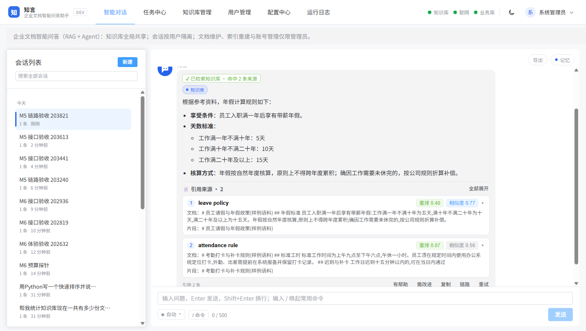
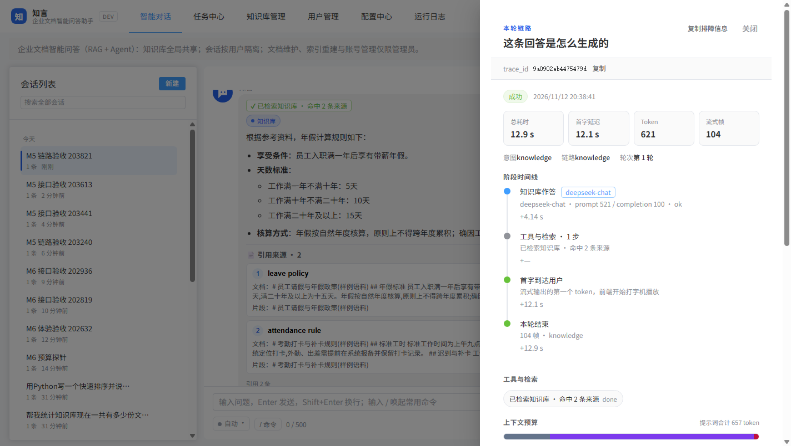
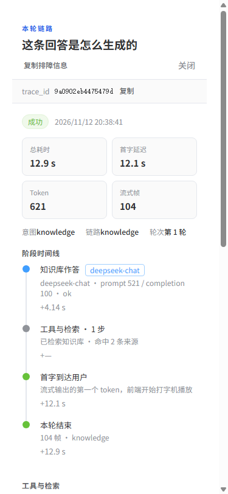
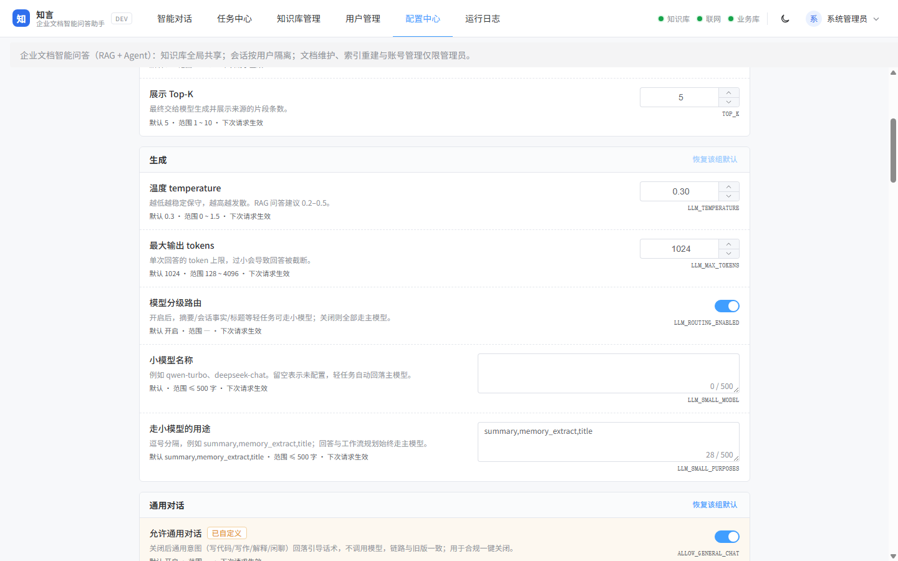

# M5 打磨（WP5-1 / WP5-2）验收报告

> 对应《RagKnowledge 能力增强需求文档 v3.md》(内部 v3.1) §10 M5、§6.1 WP5-1/WP5-2、§7 接口、§9 技术方案
> 验收时间：2026-11-12　环境：Windows 本机，后端 `127.0.0.1:8000`、前端 `127.0.0.1:5174`
> 结论：**通过（M5 接口 29/29、M5 UI 17/17、M4 回归 29/29 + UI 23/23、单测 238 passed / 1 skipped、前端 build EXIT 0、端到端演示脚本跑通）**，可进入下一版。

---

## 一、阶段目标与交付结论

M5 按要求只做 WP5-1（链路时间线查看器）与 WP5-2（模型分级路由），其余 WP5-3～WP5-10 留待下一版。HITL 确认门与任务中心列表在 M4 已完成，本轮做回归复核。

| 交付项 | 状态 | 证据 |
| --- | --- | --- |
| 用户本人 trace 详情接口，越权统一 40405 | 完成 | M5 接口 #1～#16 |
| 消息尾部「链路」入口 + 独立时间线抽屉 | 完成 | M5 UI 17/17；1440/375 截图 |
| 刷新/切页后历史消息仍可打开链路 | 完成 | `chat_record` 回填 `trace_id`；接口 #13 |
| 时间线展示模型调用、工具链、首字、总耗时 | 完成 | `m5-trace-drawer-1440.png` |
| 模型分级路由 3 个可在线配置参数 | 完成 | 配置中心 9 组 54 参数；接口 #17～#22 |
| 摘要/事实抽取传入 `purpose`，按用途选模型 | 完成 | `session_summary.py`、`session_fact.py`、`llm._model_for()` |
| 小模型失败自动回退主模型 | 完成 | 单测 `test_small_model_failure_falls_back_and_logs_primary` |
| 配置中心参数 54 项与前端渲染 | 完成 | `m5-config-routing-1440.png` |
| 全量回归 + 端到端演示 | 完成 | pytest 238、M4 回归、`m5_demo.py` |

---

## 二、实现清单

### 2.1 后端

| 文件 | 内容 |
| --- | --- |
| `backend/routers/user_io.py` | 新增 `GET /api/me/io-logs/{trace_id}`；只允许本人，他人/不存在统一 `40405` |
| `backend/errors.py` | 新增 `ERR_TRACE_NOT_FOUND = 40405` |
| `backend/services/chat_store.py` | 历史记录查询增加 `trace_id` 子查询，刷新后仍能回放链路 |
| `backend/config.py` | 新增 `LLM_ROUTING_ENABLED` / `LLM_SMALL_MODEL` / `LLM_SMALL_PURPOSES` |
| `backend/services/app_config.py` | 生成组新增 3 个 `ParamSpec`；参数数 51 → 54 |
| `backend/llm.py` | 新增 `_model_for(purpose)`；`chat/_log_call` 记录实际模型；小模型失败记错误日志后回落主模型 |
| `backend/services/session_summary.py` | `llm.chat(..., purpose="summary")` |
| `backend/services/session_fact.py` | `llm.chat(..., purpose="memory_extract")` |
| `backend/tests/test_llm_routing.py`（新建） | 4 个路由单测 + 1 个小模型失败回落单测 |
| `backend/tests/test_app_config.py` | 参数数断言 51 → 54 |

### 2.2 前端

| 文件 | 内容 |
| --- | --- |
| `components/TraceDrawer.vue`（新建） | 概览指标、阶段时间线、工具链、上下文注入、问题原文、复制排障信息；移动端满宽 |
| `components/MessageBubble.vue` | 「详情」popover 替换为「链路」入口 + `TraceDrawer` |
| `api/ioLogs.js` | 新增 `fetchMyTrace(traceId)` |
| `composables/useChat.js` | 历史回放映射 `trace_id` |

### 2.3 设计说明

- **链路查看器**复用 M3 的 `io_log.get_detail()` 数据结构，不额外落库；时间线基于 `llm_calls.latency_ms`、`tool_chain`、`first_token_ms`、`elapsed_ms` 组织，展示的是本轮实际发生的阶段，不伪造时间点。
- **隐私边界**：用户接口只返回 `chat_io_log.user_id == 当前用户` 的记录；他人 trace 与不存在 trace 都返回同一文案，避免通过错误差异探测他人日志。
- **模型分级**：`purpose` 在调用处显式传入；`_model_for()` 读取配置中心进程内缓存，未开启、未配置小模型、用途不匹配时一律回落主模型；小模型调用失败自动用主模型重试，并把失败与成功分别写入 `llm_call_log`，不牺牲回答体验。

---

## 三、M5 接口验收（29/29 PASS）

脚本：`m5_accept.py`（workspace），输出 `m5_accept_out.txt`；SSE 按整段报文解析。

| # | 用例 | 结果 | 关键证据 |
| --- | --- | --- | --- |
| 1 | 问答结束返回 trace_id | PASS | `done.trace_id` 存在 |
| 2 | 本人 trace 详情 200 | PASS | `code=0`，字段完整 |
| 3 | trace_id 与 done 帧一致 | PASS | 同值 |
| 4 | 轮次状态 ok | PASS | `status=ok` |
| 5 | 问题原文正确 | PASS | 原文一致 |
| 6 | 耗时与首字有值 | PASS | `elapsed_ms` / `first_token_ms` |
| 7 | token 汇总有值 | PASS | `total_tokens > 0` |
| 8 | 工具链已记录 | PASS | `tool_chain` 至少 1 条 |
| 9 | 上下文注入已记录 | PASS | `context_usage` 非空 |
| 10 | LLM 时间线已记录 | PASS | `llm_calls` 至少 1 条 |
| 11 | 调用含用途/模型/耗时 | PASS | `purpose` / `model` / `latency_ms` |
| 12 | 调用状态 ok | PASS | `status=ok` |
| 13 | 历史回放带 trace_id | PASS | `/api/chat/record/{sid}` 末条与 trace 一致 |
| 14 | 不存在 trace 返回 40405 | PASS | HTTP 404 / code 40405 |
| 15 | 他人 trace 统一 40405 | PASS | member 访问 admin trace 同码同文案 |
| 16 | 未登录访问 40101 | PASS | HTTP 401 |
| 17 | 配置中心 9 组 54 参数 | PASS | 组数/参数数一致 |
| 18 | 模型分级开关存在 | PASS | `LLM_ROUTING_ENABLED` |
| 19 | 小模型名称存在 | PASS | `LLM_SMALL_MODEL` |
| 20 | 小模型用途存在 | PASS | `LLM_SMALL_PURPOSES` |
| 21 | 三项归属生成组 | PASS | `generation` |
| 22 | 默认未配置小模型 | PASS | 空字符串，自动回落主模型 |
| 23 | 默认用途含摘要/事实抽取 | PASS | `summary,memory_extract,title` |
| 24 | 分级用途可在线保存 | PASS | PUT `code=0` |
| 25 | 保存后立即生效 | PASS | `current=summary`、`overridden=true` |
| 26 | 恢复默认成功 | PASS | POST reset `code=0` |
| 27 | 恢复后回到默认值 | PASS | 值与 `overridden` 均还原 |
| 28 | 任务中心列表接口回归 | PASS | `/api/workflow/list` 正常 |
| 29 | 任务中心有历史任务 | PASS | 列表非空 |

---

## 四、M5 UI 验收（17/17 PASS）

脚本：`m5_ui.py`，使用本机 Chrome headless + CDP（9354），显式 `Page.navigate`，截图见 §六。

| 用例 | 结果 | 证据 |
| --- | --- | --- |
| 新会话出现在列表 | PASS | 接口造数后 UI 可见 |
| 历史消息已回填 | PASS | assistant 气泡 ≥1 |
| 消息尾部有「链路」入口 | PASS | `.trace-trigger` |
| 链路抽屉打开 | PASS | 可见 `.el-drawer` |
| 抽屉标题正确 | PASS | 「这条回答是怎么生成的」 |
| trace_id 与接口一致 | PASS | 同值 |
| 4 个耗时指标 | PASS | 总耗时/首字/Token/帧数 |
| 时间线包含阶段 | PASS | 模型作答/工具/首字/结束 |
| 工具链已展示 | PASS | `.td-tool` ≥1 |
| 1440 抽屉无横向溢出 | PASS | `scrollWidth-clientWidth ≤ 1` |
| 375 抽屉满宽不裁切 | PASS | 宽度 ≤ 375 且 ≥360 |
| 375 抽屉无横向溢出 | PASS | 同上 |
| 375 指标两列布局 | PASS | 4 个指标卡 |
| 配置中心参数数 54 | PASS | `.param-row` = 54 |
| 模型分级路由开关存在 | PASS | 页面文案 |
| 小模型名称参数存在 | PASS | 页面文案 |
| 小模型用途参数存在 | PASS | 页面文案 |

---

## 五、回归与端到端

| 项目 | 结果 | 命令/脚本 |
| --- | --- | --- |
| 后端单测 | **238 passed / 1 skipped（6.32s）** | `.venv\Scripts\python.exe -m pytest backend\tests -q` |
| 前端构建 | **EXIT 0（13.53s）** | `npm run build` |
| M4 接口回归 | **29/29** | `m4_accept.py` |
| M4 UI 回归（HITL + 任务中心） | **23/23** | `m4_ui.py` |
| M5 端到端演示 | **DEMO OK** | `m5_demo.py` |

端到端演示链路：

```text
登录 admin
→ 新建会话 421
→ 知识库问答完成（trace=c5dde82c0c554eda，耗时 2531ms）
→ 本人链路详情：1 次模型调用、1 个工具步骤、token=621
→ 配置中心模型分级：开关 True、参数总数 54
→ 任务计划 #41：awaiting_confirm、2 步（HITL 待确认）
→ 任务执行结束：completed、报告 346 字
→ DEMO OK
```

---

## 六、截图

### 6.1 消息尾部「链路」入口（1440）



### 6.2 链路时间线抽屉（1440）



可见：总耗时 2.28s、首字 1.84s、Token 624、107 帧；模型 `deepseek-chat`、prompt 521 / completion 103；工具链 1 步；上下文注入。

### 6.3 链路抽屉（375）



抽屉满宽、指标两列、无横向溢出。

### 6.4 配置中心模型分级（1440）



---

## 七、本轮发现并修复的问题

| # | 现象 | 根因 | 修复 |
| --- | --- | --- | --- |
| 1 | 刷新/切页后消息点开「链路」没有 trace_id，抽屉取不到数据 | 历史记录 API 只返回 `chat_record` 字段，未带 trace | `chat_store.list_records` 增加 `chat_io_log.trace_id` 子查询；`useChat` 映射 `traceId` |
| 2 | 新增配置参数后后端导入失败 | `ParamSpec` 不支持 `max_length` 字段 | 删除不支持的 `max_length`，保留类型与描述 |
| 3 | 小模型回落时可能重复写错误日志 | 内外两层异常都记录 | 仅小模型失败时记一条错误，主模型失败由外层统一记 |
| 4 | 小模型/用途配置无实际调用点 | `session_summary` / `session_fact` 未传 `purpose` | 两处显式传 `summary` / `memory_extract` |

---

## 八、边界与后续

1. **小模型名称默认留空**：为避免把不存在的模型名写死到不同 Provider 环境，默认不配置；在配置中心填入与当前 Provider 兼容的小模型（如 `qwen-turbo`）后生效。未配置时所有调用仍走主模型。
2. **标题提炼仍是规则实现**：`LLM_SMALL_PURPOSES` 默认包含 `title` 是为后续接入预留；当前 `session_title.py` 不调 LLM，所以 `title` 暂无实际路由效果。
3. **时间线精度**：模型调用耗时来自 `llm_call_log.latency_ms`，工具链无独立耗时，按「模型调用之后、首字之前」展示；不伪造绝对时间戳。
4. **未做项**：WP5-3 反馈闭环、WP5-4 上下文预算面板、WP5-5 会话导出、WP5-6 配额限流、WP5-7 提示词版本化、WP5-8 事实冲突提示、WP5-9 会话 pin/归档、WP5-10 依据强度标注，均按需求文档建议留待下一版。

---

## 九、交付文件

| 类型 | 路径 |
| --- | --- |
| 验收报告 | `M5 打磨验收报告.md` |
| 接口脚本/输出 | workspace `m5_accept.py`、`m5_accept_out.txt` |
| UI 脚本/输出 | workspace `m5_ui.py`、`m5_ui_out.txt` |
| 端到端演示 | workspace `m5_demo.py`、`m5_demo_out.txt` |
| 单测日志 | workspace `m5_pytest.log` |
| 截图 | `docs/m5-screens/`（4 张） |
| M4 回归日志 | workspace `m5_m4_regression.txt`、`m5_m4_ui_regression.txt` |
