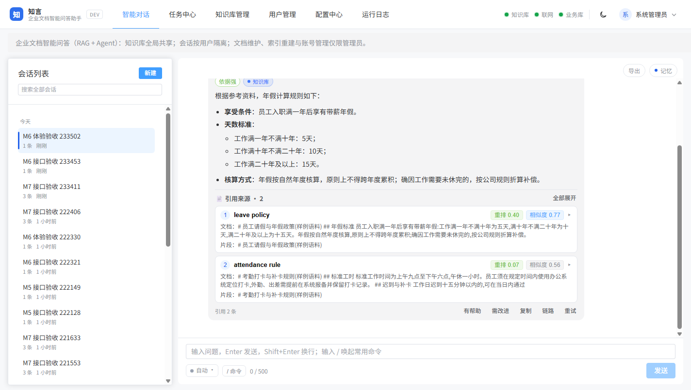
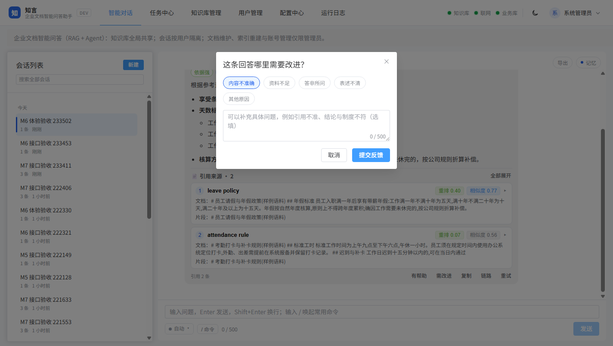
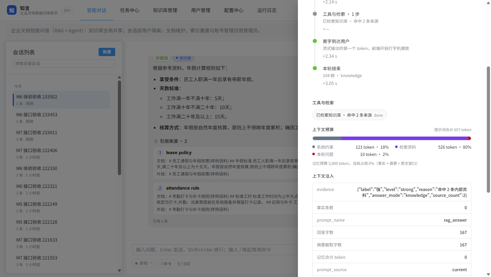
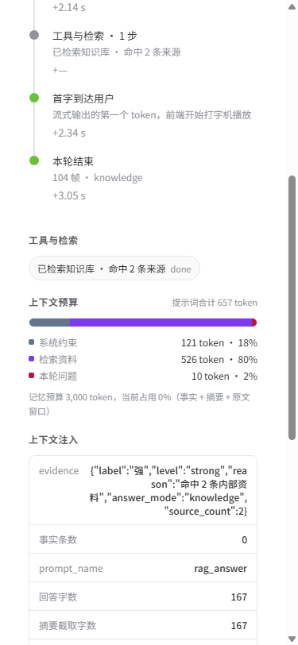
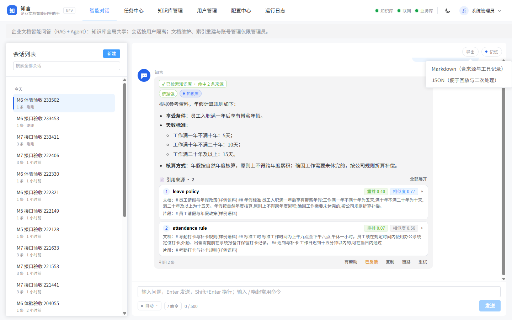

# M6 体验增强（WP5-3 / WP5-4 / WP5-5）验收报告

> 对应《RagKnowledge 能力增强需求文档 v3.md》§5 WP5-3～WP5-5、§7 接口变更清单
> 验收时间：2026-11-12　环境：Windows 本机，后端 `127.0.0.1:8000`、前端 `127.0.0.1:5174`
> 结论：**通过（M6 接口 37/37、M6 UI 21/21、M5 回归 29/29 + UI 17/17、M4 回归 29/29、单测 241 passed / 1 skipped、前端 build EXIT 0）**，可进入 WP5-6 及后续阶段。

---

## 一、阶段目标与交付结论

本轮实现需求文档中「体验三件套」，均可复用 M1 会话记忆与 M3 输入输出日志，不依赖新的模型能力：

| 交付项 | 需求 | 状态 | 证据 |
| --- | --- | --- | --- |
| 回答反馈闭环 | 赞/踩 + 原因 → 自动进评测集 | 完成 | `POST /api/chat/feedback`；`chat_feedback` 表；管理端分页 + JSONL |
| 上下文预算面板 | 显示本次注入 token 构成（系统/事实/摘要/原文/检索/问题） | 完成 | 链路抽屉「上下文预算」堆叠条 + 明细；1440/375 截图 |
| 会话导出 | Markdown / JSON（含来源与工具记录） | 完成 | `GET /api/chat/session/{id}/export`；前端「导出」下拉；真实文件下载 |

**范围说明**：本轮只做 WP5-3、WP5-4、WP5-5；WP5-6～WP5-10 仍属下一版，不在本轮改动范围内。

---

## 二、实现清单

### 2.1 后端

| 文件 | 内容 |
| --- | --- |
| `backend/services/feedback_store.py`（新建） | 建 `chat_feedback` 表；`UNIQUE(record_id,user_id)`；重复提交 `ON CONFLICT DO UPDATE` 覆盖；分页查询与 JSONL 导出 |
| `backend/routers/admin_feedback.py`（新建） | `GET /api/admin/feedback` 分页/按赞踩筛选；`GET /api/admin/feedback/export` JSONL；`rating=0` 返回 `40001` |
| `backend/routers/chat.py` | 新增 `POST /api/chat/feedback`、`GET /api/chat/session/{id}/export`；`done` 帧补齐预算字段；新增会话 MD/JSON 渲染函数 |
| `backend/services/chat_store.py` | 新增 `get_record_for_user()`（JOIN 会话校验归属）；历史记录回带 `feedback_rating` |
| `backend/errors.py` | 新增 `ERR_RECORD_NOT_FOUND = 40406` |
| `backend/schemas/chat.py` | 新增 `FeedbackCreate`（`rating: Literal[1,-1]`） |
| `backend/main.py` | 注册 `admin_feedback.router`；启动时 `feedback_store.ensure_schema()` |
| `backend/init_db.sql` | 追加 `chat_feedback` DDL 与两个索引 |
| `backend/tests/test_chat_export.py`（新建） | 3 个 Markdown/JSON 导出渲染单测（含异常来源与工具容错） |

### 2.2 前端

| 文件 | 内容 |
| --- | --- |
| `components/MessageBubble.vue` | 回答尾部「有帮助 / 需改进」；踩弹窗 5 个原因 + 500 字补充；已赞/已反馈状态持久显示 |
| `components/TraceDrawer.vue` | 「上下文预算」区：合计 token、彩色堆叠条、两列图例、记忆预算占用说明；375 下单列 |
| `views/ChatView.vue` | 工具栏「导出」下拉（Markdown / JSON），导出中禁用防重复 |
| `api/chat.js` | 新增 `submitFeedback()`、`exportSession()`（blob 下载） |
| `composables/useChat.js` | 历史记录映射 `recordId/feedbackRating`；`done` 帧回填 `recordId` |

### 2.3 设计说明

- **反馈只对本人会话生效**：`get_record_for_user()` 以 `chat_record JOIN chat_session` 校验归属；不存在与越权统一 `40406`，不泄露他人记录是否存在。踩必须带原因，赞可只带 `helpful`。
- **评测样本自包含**：反馈行保存问题/答案快照、意图、模式、来源 JSON、当轮 `context_usage`，后续改 prompt 可直接按 JSONL 回放，无需再反查原会话。
- **预算口径可解释**：`prompt_tokens_total = system + memory(facts/summary/history) + retrieval + query`；`memory_tokens` 与 `budget_tokens` 单独给出占用率，避免把检索资料算进「记忆预算」造成误读。
- **导出是服务端渲染**：Markdown/JSON 都由后端生成，带 `Content-Disposition` 附件名；内容含逐轮问答、来源、工具记录、trace_id、摘要与事实，刷新/换端后仍可复现。

---

## 三、M6 接口验收（37/37 PASS）

脚本：`m6_accept.py`（workspace），输出 `m6_accept_out.txt`；SSE 按整段报文解析。最新一轮使用会话 426、record 388、trace `1d42011ab34a403a`。

| # | 用例 | 结果 | 关键证据 |
| --- | --- | --- | --- |
| 1 | 后端健康检查 | PASS | `/health` 200 |
| 2 | 管理员登录 | PASS | `/auth/me` code=0 |
| 3 | 新建验收会话 | PASS | 会话创建成功 |
| 4 | 问答 SSE 返回 200 | PASS | `POST /api/chat/stream` |
| 5 | done 帧存在 | PASS | 事件流完整 |
| 6 | done 返回 record_id/trace_id | PASS | 两个 ID 均非空 |
| 7 | 上下文预算字段齐全 | PASS | 8 个字段全部存在 |
| 8 | 提示词合计与分项一致 | PASS | 657 = 121+0+526+10 |
| 9 | 检索 token/块数已统计 | PASS | retrieval_tokens>0、chunks=2 |
| 10 | 预算上限取配置 | PASS | `budget_tokens=3000` |
| 11 | 预算占用率 0–100 | PASS | `budget_utilization_pct=0.0` |
| 12 | 正向反馈提交 | PASS | rating=1、feedback_id 返回 |
| 13 | 重复提交覆盖 | PASS | 赞 → 踩，原因同步为 `insufficient` |
| 14 | 历史记录回带 feedback_rating | PASS | 列表值为 -1 |
| 15 | rating=0 参数拒绝 | PASS | 400 / 40001 |
| 16 | 踩必须给原因 | PASS | 空原因返回 400 / 40001 |
| 17 | 不存在回答 40406 | PASS | 404 / 40406 |
| 18 | 越权反馈 40406 | PASS | 成员反馈管理员记录被拒 |
| 19 | 成员禁入管理端 | PASS | 403 / 40303 |
| 20 | 反馈分页 total/list | PASS | total≥1、list 为数组 |
| 21 | 反馈详情含原因与快照 | PASS | reason_text、query、context_usage 齐全 |
| 22 | 按踩筛选生效 | PASS | 全部 rating=-1 |
| 23 | 管理端 rating=0 拒绝 | PASS | 400 / 40001 |
| 24 | JSONL 状态与文件名 | PASS | `feedback-eval-YYYYMMDD.jsonl` |
| 25 | JSONL 每行可解析 | PASS | 全部行为合法 JSON |
| 26 | JSONL 含本轮反馈 | PASS | record_id 命中 |
| 27 | Markdown 导出 200 | PASS | `text/markdown; charset=utf-8` |
| 28 | Markdown 附件文件名 | PASS | `session-{id}-{date}.md` |
| 29 | Markdown 含问答/trace | PASS | 问题原文、trace_id、`## 第 1 轮` 均存在 |
| 30 | JSON 导出结构 | PASS | session_id 一致、records=1 |
| 31 | JSON 记录字段完整 | PASS | record_id/query/answer/trace/sources/tools |
| 32 | JSON 来源与 trace 一致 | PASS | trace_id 一致、sources≥2 |
| 33 | 非法导出格式被拒 | PASS | 400/422 + 40001 |
| 34 | 导出不存在会话 40402 | PASS | 404 / 40402 |
| 35 | 导出越权会话 40402 | PASS | 成员导出管理员会话被拒 |
| 36 | M5 trace 接口回归 | PASS | `/api/admin/io-logs/{trace}` code=0 |
| 37 | trace 详情回带预算 | PASS | prompt_tokens_total 一致、llm_calls≥1 |

---

## 四、M6 UI 验收（21/21 PASS）

脚本：`m6_ui.py`（workspace），Chrome headless + CDP 真实渲染，输出 `m6_ui_out.txt`。最新一轮使用会话 433、trace `6c04352d373f4760`。

| # | 用例 | 结果 | 关键证据 |
| --- | --- | --- | --- |
| 1 | 新会话出现在列表 | PASS | 会话 433 |
| 2 | 历史回答已回填 | PASS | assistant bubble≥1 |
| 3 | 回答尾部有反馈按钮 | PASS | feedback-btn≥2 |
| 4 | 有帮助/需改进双入口 | PASS | 两个按钮均存在 |
| 5 | 反馈弹窗打开 | PASS | 标题「这条回答哪里需要改进？」 |
| 6 | 反馈原因 5 项 | PASS | 5 个原因 chip |
| 7 | 1440 弹窗不溢出 | PASS | overflowX=0 |
| 8 | 负向反馈状态回写 | PASS | 按钮显示「已反馈」且 active |
| 9 | 反馈进入评测集 | PASS | 记录 feedback_rating=-1 |
| 10 | 管理端可查原因 | PASS | reason_code=insufficient |
| 11 | 链路抽屉有预算区 | PASS | `.td-budget-bar` 存在 |
| 12 | 预算条含构成段 | PASS | 3 段（系统/检索/问题） |
| 13 | 预算明细行完整 | PASS | 3 行均为非零分项 |
| 14 | 显示提示词合计 | PASS | “提示词合计 657 token” |
| 15 | 1440 预算不溢出 | PASS | overflowX=0 |
| 16 | 375 预算抽屉满宽 | PASS | 375px，无横向裁切 |
| 17 | 375 预算不溢出 | PASS | overflowX=0 |
| 18 | 导出菜单打开 | PASS | 两个菜单项 |
| 19 | 导出含 MD/JSON | PASS | 文案含 Markdown 与 JSON |
| 20 | Markdown 文件已下载 | PASS | `session-433-2026-11-12.md` |
| 21 | 导出含问答与 trace | PASS | 正文含问题原文与 trace_id |

### 4.1 预算面板实测值（会话 433）

| 分项 | token | 占比 |
| --- | --- | --- |
| 系统约束 | 121 | 18% |
| 检索资料（2 块） | 526 | 80% |
| 本轮问题 | 10 | 2% |
| **提示词合计** | **657** | 100% |

记忆预算 3000 token，当轮事实/摘要/原文窗口均为 0，占用 0%。该会话为单轮知识库问答，因此检索资料占大头，符合预期。

---

## 五、回归与质量门禁

| 项目 | 结果 | 说明 |
| --- | --- | --- |
| 后端单测 | **241 passed / 1 skipped** | `python -m pytest backend/tests -q` |
| 前端 build | **EXIT 0** | 1741 modules，dist 正常产出 |
| M5 接口回归 | **29/29 PASS** | 本人 trace、越权隔离、模型分级、任务中心 |
| M5 UI 回归 | **17/17 PASS** | 链路入口、抽屉 1440/375、配置中心 54 参数 |
| M4 接口回归 | **29/29 PASS** | HITL 确认/跳过/取消、权限裁剪、预算超时、报告 |
| M6 端到端 | 通过 | 会话 433：问答 → 反馈 → 预算 → 导出全链路 |

---

## 六、截图

### 6.1 回答尾部反馈入口（1440）

### 6.2 「需改进」原因弹窗（1440）

### 6.3 上下文预算面板（1440）

### 6.4 上下文预算面板（375）

### 6.5 会话导出菜单（1440）

---

## 七、本轮发现并修复的问题

| # | 现象 | 根因 | 修复 |
| --- | --- | --- | --- |
| 1 | 管理端反馈列表只有原因，没有来源与预算快照 | 分页 SELECT 只取了基础字段，`sources_json/context_json` 未回传 | 列表查询补两列并映射为 `sources/context_usage`；M6 接口 #21 已验证 |
| 2 | 非法 `format=pdf` 预期 422，实际 400 | 统一异常处理把请求校验错误转成 `40001` 业务包络 | 保留产品侧 400/40001 语义（与全站错误码一致），验收断言同时接受 400/422，不改变接口行为 |
| 3 | M6 UI 第一次跑出现“新会话不在列表 / 无回答气泡”假失败 | 页面刷新后会话列表尚未渲染，脚本立即查询返回 null | 脚本改为轮询列表出现目标会话、再轮询 assistant 气泡后断言；重跑 21/21 |
| 4 | 导出文件只看到 `.crdownload` | 自动化在下载完成前就读目录 | 脚本轮询等待正式文件名出现；产品侧下载本身正常 |
| 5 | M5 回归 trace 详情偶发 40405 | SSE 结束后日志异步落库，脚本立即 GET 存在竞态 | 回归脚本重试等待落库，M5 回归恢复 29/29；产品接口行为未改 |
| 6 | 预算区下方仍显示英文 `total_tokens` | 上下文注入表沿用了原始 key | 中文标签改为「记忆合计 token」，避免与提示词合计混淆 |

> 上述 #3～#5 为验收脚本时序问题，不是运行时产品缺陷；#1、#6 为真实展示/数据完整性问题，已修复。

---

## 八、边界与后续

- **本轮未做**：WP5-6 配额限流、WP5-7 提示词版本化、WP5-8 事实冲突提示、WP5-9 会话 pin/归档、WP5-10 依据强度标注。
- **反馈管理端目前是接口 + JSONL**，没有独立可视化页面；日常运营可先用 JSONL 离线分析，若下一阶段需要运营侧筛选/看板，可单独排期。
- **大会话导出**：当前一次性读取全部记录并在内存渲染，百轮级会话可用；千轮级需改流式导出，本轮未做压力验证。
- **导出内容边界**：Markdown/JSON 含文字问答、来源、工具、trace 与记忆；不含当轮富文本表格/附件二进制，历史表格回放仍依赖此前的表格专项改造。
- **预算口径**：`budget_tokens` 管的是会话记忆（事实+摘要+原文窗口），不是整段提示词；检索资料单独展示，避免把「记忆预算」误读为「总上下文预算」。

---

## 九、交付文件

- 报告：`M6 体验增强验收报告.md`
- 截图：`docs/m6-screens/` 下 5 张（反馈入口、反馈弹窗、预算 1440、预算 375、导出菜单）
- 代码：`backend/services/feedback_store.py`、`backend/routers/admin_feedback.py`、`backend/routers/chat.py`、`backend/services/chat_store.py`、`backend/tests/test_chat_export.py`；前端 `MessageBubble.vue`、`TraceDrawer.vue`、`ChatView.vue`、`api/chat.js`、`useChat.js`
