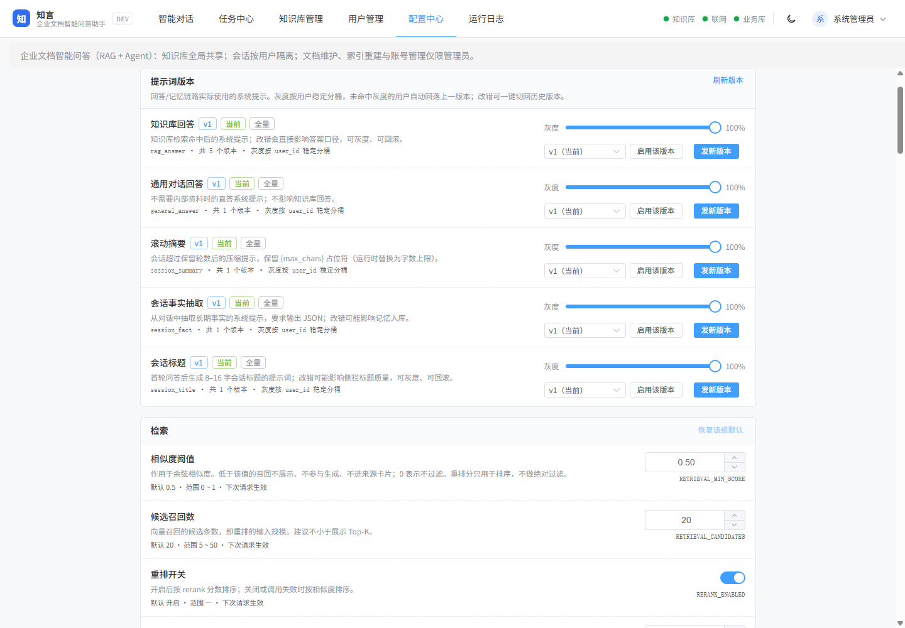
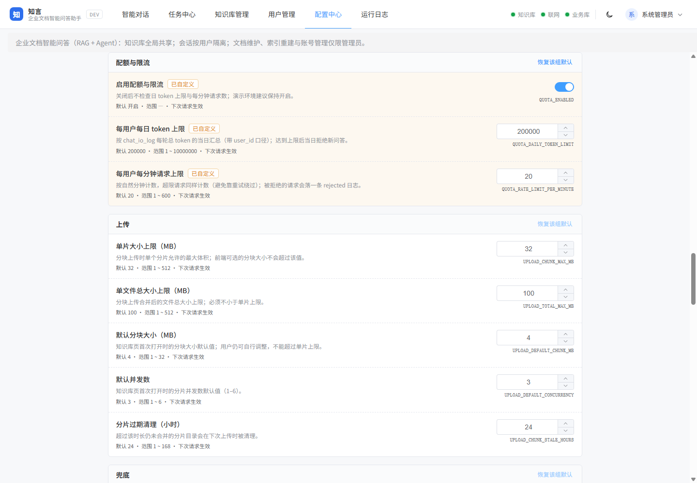
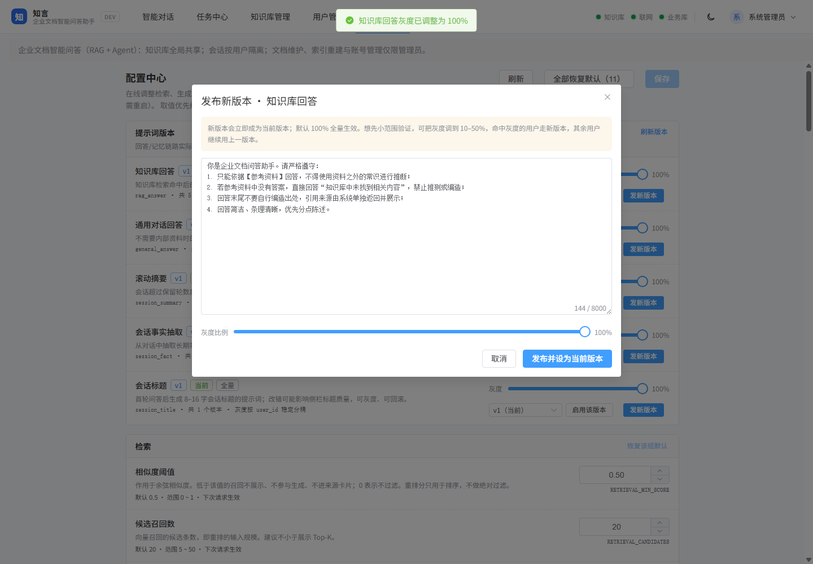
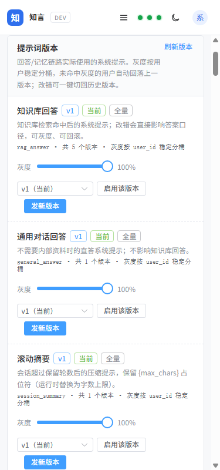

# M7 治理能力验收报告（WP5-6 / WP5-7）

> 项目：RagKnowledge（企业文档智能问答 RAG + Agent）
> 阶段：v3 需求文档 M7 —— 配额限流 + 提示词版本化
> 验收日期：2026-11-12
> 结论：**通过**。接口 34/34、UI 25/25、M6 回归 37/37 + UI 21/21、M5 回归 29/29、M4 回归 29/29、pytest 245 passed / 1 skipped、前端 build EXIT 0。

---

## 一、本阶段做了什么

v3 需求文档对 WP5-6、WP5-7 各只有一句话，本阶段把这两句话落成可配置、可观测、可回滚的完整能力：

| 需求项 | 落地结果 |
|---|---|
| WP5-6 每用户日 token 配额 + 每分钟请求限流 | 配置中心新增「配额与限流」组（3 个参数），问答入口在 SSE 建立前拦截，超限返回 429 业务包络，并落 `rejected` 运行日志 |
| WP5-7 提示词版本化表 + 版本号 + 灰度开关 | 新增 `prompt_template` 版本表与管理接口；4 个真实生效提示词支持发版、灰度、回滚；回答 done 帧回带版本、灰度与命中来源 |

### 1.1 配额与限流

新增配置（均可在配置中心在线改、下一条请求生效）：

| 参数 | 默认值 | 范围 | 说明 |
|---|---:|---|---|
| `QUOTA_ENABLED` | true | 开关 | 关闭后完全跳过配额与限流检查 |
| `QUOTA_DAILY_TOKEN_LIMIT` | 200000 | 1–10,000,000 | 每用户每日 token 上限 |
| `QUOTA_RATE_LIMIT_PER_MINUTE` | 20 | 1–600 | 每用户每分钟问答请求上限 |

实现要点：

- **拦截位置**：`POST /api/chat/stream` 在「会话归属校验通过」之后、建立 SSE 之前做 gate。被拒绝的请求不会开始 LLM 调用，也不会产生半截回答。
- **分钟窗口**：`chat_rate_window` 表按 `(user_id, window_start)` 主键做 `INSERT ... ON CONFLICT DO UPDATE request_count + 1 ... RETURNING`，原子计数，跨进程、重启不丢；被拒绝的请求也计数，防止“被限流后无限重试”。
- **日 token 口径**：按 `chat_io_log` 当日 `total_tokens` 按 `user_id` 汇总。`llm_call_log.user_id` 在线程化 LLM 调用中实测全为 NULL，不能作为用户级统计口径；`chat_io_log` 每轮带 `user_id` 和按 trace 聚合后的总 token，是当前唯一可靠的用户级口径。
- **可用性优先**：配额服务自身异常时放行本次请求，并且只告警一次，避免数据库抖动被放大成全站不可用。
- **拒绝可观测**：超限时先写 `chat_io_log`（`status=rejected`，`error_code=RATE_LIMITED / QUOTA_EXCEEDED`，`user_id` 为当前登录用户），再返回 HTTP 429：

```json
{"code": 42902, "msg": "请求过于频繁（每分钟最多 20 次），请稍后再试", "data": {}}
{"code": 42901, "msg": "今日 token 配额已用完（25342/200000），请明日再试或联系管理员调整上限", "data": {}}
```

- **历史窗口清理**：每分钟最多清理一次 2 天前的窗口行，表不会无限增长。

### 1.2 提示词版本化与灰度

表结构 `prompt_template`：

| 字段 | 类型 | 说明 |
|---|---|---|
| `prompt_id` | BIGSERIAL | 主键 |
| `name` | VARCHAR(64) | 提示词标识 |
| `version` | INTEGER | 版本号，同一 name 单调递增 |
| `content` | TEXT | 完整提示词正文 |
| `gray_percent` | SMALLINT | 当前版本灰度比例 0–100 |
| `is_active` | BOOLEAN | 同一 name 仅一条为 true，表示当前目标版本 |
| `created_by` | BIGINT | 发版管理员 |
| `created_at / updated_at` | TIMESTAMP | 审计时间 |

约束：`UNIQUE(name, version)`，索引 `idx_prompt_name_active(name, is_active)`。

灰度算法：

```text
bucket = sha1(f"{name}:{user_id}") % 100
bucket < gray_percent  -> 命中灰度，走当前版本
否则                    -> 回落“版本号小于当前版本的最大历史版本”
```

同一用户在同一个提示词上始终落同一桶，不会在灰度期间来回跳版本；没有历史版本时仍使用当前版本。

只登记 4 个**实际接入链路**的提示词，避免出现“界面能改、线上不生效”的假配置：

| name | 界面名称 | 接入位置 |
|---|---|---|
| `rag_answer` | 知识库回答 | 知识库检索命中后的回答 system prompt |
| `general_answer` | 通用对话回答 | 不需要内部资料时的直答 system prompt |
| `session_summary` | 滚动摘要 | 会话压缩摘要，运行时替换 `{max_chars}` |
| `session_fact` | 会话事实抽取 | 长期事实抽取，要求输出 JSON |

其他机制：

- 启动时 `ensure_schema()` 幂等建表，并为 4 个提示词补齐默认 v1（100% active），空库也能直接用。
- 读取侧 5 秒进程内缓存；管理端发版 / 调灰度 / 回滚后立即失效，保证“改完下一条请求生效”。
- 提示词存储异常时回落到代码默认，不击穿回答。
- 管理接口全部 `require_admin`，并写审计日志：

| 方法 | 路径 | 作用 |
|---|---|---|
| GET | `/api/admin/prompts` | 列出 4 个提示词的当前版本、灰度与全部历史版本 |
| POST | `/api/admin/prompts/{name}/versions` | 发新版本并设为当前版本 |
| PATCH | `/api/admin/prompts/{name}/gray` | 只调当前版本灰度 |
| POST | `/api/admin/prompts/{name}/activate` | 把指定历史版本设为当前版本（回滚） |

- 回答 done 帧 `context_usage` 新增：`prompt_name`、`prompt_version`、`prompt_current_version`、`prompt_gray_percent`、`prompt_source`（`current` / `base` / `default`）；`system_tokens` 按实际生效提示词估算，预算面板口径与真实提示词一致。

### 1.3 前端

配置中心新增「提示词版本」卡片（位于参数组之前，与普通参数分离）：

- 每个提示词展示：名称、当前版本标签、灰度状态标签、说明、`name`、版本总数。
- 0–100 滑杆调灰度，10% 步进，改完自动保存并刷新。
- 版本下拉 + 「启用该版本」一键回滚。
- 「发新版本」弹窗：正文编辑（最多 8000 字）+ 灰度比例，默认 100%。
- 移动端（≤720px）提示词行改为纵向布局，控件不超出卡片，页面无横向溢出。

配置页说明文案同步加入「配额限流」。

---

## 二、验收结果

### 2.1 M7 接口验收：34/34 PASS

脚本：`m7_accept.py`（workspace），不清理既有数据，只新增本轮会话与提示词版本，配置改动在用例内恢复。

| # | 用例 | 结果 |
|---:|---|---|
| 1 | 后端健康检查 | PASS |
| 2 | 管理员登录并取 admin_id | PASS |
| 3 | 配置中心包含「配额与限流」组 | PASS |
| 4 | 配置总数 57 | PASS |
| 5–7 | 3 个配额参数均存在 | PASS ×3 |
| 8 | `QUOTA_ENABLED` 默认 true | PASS |
| 9 | `QUOTA_DAILY_TOKEN_LIMIT` 默认 200000 | PASS |
| 10 | `QUOTA_RATE_LIMIT_PER_MINUTE` 默认 20 | PASS |
| 11 | 提示词列表接口成功 | PASS |
| 12 | 恰好登记 4 个生效提示词 | PASS |
| 13 | 每个提示词有当前版本与历史 | PASS |
| 14 | 发布 `rag_answer` 新版本成功 | PASS |
| 15 | 新版本成为当前版本（100%） | PASS |
| 16 | 问答返回 done 帧 | PASS |
| 17 | 灰度 100 时命中新版本（`source=current`） | PASS |
| 18 | 灰度改为 0 成功 | PASS |
| 19 | 灰度 0 时回落上一版本（`source=base`） | PASS |
| 20 | 回滚到基础版本成功 | PASS |
| 21 | 回滚后当前版本正确 | PASS |
| 22 | 灰度 101 返回 400/40001 | PASS |
| 23 | 未知提示词返回 400/40001 | PASS |
| 24 | 不存在版本返回 400/40001 | PASS |
| 25 | 空提示词内容返回 400/40001 | PASS |
| 26 | 成员访问提示词管理 403/40303 | PASS |
| 27 | 日配额可在线调小 | PASS |
| 28 | 日配额耗尽返回 429/42901 | PASS |
| 29 | 配额拒绝提示含配额信息 | PASS |
| 30 | 分钟限流可在线调小 | PASS |
| 31 | 超频请求返回 42902 | PASS |
| 32 | 限流/配额拒绝落 `rejected` 日志 | PASS |
| 33 | 配额总开关可关闭 | PASS |
| 34 | 关闭配额后问答恢复 200 | PASS |

### 2.2 M7 UI 验收：25/25 PASS

脚本：`m7_ui.py`（Chrome headless + CDP，真实渲染 Vue 页面并读取 DOM）。

| # | 用例 | 结果 |
|---:|---|---|
| 1 | 管理员可进入配置中心 | PASS |
| 2 | 提示词卡片渲染 4 行 | PASS |
| 3 | 4 个提示词名称齐全 | PASS |
| 4 | 每行都有灰度滑杆 | PASS |
| 5 | 每行都有版本下拉 | PASS |
| 6 | 当前灰度均为 100% | PASS |
| 7 | 每行都有「发新版本」入口 | PASS |
| 8 | 「启用该版本」按钮可用 | PASS |
| 9 | 配置参数共 57 项 | PASS |
| 10 | 1440 页面无横向溢出 | PASS |
| 11 | 存在「配额与限流」组 | PASS |
| 12 | 配额组 3 个参数 | PASS |
| 13 | 3 个参数键正确 | PASS |
| 14 | 拖动滑杆后灰度数值变化 | PASS |
| 15 | 非 100% 灰度显示提示标签 | PASS |
| 16 | 灰度改动已落库（与后端一致） | PASS |
| 17 | 灰度可恢复 100% | PASS |
| 18 | 发新版本弹窗打开 | PASS |
| 19 | 弹窗带已填写的提示词正文 | PASS |
| 20 | 弹窗默认灰度 100% | PASS |
| 21 | 弹窗 1440 不溢出 | PASS |
| 22 | 弹窗可取消关闭 | PASS |
| 23 | 375 提示词行改为纵向 | PASS |
| 24 | 375 控件不超出卡片 | PASS |
| 25 | 375 页面无横向溢出 | PASS |

截图：









### 2.3 旧阶段回归

| 回归 | 结果 |
|---|---|
| M6 接口（反馈闭环 / 上下文预算 / 导出） | 37/37 PASS |
| M6 UI（反馈入口与弹窗、预算面板、导出菜单） | 21/21 PASS |
| M5 接口（链路查看器、模型分级、任务中心） | 29/29 PASS（配置总数断言由 9 组 54 参数更新为 10 组 57 参数） |
| M4 接口（工作流 Agent 全链路） | 29/29 PASS |
| 后端单测 | 245 passed, 1 skipped（6.16s） |
| 前端构建 | EXIT 0，1742 modules，13.96s |

M7 改动没有破坏 M4 工作流、M5 链路与模型分级、M6 反馈/预算/导出链路。

---

## 三、开发中发现并修复的问题

| # | 现象 | 根因 | 修复 |
|---:|---|---|---|
| 1 | 日配额调成 1 后，问答仍返回 200 SSE | 初版按 `llm_call_log.user_id` 汇总，但该列在线程化 LLM 调用中实际全为 NULL（219 行、122458 token 全落在 NULL 用户下） | 改为按 `chat_io_log` 当日 `total_tokens` + `user_id` 汇总；该表每轮有真实用户归属，且 token 已按 trace 聚合 |
| 2 | 配置页配额说明仍写 `llm_call_log` | 口径切换后文案未同步 | 配置项 desc 改为「按 chat_io_log 每轮总 token 的当日汇总」 |
| 3 | 验收脚本在 200 SSE 响应上调用 `.json()` 中断 | 脚本默认所有响应都是 JSON 包络 | 先判断 `content-type`，非 JSON 时按空对象处理，保留“拒绝提示含配额信息”断言 |
| 4 | 单测 2 项失败：配置组集合、摘要 fake 签名 | M7 新增 `quota` 组后旧断言未更新；`_llm_summary` 新增 `user_id` 参数 | 更新组集合断言为 10 组；fake 函数补 `user_id` 形参 |
| 5 | UI 验收取不到提示词行 / 弹窗 | `:first-child` 选中了卡片头部而非第一行；标题内 `innerText` 带换行 | 改为 `querySelector('.prompt-card .prompt-row')`，名称匹配去掉空白 |
| 6 | M5 回归断言 9 组 54 参数失败 | M7 合法新增 1 组 3 参数 | 回归脚本期望改为 10 组 57 参数，其余 M5 用例全通过 |

---

## 四、已知边界

1. **日配额是“已落库用量”口径**：`chat_io_log` 由异步写入器落库，极端情况下上一轮日志尚未写完时，下一次检查可能少算一轮；即“最多多放行一轮”，不会少放行。没有做预扣，避免失败请求占掉用户额度。
2. **日配额按轮次总量计**：`chat_io_log.total_tokens` 是该轮所有 LLM 调用（回答、摘要、事实抽取、工具规划等）的总和，不是只算回答模型；这正是“用户当天真实消耗”的语义。
3. **分钟限流按自然分钟**：窗口边界重置，不做滑动窗口；当前实现跨进程原子，工程上更稳。
4. **提示词只开放 4 个已接入项**：新增提示词仍需在 `PROMPT_REGISTRY` 登记并接入链路后才出现在管理端，避免“能改不生效”。
5. **管理员不豁免**：管理员同样受配额与限流约束，便于验收与自测；如需“管理员免限流”，可作为后续配置项扩展。
6. **灰度回落只回落到上一历史版本**：若管理员把 v1 设为当前版本、同时存在更高版本，灰度回落基线是“小于当前版本的最大历史版本”；当前版本若已是最老版本，则没有回落版本。
7. **验收数据**：接口验收创建的 `rag_answer` 临时版本已在验收后清理，4 个提示词恢复为 v1 / 100% / active；配置项恢复为默认 200000 / true / 20。

---

## 五、下一阶段建议

v3 剩余未开发项：

- WP5-8 会话事实冲突提示
- WP5-9 会话 pin / 归档
- WP5-10 依据强度标注

建议下一阶段优先 WP5-10「依据强度标注」：它直接提升回答可信度，且可复用现有检索分数、来源卡片与预算面板；WP5-8/9 更偏会话管理体验，可放在同一阶段的后半段。
