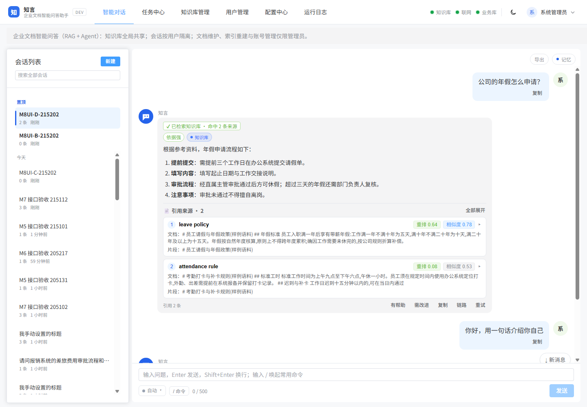
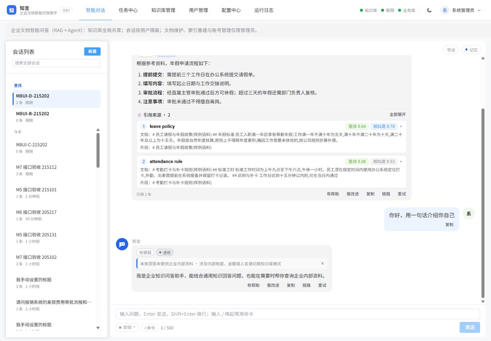
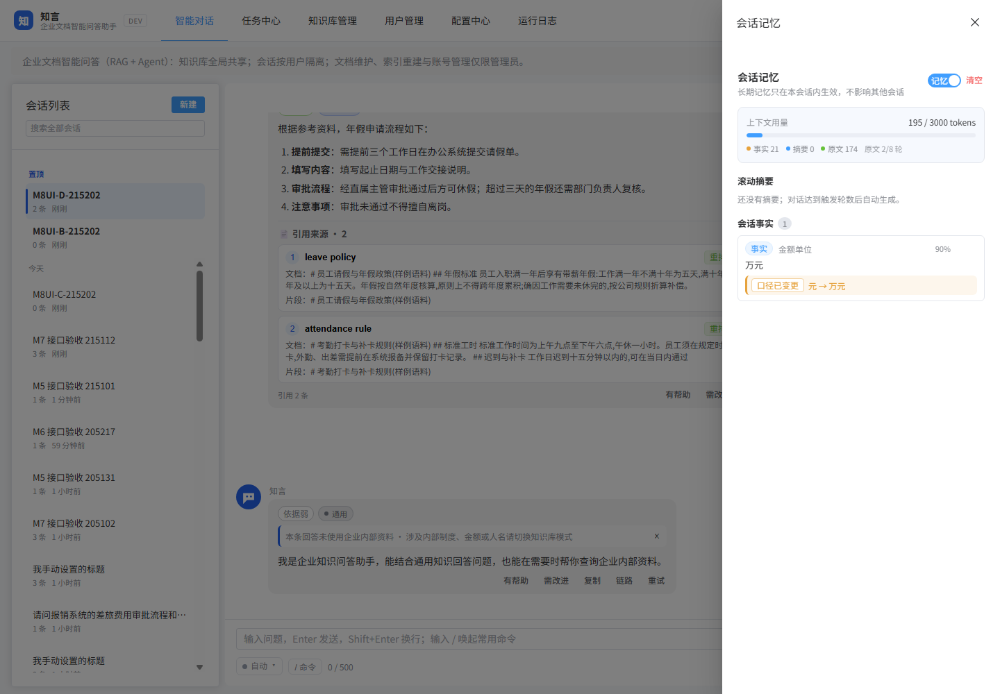
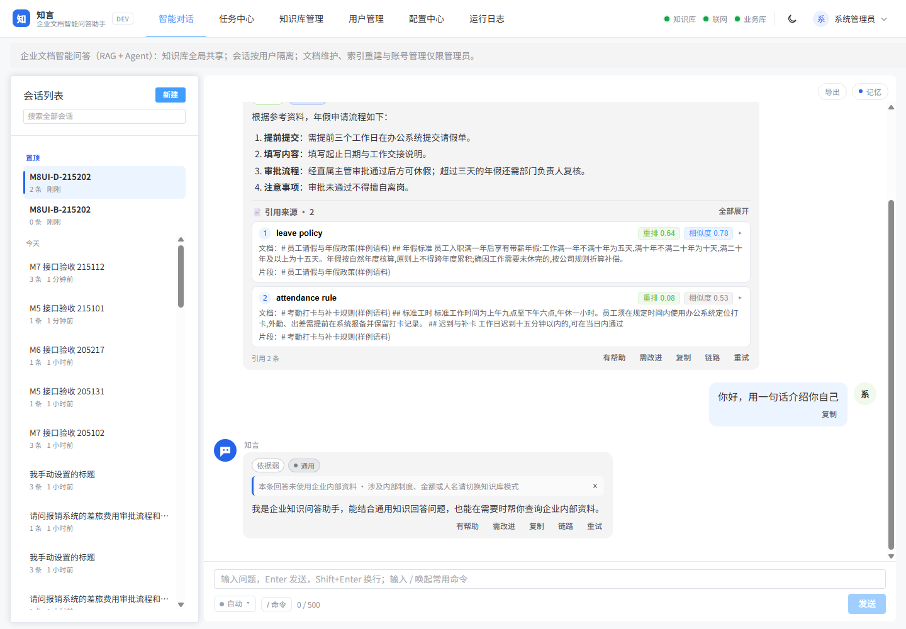
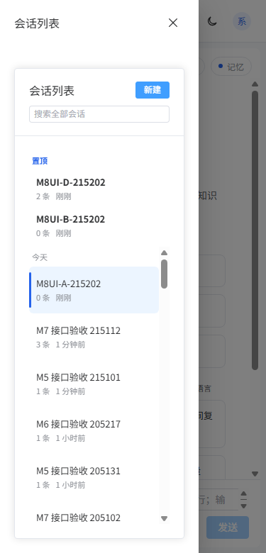
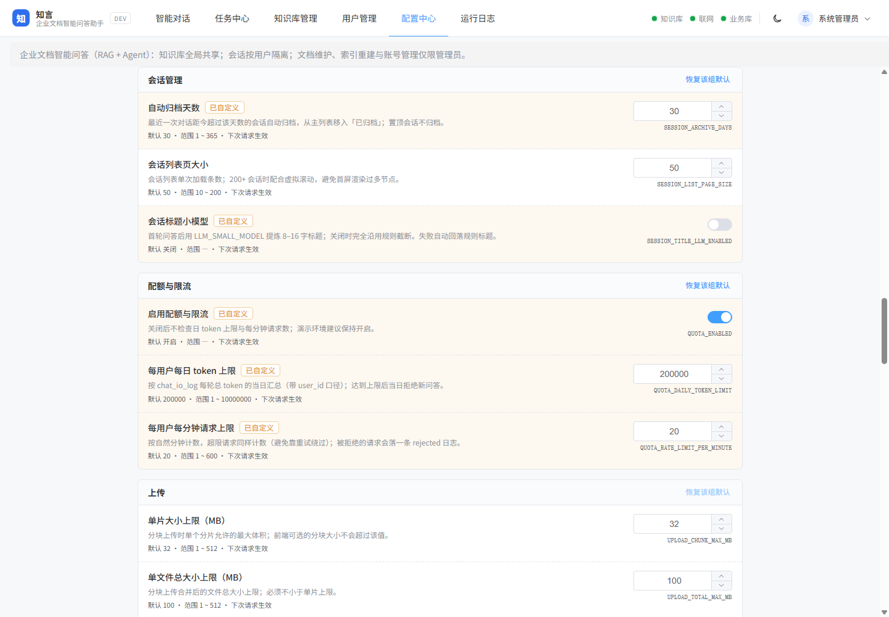

# M8 会话体验与可信度验收报告（WP5-8 / WP5-9 / WP5-10）

> 项目：RagKnowledge（企业文档智能问答 RAG + Agent）
> 阶段：v3 需求文档 M8 —— 会话事实冲突提示 + 会话置顶/归档 + 回答依据强度
> 验收日期：2026-11-12
> 结论：**通过**。接口 38/38、UI 31/31、M7 回归 34/34 + UI 25/25、M6 回归 37/37 + UI 21/21、M5 回归 29/29、M4 回归 29/29、pytest 255 passed / 1 skipped、前端 build EXIT 0。

---

## 一、本阶段做了什么

需求文档第 783–785 行对三项能力各只有一句话，第 905 行要求事实冲突「面板可见可删、同 key 冲突提示」。本阶段把三句话落成可配置、可观测、可回归的完整能力：

| 需求项 | 落地结果 |
|---|---|
| WP5-8 会话事实冲突提示 | `session_memory` 新增 `previous_value / value_changed_at`；同 key 真正改值才保留上一版；记忆面板显示「口径已变更 旧值 → 新值」 |
| WP5-9 会话 pin / 归档 | `chat_session` 新增 `is_pinned / archived_at / last_active_at`；侧栏置顶组、已归档折叠区、置顶/归档/恢复接口、按天数自动归档 |
| WP5-10 回答「依据强度」 | 新增 `evidence.assess()` 纯函数；done 帧、历史回放、会话导出统一回带「依据强 / 依据中 / 依据弱」 |

### 1.1 WP5-8 会话事实冲突提示

表结构（幂等补列）：

| 字段 | 类型 | 说明 |
|---|---|---|
| `previous_value` | TEXT NULL | 同一 `fact_key` 上一版值；首写或同值覆盖为 NULL |
| `value_changed_at` | TIMESTAMP NULL | 最近一次真正改值时间；无变更为 NULL |

判定规则：

- 首写：`previous_value = NULL`，不提示变更。
- 同值覆盖（含首尾空格归一）：`previous_value = NULL`，不提示变更，避免每轮重复抽取同一事实都弹「已变更」。
- 不同值：保留上一版，写 `value_changed_at = now()`，接口回带 `previous_value`。

前端 `MemoryItem.vue` 在事实值下方渲染：

```text
[口径已变更]  元 → 万元
```

旧值支持 tooltip 与两行截断，长文本不会撑破面板。事实仍可单条删除、可清空，置信度门槛仍为 0.6。

### 1.2 WP5-9 会话置顶 / 归档

表结构：

| 字段 | 类型 | 说明 |
|---|---|---|
| `is_pinned` | BOOLEAN NOT NULL DEFAULT FALSE | 置顶标记 |
| `archived_at` | TIMESTAMP NULL | 归档时间；NULL 表示在主列表 |
| `last_active_at` | TIMESTAMP NULL | 最近活跃时间，启动时按历史记录回填 |

索引：`idx_chat_session_active (user_id, archived_at, is_pinned, last_active_at DESC)`。

列表语义：

- 主列表：`archived_at IS NULL`，排序 `is_pinned DESC, last_active_at DESC, session_id DESC`。
- 归档列表：`archived_at IS NOT NULL`，排序 `archived_at DESC, session_id DESC`。
- 响应新增 `archived / archived_total`；每条会话新增 `last_active_at / is_pinned / archived_at`。

新增配置：

| 参数 | 默认值 | 范围 | 说明 |
|---|---:|---|---|
| `SESSION_ARCHIVE_DAYS` | 30 | 1–365 | 最近一次对话距今超过该天数的会话自动归档；置顶会话不归档 |

自动归档：

- 在读取主列表前按当前配置执行，异常只忽略、不影响列表。
- 条件：`archived_at IS NULL AND is_pinned = FALSE AND COALESCE(last_active_at, create_time) < now() - days`。
- 归档同时取消置顶；归档会话收到新消息时由 `insert_record` 自动清空 `archived_at`，回到主列表。

接口：

| 方法 | 路径 | 说明 |
|---|---|---|
| GET | `/api/chat/session/list?archived=false\|true` | 主列表或归档列表，返回 `archived_total` |
| PATCH | `/api/chat/session/{id}/pin` | body `{"pinned": true\|false}` |
| PATCH | `/api/chat/session/{id}/archive` | body `{"archived": true\|false}` |

不存在与越权统一 `40402`；参数错误沿用 `40001`，本阶段未新增错误码。

前端：

- 侧栏「置顶」组固定在日期分组之前，支持 ★ 取消置顶 / ⇩ 归档 / ✎ 重命名 / 🗑 删除。
- 普通会话支持 ☆ 置顶 / ⇩ 归档。
- 「已归档 N」折叠区按需加载，显示「归档于 …」，点击条目直接恢复。
- 会话列表自身滚动、header 固定；1440 与 375 抽屉均可用。

### 1.3 WP5-10 回答依据强度

判定口径（`backend/services/evidence.py`）：

| answer_mode | 条件 | 等级 |
|---|---|---|
| `knowledge` | 内部来源 ≥ 2 | 强 |
| `knowledge` | 内部来源 = 1 | 中 |
| `knowledge` | 内部来源 = 0 | 弱 |
| `biz_query` | 返回结构化表格 | 强 |
| `biz_query` | 未返回数据 | 中 |
| `tool` | 内部工具计算 | 中 |
| `web / general / chat / fallback_*` | — | 弱 |
| 其他未知模式 | 按来源数 2 / 1 / 0 映射 | 强 / 中 / 弱 |

接入点：

- SSE done 帧新增顶层 `evidence_strength`，同时写入 `context_usage.evidence`。
- 历史记录 `GET /api/chat/record/{session_id}` 的每条记录新增 `evidence`，按 `answer_mode + source_ref 数 + table_payload` 实时计算，未新增 `chat_record` 列。
- 会话导出 Markdown 增加「依据强度：强（命中 2 条内部资料）」，JSON 增加 `evidence`。
- 前端 `EvidenceBadge.vue` 显示「依据强 / 依据中 / 依据弱」（success / warning / info），tooltip 展示原因与来源数；消息详情新增「依据强度」行。

---

## 二、验收结果

### 2.1 M8 接口验收：38/38 PASS

脚本：`m8_accept.py`（requests + SSE done 帧解析 + 真实数据库校验）。

| # | 用例 | 结果 |
|---:|---|---|
| 1 | 后端 `/health` 200 | PASS |
| 2 | 管理员登录成功 | PASS |
| 3 | 配置中心包含「会话管理」组 | PASS |
| 4 | 配置总数 58 | PASS |
| 5 | `SESSION_ARCHIVE_DAYS` 默认 30 | PASS |
| 6 | 会话列表返回 `archived_total` | PASS |
| 7 | 新增 3 个临时会话 | PASS |
| 8 | 置顶接口成功 | PASS |
| 9 | 置顶会话排在列表首位 | PASS |
| 10 | 列表回带 `is_pinned` | PASS |
| 11 | 取消置顶成功 | PASS |
| 12 | 取消置顶后不再排首位 | PASS |
| 13 | 归档接口成功 | PASS |
| 14 | 归档后从主列表移除 | PASS |
| 15 | 归档列表包含该会话 | PASS |
| 16 | 归档列表回带 `archived_at` | PASS |
| 17 | 主列表 `archived_total` 增加 | PASS |
| 18 | 归档会话置顶返回 404/40402 | PASS |
| 19 | 恢复接口成功 | PASS |
| 20 | 恢复后回到主列表 | PASS |
| 21 | 归档会话收到新消息自动恢复 | PASS |
| 22 | 400 天未活跃会话自动归档 | PASS |
| 23 | 置顶会话不自动归档 | PASS |
| 24 | 自动归档进入归档列表 | PASS |
| 25 | 他人会话置顶返回 404/40402 | PASS |
| 26 | 首次写事实无变更提示 | PASS |
| 27 | 同 key 改写带回旧值（元 → 万元） | PASS |
| 28 | 同值重复写入不算口径变更 | PASS |
| 29 | 记忆接口回带 `previous_value` | PASS |
| 30 | 记忆接口回带 `value_changed_at` | PASS |
| 31 | 知识库问答返回 done 帧 | PASS |
| 32 | 知识库依据强度与命中数一致 | PASS |
| 33 | done 帧 `context_usage.evidence` 同步 | PASS |
| 34 | 通用回答依据为弱 | PASS |
| 35 | 历史记录回放 `evidence` | PASS |
| 36 | 会话导出包含依据强度 | PASS |
| 37 | 临时会话已清理 | PASS |
| 38 | 清理后无本轮基线变化 | PASS |

关键实测数据：

```text
知识库问答：answer_mode=knowledge, source_count=2,
evidence={"level":"strong","label":"强","reason":"命中 2 条内部资料"}
通用问答：answer_mode=general, evidence={"level":"weak","label":"弱"}
事实冲突：fact_value=万元, previous_value=元, value_changed_at 非空
自动归档：SESSION_ARCHIVE_DAYS=365 时，400 天未活跃且未置顶的会话归档；
          400 天未活跃但置顶的会话仍在主列表
```

### 2.2 M8 UI 验收：31/31 PASS

脚本：`m8_ui.py`（Chrome headless + CDP，真实渲染 Vue 页面并读取 DOM）。

| # | 用例 | 结果 |
|---:|---|---|
| 1 | 侧栏存在「置顶」分组 | PASS |
| 2 | 置顶分组含本轮 2 个会话 | PASS |
| 3 | 点击置顶按钮后后端 `is_pinned=true` | PASS |
| 4 | 可选中置顶会话 | PASS |
| 5 | 消息区渲染依据强度徽标 | PASS |
| 6 | 知识库回答显示「依据强」 | PASS |
| 7 | 通用回答显示「依据弱」 | PASS |
| 8 | 徽标 tooltip 含来源/原因 | PASS |
| 9 | 截图：依据强度 1440 | PASS |
| 10 | 截图：依据弱 1440 | PASS |
| 11 | 记忆面板出现「口径已变更」 | PASS |
| 12 | 提示显示「元 → 万元」 | PASS |
| 13 | 事实条目可见 | PASS |
| 14 | 截图：会话记忆面板 1440 | PASS |
| 15 | UI 归档确认生效 | PASS |
| 16 | 已归档区展开 | PASS |
| 17 | 已归档区显示本轮归档会话 | PASS |
| 18 | 归档项显示「归档于 …」 | PASS |
| 19 | 截图：置顶分组 1440 | PASS |
| 20 | 截图：已归档区 1440 | PASS |
| 21 | 点击归档项可恢复会话 | PASS |
| 22 | 375 可打开会话抽屉 | PASS |
| 23 | 375 抽屉保留置顶分组 | PASS |
| 24 | 375 抽屉保留已归档入口 | PASS |
| 25 | 375 无横向溢出 | PASS |
| 26 | 截图：375 会话抽屉 | PASS |
| 27 | 配置页有「会话管理」组 | PASS |
| 28 | 会话管理组 1 个参数 `SESSION_ARCHIVE_DAYS` | PASS |
| 29 | 配置参数共 58 项 | PASS |
| 30 | 1440 配置页无横向溢出 | PASS |
| 31 | 截图：会话管理配置组 1440 | PASS |

### 2.3 截图














### 2.4 数据库与启动核验

| 检查项 | 结果 |
|---|---|
| 后端启动 `/health` | 200，`db_ready=true` |
| `chat_session` 新列 | `is_pinned / archived_at / last_active_at` 均存在 |
| `session_memory` 新列 | `previous_value / value_changed_at` 均存在 |
| `last_active_at` 回填 | `WHERE last_active_at IS NULL` 计数为 0 |
| 现有会话状态 | 最近 8 个会话均 `is_pinned=false`、`archived_at IS NULL`、活跃日期 2026-11-12 |
| 自动归档配置 | `app_config` 无 `SESSION_ARCHIVE_DAYS` 行，走代码默认 30；验收临时行已删除 |
| M7 配额配置 | `QUOTA_ENABLED=true`、`QUOTA_DAILY_TOKEN_LIMIT=200000`、`QUOTA_RATE_LIMIT_PER_MINUTE=20` |
| M8 临时数据 | `M8%` / `M8UI%` 会话计数均为 0 |

### 2.5 旧阶段回归

| 回归 | 结果 |
|---|---|
| M7 接口（配额限流 / 提示词版本化） | 34/34 PASS（57 → 58 参数断言已同步） |
| M7 UI（提示词卡片 / 配额组） | 25/25 PASS（57 → 58 参数断言已同步） |
| M6 接口（反馈闭环 / 上下文预算 / 导出） | 37/37 PASS |
| M6 UI（反馈入口与弹窗、预算面板、导出菜单） | 21/21 PASS |
| M5 接口（链路查看器 / 模型分级 / 任务中心） | 29/29 PASS（10 组 57 → 11 组 58 参数断言已同步） |
| M4 接口（工作流任务 / 权限裁剪 / 预算） | 29/29 PASS |
| 后端单测 | 255 passed, 1 skipped（5.31s） |
| 前端生产构建 | EXIT 0，1744 modules，17.31s |

构建产物：`dist/assets/index-CHBKxN2R.css`、`dist/assets/index-CApwzdHL.js`、`ui-vendor-CrdajAJu.js` 等；仅保留原有 >500KB chunk 警告。

---

## 三、本阶段发现并修复的问题

| # | 现象 | 根因 | 修复 |
|---:|---|---|---|
| 1 | 前端 build 失败：`EvidenceBadge.vue (23:1): Invalid end tag` | 新组件文件缺少 `<script setup>` 起始标签 | 补齐 `<script setup>`，重跑 build EXIT 0 |
| 2 | 事实值首尾空格会被误判为「口径变更」 | 初始判定直接比较未归一值 | 新增 `detect_change()`：先 `strip()` 再比较，同值覆盖不提示 |
| 3 | 独立验收脚本直连存储层时报 `Psycopg cannot use ProactorEventLoop` | Windows 默认事件循环不支持 psycopg 异步连接 | 验收脚本显式切换 `WindowsSelectorEventLoopPolicy`，业务后端不受影响 |
| 4 | 旧回归脚本断言仍为 10 组 / 57 参数 | M8 新增「会话管理」组与 `SESSION_ARCHIVE_DAYS` | 同步 `m5_accept.py`、`m7_accept.py`、`m7_ui.py` 到 11 组 / 58 参数 |
| 5 | 验收首轮在通用问题上走成 `fallback_guide` | 请求未显式指定 `mode=general`，知识库模式按兜底处理 | 验收用例改为显式通用模式；产品口径本身正确（兜底也为弱） |
| 6 | UI 截图未覆盖弱依据与已归档区 | 初始只截首屏 | 增加 `m8-evidence-weak-1440.png`，侧栏滚动到归档区后单独截图 |

---

## 四、已知边界与行为说明

1. **自动归档触发时机**：在读取主列表时执行，不是后台定时任务；长期不打开会话页不会立即归档，但一进列表就会按阈值整理。
2. **置顶保护**：置顶会话不参与自动归档；归档会话不允许置顶（返回 40402），避免「已归档却仍在置顶区」的矛盾状态。
3. **归档后新消息自动恢复**：归档会话收到新消息会清空 `archived_at` 回到主列表；本阶段已接口实测通过。
4. **`archived_total` 口径**：为当前用户全量归档数，不随关键词搜索变化；归档区列表本身带关键词。
5. **依据强度为实时计算**：历史回放按 `answer_mode + source_ref 数 + table_payload` 重算，未把等级写死进 `chat_record`；因此补充来源后可得到更准确的回放等级。
6. **导出已补依据强度**：Markdown 与 JSON 均带 `evidence`；其他导出字段保持 M6 口径不变。
7. **事实冲突只保留上一版**：不保留完整版本历史，满足「当场发现口径被改写」的目标；完整审计仍以运行日志与记录为准。
8. **配置默认值**：`SESSION_ARCHIVE_DAYS` 当前未落 `app_config` 行，读取代码默认 30；通过配置中心修改后立即生效，验收临时行已清理，未污染配置。
9. **验收数据已清理**：本轮所有 `M8` / `M8UI` 会话按 `session_id` 精确删除，未全表清理、未改动用户已有会话与提示词版本。
10. **未做 Git 提交**：本机 `git` 命令不可用，代码已落盘但未提交，无法提供 diff；改动文件清单见第五节。

---

## 五、本阶段改动清单

### 5.1 后端

- `backend/config.py`：新增 `SESSION_ARCHIVE_DAYS=30`。
- `backend/services/app_config.py`：新增 `session`「会话管理」组与 `SESSION_ARCHIVE_DAYS`，配置总数 58、组数 11。
- `backend/services/chat_store.py`：会话三列、回填、索引；`list_sessions` 归档过滤与置顶排序、`count_sessions`、`archive_stale_sessions`、`set_session_pinned`、`set_session_archived`、`insert_record` 活跃时间与自动恢复、`list_records` 依据强度。
- `backend/services/session_memory_store.py`：`detect_change()`、两列、`list_facts` 新字段、`upsert_fact` 保留上一版。
- `backend/services/evidence.py`：新建依据强度纯函数。
- `backend/routers/chat.py`：done 帧 `evidence_strength`、`context_usage.evidence`、导出 Markdown/JSON 依据强度。
- `backend/routers/session.py`：列表 `archived` 参数、自动归档、置顶/归档接口。
- `backend/schemas/chat.py`：`SessionPinUpdate`、`SessionArchiveUpdate`。
- `backend/init_db.sql`：同步新列与索引。
- 测试：`test_evidence.py`（6 例）、`test_fact_change.py`（4 例）；`test_app_config.py` 与 `test_admin_config_api.py` 同步 58 参数 / 11 组。

### 5.2 前端

- `frontend/src/api/chat.js`：`pinSession`、`archiveSession`。
- `frontend/src/composables/useChat.js`：归档区状态与置顶/归档/恢复方法、`evidence` 接线。
- `frontend/src/components/SessionList.vue`：置顶组、已归档折叠区、四类操作与样式。
- `frontend/src/views/ChatView.vue`：置顶/归档/恢复/折叠 handlers，桌面与移动两处 SessionList 接线。
- `frontend/src/components/MemoryItem.vue`：口径变更提示。
- `frontend/src/components/EvidenceBadge.vue`：新建依据强度徽标。
- `frontend/src/components/MessageBubble.vue`：徽标与详情行。
- `frontend/src/views/ConfigView.vue`：说明文案补充「会话记忆与归档」。

### 5.3 验收脚本与截图

- `m8_accept.py`：接口 38 项。
- `m8_ui.py`：UI 31 项。
- `docs/m8-screens/`：7 张截图。
- 同步更新 `m5_accept.py`、`m7_accept.py`、`m7_ui.py` 的配置计数断言。

---

## 六、验收结论

M8 三项能力均按要求落地并通过实测：

- **WP5-8**：同 key 改值后面板显式提示「口径已变更 元 → 万元」，首写与同值覆盖不误报。
- **WP5-9**：置顶、归档、恢复、按天数自动归档全链路可用；置顶会话不自动归档，归档会话收到新消息自动恢复；1440 与 375 均可用。
- **WP5-10**：知识库 / 通用 / 业务库 / 工具 / 联网 / 兜底均按统一口径标注依据强度，done 帧、历史回放、导出三处一致。

**结论：通过，可进入下一阶段。**
