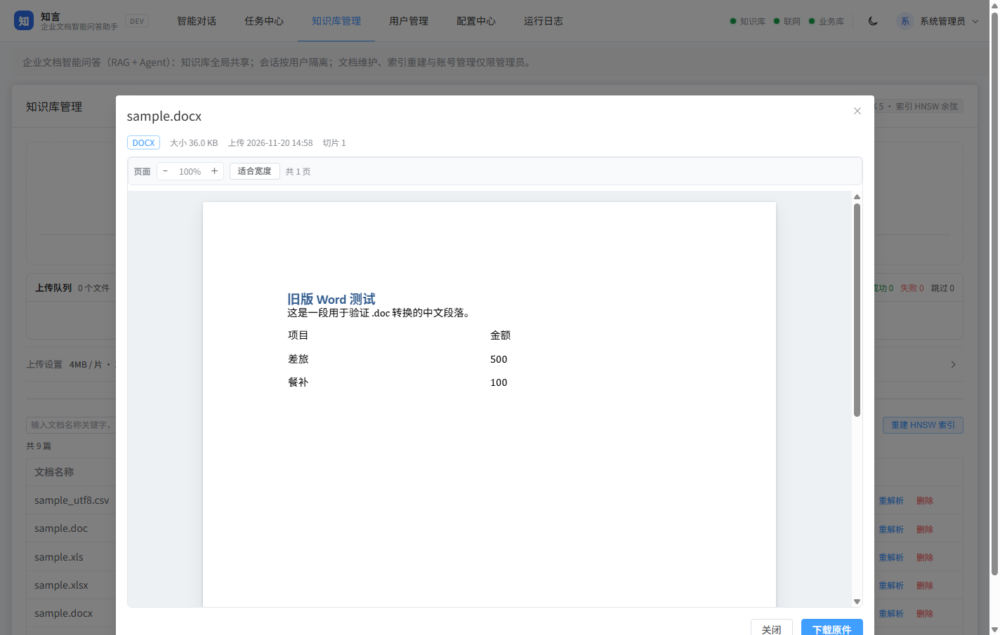
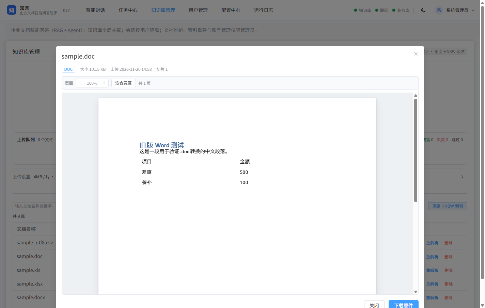
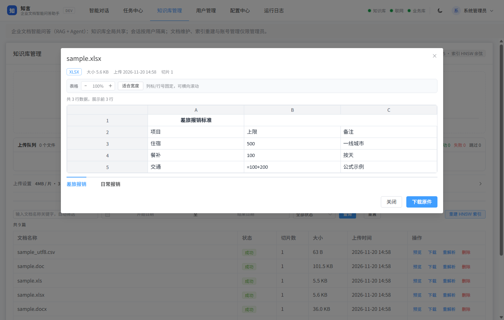
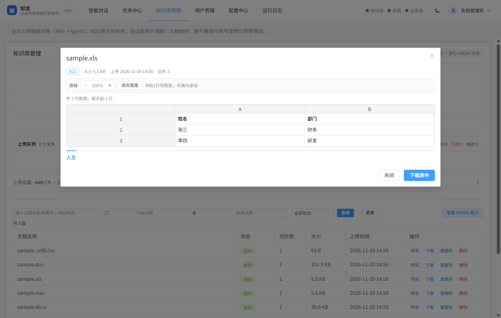

# V5-2 原格式预览增强验收报告

> 阶段：V5-2 / R4 增强补丁
> 日期：2026-11-20
> 范围：DOCX/DOC 按页渲染、Excel/CSV 列标行号与表格视图、375 适配
> 结论：**通过**（内容结构正确、样式大致保留、接近 Office 原文件；未新增文档服务）

---

## 1. 验收口径

本轮不引入 LibreOffice、OnlyOffice、Collabora 或其他文档转换服务，只使用现有 FastAPI + Vite + 前端只读组件：

- DOCX/DOC：浏览器内按 A4 纸张分页渲染，保留页边距、页眉页脚、表格、图片和段落样式。
- Excel/CSV：只读表格视图，保留合并单元格、列宽、字体、底色、边框、对齐，并增加 Excel 列标与行号。
- 接受只读、不可编辑；不承诺像素级一致、批注/修订和宏。
- 原有 PDF、Markdown 预览不变。

---

## 2. 代码变更

| 文件 | 变更 |
|---|---|
| `backend/services/preview.py` | 新增 `_docx_preview()`；DOCX 默认返回 `kind=docx` + `docx_base64`，上限 6 MB；新增 `force_html` 降级 |
| `backend/services/preview_html.py` | 拆出 DOCX 字节转换与 `.doc→.docx` 复用；Excel/XLS/CSV 统一生成列标、行号、corner |
| `backend/routers/docs.py` | `GET /api/docs/{doc_id}/preview?html=1` 支持强制语义 HTML |
| `backend/tests/test_doc_preview_api.py` | 覆盖 `kind=docx`、base64 解码、`?html=1`、xlsx 列标/行号/corner |
| `frontend/src/api/docs.js` | `fetchDocPreview(docId, { forceHtml })` |
| `frontend/src/components/DocPreviewDialog.vue` | DOCX 分支动态加载 `docx-preview`；缩放/适合宽度/页数；Excel 底部工作表标签、缩放、列标行号固定；修复挂载时序导致的 HTML 回退 |
| `frontend/package.json` / `package-lock.json` | 新增 `docx-preview@^0.3.7` |

### 关键修复

DOCX 首次实测仍显示旧语义 HTML。根因是 `load()` 中 `preview` 写入后立即 `nextTick()` 调 `renderDocx()`，但外层 `v-if="loading"` 尚未卸载，`docxBody` ref 为空，渲染函数直接走了 HTML 降级。

修复方式：写入 `preview` 后先把 `loading=false`，再 `await nextTick()`，确保预览容器和 ref 已挂载后再渲染。Excel 移动端自动适配同样因此生效。

---

## 3. 自动化验证

### 后端

```text
pytest backend/tests -q
295 passed, 1 skipped in 11.67s
```

预览定向测试 11 项通过，覆盖 DOCX 字节协议、`?html=1` 降级、Excel 列标/行号/corner。

### 前端

```text
npm run build
1762 modules transformed
docx-preview 173.91 kB / gzip 51.03 kB
✓ built in 16.55s
```

`docx-preview` 为动态 import，不进入首屏主包。

---

## 4. 真实 API 验证

通过真实上传 + `/api/docs/{id}/preview` 验证：

| 文件 | doc_id | 返回 | 结果 |
|---|---:|---|---|
| `sample.docx` | 78 | `kind=docx`，`docx_base64` 长度 49,188，`content=""` | 通过 |
| `sample.doc` | 81 | `kind=docx`，`docx_base64` 长度 41,060 | 通过 |
| `sample.xlsx` | 79 | `kind=sheet`，HTML 含 corner/列标/行号、`colspan`、字体与对齐 | 通过 |
| `sample.xls` | 80 | `kind=sheet`，列标 `A/B`、行号 `1/2/3` | 通过 |
| `sample_utf8.csv` | 82 | `kind=sheet`，列标/行号正常 | 通过 |
| `sample.docx?html=1` | 78 | `kind=html`，`<h1>旧版 Word 测试</h1>` 开头 | 降级通过 |

测试完成后已删除 78–82，知识库恢复基线 4 篇（doc 9、10、11、13）。

---

## 5. UI 实测

### DOCX / DOC

- `docx_rendered=true`，页数 1，表格存在，缩放 100%。
- 缩放按钮：100% → 110% → 100%，按钮生效。
- `.doc` 转换后同样按页渲染，页数 1，缩放 100%。
- 375 宽度自动适合宽度，缩放 39%，页面级横向溢出 0。

### Excel / XLS / CSV

- `xlsx_rendered=true`，单元格 19 个，列标 `A,B,C,A,B`，行号 `1,2,3,4,5,1,2,3`。
- 第二个工作表“日常报销”切换成功，单元格 19 个。
- 缩放按钮 100% → 110% 生效。
- 合并标题“差旅报销标准”跨 A–C 显示；脚本读取 `colspan` 为空，但截图与后端 HTML 均确认合并存在，判定为脚本属性读取方式问题，不是渲染缺失。
- `.xls` 列标 `A,B`、行号 `1,2,3`，工作表标签“人员”显示。
- 375 宽度下表格在弹窗内滚动，页面级横向溢出 0。

### 截图

DOCX 1440：



DOCX 375：


DOC 1440：



XLSX 1440：



XLSX 375：


XLS 1440：



---

## 6. 安全与权限

- 预览接口仍要求登录；下载仍仅管理员。
- DOCX 渲染后清理脚本、iframe、object、embed、`on*` 事件属性、危险链接和非 `data/blob` 图片；页面保持只读。
- DOCX 原字节以 base64 返回给已登录用户，与“普通用户可预览、不可下载”的现有口径一致，本轮未改变权限模型。
- 未新增端口、后台进程或外部文档服务。

---

## 7. 边界与已知限制

1. DOCX 超过 6 MB 自动回退语义 HTML，不保证分页。
2. 复杂浮动文本框、艺术字、SmartArt、精确分栏可能和 Word 有差异。
3. Excel 图表、条件格式、图片、透视表不进入只读表格；可通过下载原件查看。
4. `.doc` 转换仍依赖本机 WPS/Office COM 或 LibreOffice；本机转换可用。
5. DOCX 是只读渲染，不支持编辑、批注、修订留痕和表单填写。

---

## 8. 结论

DOCX/DOC 已从“语义 HTML 可读”升级为“浏览器内按页渲染”，Excel/CSV 已从“值表格”升级为带列标、行号、合并单元格、底部工作表标签和缩放的 Office 式只读视图。内容结构正确、样式大致保留，符合“接近 Office 原文件、暂不新增服务”的验收口径。

**通过。**
